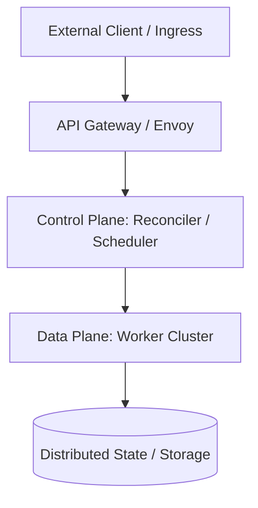

# [Module Title]

> **Executive Summary:** A 2-3 sentence high-impact summary capturing the core engineering problem, the foundational mechanism solving it, and the enterprise outcome achieved.

---

# 1. Interactive Concept Breakdown

## 1.1 The Production Crucible (The Why Before The How)
<!-- Start with a concrete, visceral production incident or scaling bottleneck.
     Example: "At 3:14 AM on Cyber Monday, our payment queue exploded to 450,000 pending jobs..."
     Explain why standard or naive solutions (e.g., CPU-based HPA, un-bounded thread pools) failed catastrophically. -->

## 1.2 First-Principles Mental Model
<!-- Establish an intuitive, physics/math/CS-grounded mental model.
     Use a clean real-world analogy followed immediately by the underlying mathematical or systems constraint
     (e.g., Little's Law, CAP Theorem trade-off, memory bandwidth saturation, Amdahl's Law). -->

## 1.3 Architectural Invariants & Core Definitions
<!-- Define 3 to 5 non-negotiable architectural rules that must never be violated in this design. -->
- **Invariant 1:** [Definition and reasoning]
- **Invariant 2:** [Definition and reasoning]
- **Invariant 3:** [Definition and reasoning]

---

# 2. Visual Architecture

## 2.1 End-to-End System Topology
<!-- Embed a Mermaid diagram visualizing the end-to-end component topology. -->



## 2.2 Control Plane vs. Data Plane Split
<!-- Clearly delineate components responsible for routing, consensus, and metadata (Control Plane)
     from those executing high-throughput payload processing (Data Plane). -->

```
+--------------------------------------------------------------------------+
|                       CONTROL PLANE (Metadata & Ingress)                 |
|   +-----------------------+              +---------------------------+   |
|   | Orchestrator / API    | -----------> | Policy / Scaler Engine    |   |
|   +-----------------------+              +---------------------------+   |
+---------------------------------------|----------------------------------+
                                        | Sync / Schedule
                                        v
+--------------------------------------------------------------------------+
|                       DATA PLANE (Execution Tier)                        |
|   +-----------------------+              +---------------------------+   |
|   | Worker Pod / Replica  | <==========> | Backend Service / Cache   |   |
|   +-----------------------+     gRPC     +---------------------------+   |
+--------------------------------------------------------------------------+
```

## 2.3 Step-by-Step Request, Packet, or State Flow
1. **Trigger / Ingress:** Description of the initiating event.
2. **Evaluation / Routing:** How the control plane processes and dispatches.
3. **Execution / Processing:** How the data plane processes the payload.
4. **State Commit & Feedback:** Reconciliation, telemetry emission, and completion.

---

# 3. Real-World Code & Configuration

## 3.1 Production Manifests & Declarative Configs
<!-- Provide production-ready Kubernetes manifests, KEDA ScaledObjects, Helm values, or Terraform snippets.
     MUST include enterprise requirements: explicit resource requests/limits, health probes,
     securityContext (runAsNonRoot), and graceful termination settings. No toy manifests. -->

```yaml
apiVersion: apps/v1
kind: Deployment
metadata:
  name: sample-production-workload
  namespace: production
  labels:
    app.kubernetes.io/name: sample-workload
spec:
  replicas: 2
  selector:
    matchLabels:
      app.kubernetes.io/name: sample-workload
  template:
    metadata:
      labels:
        app.kubernetes.io/name: sample-workload
    spec:
      securityContext:
        runAsNonRoot: true
        runAsUser: 10001
        fsGroup: 10001
      containers:
        - name: app
          image: registry.enterprise.internal/app:v1.4.2
          resources:
            requests:
              cpu: "500m"
              memory: "512Mi"
            limits:
              cpu: "2"
              memory: "2Gi"
          securityContext:
            allowPrivilegeEscalation: false
            readOnlyRootFilesystem: true
            capabilities:
              drop: ["ALL"]
          livenessProbe:
            httpGet:
              path: /healthz
              port: 8080
            initialDelaySeconds: 15
            periodSeconds: 10
          readinessProbe:
            httpGet:
              path: /ready
              port: 8080
            initialDelaySeconds: 5
            periodSeconds: 5
```

## 3.2 Implementation Code
<!-- Complete, clean, idiomatic Python (3.11+), TypeScript, or Go code.
     Include robust type hinting, async support, error handling, and structured data classes/Pydantic models. -->

```python
"""Production implementation snippet demonstrating core design mechanics."""
import asyncio
from pydantic import BaseModel, Field

class PayloadRequest(BaseModel):
    request_id: str = Field(..., description="Unique idempotency key")
    payload_size: int = Field(gt=0, description="Payload byte length")

async def execute_pipeline(request: PayloadRequest) -> bool:
    # Implementation logic
    await asyncio.sleep(0.01)
    return True
```

## 3.3 Line-by-Line "Under the Hood" Annotations
- **Lines X-Y:** Architectural rationale for configuration parameters or memory management decisions.
- **Lines A-B:** Concurrency controls, timeout guards, and resilience boundaries.

---

# 4. Edge Cases, Failure Modes & Trade-offs

## 4.1 Comparative Decision Matrix (When to use / When it breaks)

| Technology / Design Pattern | Primary Sweet Spot | Known Failure Modes | Cost / Latency Profile | When NOT to Use |
| :--- | :--- | :--- | :--- | :--- |
| **Pattern / Architecture A** | [Sweet spot scenario] | [Specific failure mode] | [Resource consumption] | [Anti-pattern scenario] |
| **Pattern / Architecture B** | [Sweet spot scenario] | [Specific failure mode] | [Resource consumption] | [Anti-pattern scenario] |

## 4.2 Failure Mode & Blast Radius Analysis
<!-- Analyze at least three real-world failure scenarios and their containment strategies:
     1. Downstream Outage / Backpressure: What happens when dependencies crash or slow down?
     2. Thundering Herd / Burst Traffic: How does the system handle 100x traffic spikes?
     3. State / Memory Corruption: Split-brain, out-of-memory cascading kills, or context bloat. -->

### Failure Scenario 1: Downstream Saturation & Cascade
- **Trigger:** ...
- **Blast Radius:** ...
- **Mitigation / Guardrail:** ...

### Failure Scenario 2: Flapping & Hysteresis
- **Trigger:** ...
- **Blast Radius:** ...
- **Mitigation / Guardrail:** ...

## 4.3 Operational Triage & Observability Runbook
<!-- Actionable SRE guide: what to measure, how to alert, and the 3-step triage checklist. -->

### Key SLIs & Prometheus Metrics
- `metric_name_duration_seconds{quantile="0.99"}`: Target < 250ms.
- `metric_name_error_rate_total`: Alert if > 0.5% over 5m window.

### Emergency Triage Checklist
1. **Step 1 (Isolate):** ...
2. **Step 2 (Divert / Degrade):** ...
3. **Step 3 (Recover / Re-scale):** ...
