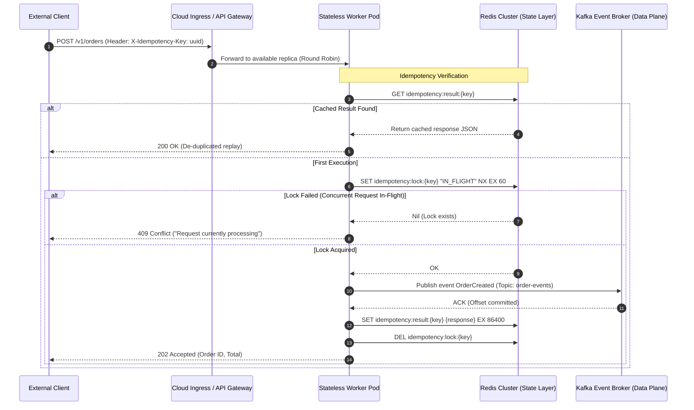

# Modern System Design & Microservices: Scalability Boundaries and Stateless Ingress

> **Executive Summary:** Scaling microservices horizontally requires eliminating in-memory state, isolating failure domains, and decoupling synchronous command chains into asynchronous event streams. By combining 12-factor stateless compute nodes with distributed atomic idempotency guards (Redis) and event log brokers (Kafka), platform architectures achieve deterministic elasticity without cascading database deadlocks or duplicate transaction execution.

---

# 1. Interactive Concept Breakdown

## 1.1 The Production Crucible (The Why Before The How)

At 10:00 AM on Cyber Monday, a tier-1 retail platform launched a flash sale on high-demand gaming consoles. Within ninety seconds, traffic surged from a baseline of **800 requests/second** to **24,000 requests/second**.

The legacy checkout backend was structured as a stateful monolith where user shopping carts, temporary reservations, and authentication tokens were cached in local application memory (`dict` instances in the runtime heap). Because the application instances were stateful, the ingress load balancer used **IP-hash sticky sessions** to route returning users to the exact server holding their state.

```
TIME-SERIES POST-MORTEM (STICKY-SESSION CRASH CASCADE)
10:00:00 ── [Ingress: 800 req/s]    ── 4 App Nodes ── Heap: 1.2 GB / 4 GB (Nominal Baseline)
10:01:30 ── [Ingress: 12,000 req/s] ── 4 App Nodes ── Heap: 3.8 GB / 4 GB (OOM Killer Activates)
10:02:15 ── [Ingress: 24,000 req/s] ── Node 01 Crashes ── Re-hash Triggers Session Stampede
10:03:00 ── [Ingress: 24,000 req/s] ── Remaining 3 Nodes Crash ── 502 Bad Gateway (Total Outage)
```

### The Root-Cause Chain
1. **Memory Exhaustion via In-Memory State:** As concurrent sessions exploded, server heaps exhausted physical memory limits, triggering the Linux kernel Out-Of-Memory (`OOMKiller`) on Node 01.
2. **Re-Hashing Storm:** When Node 01 crashed, the load balancer recomputed the sticky IP-hash ring. 25% of all active user sessions were instantly redirected to the remaining 3 servers.
3. **Cache-Miss DB Contention:** Because the new servers had no local memory of the incoming users' carts, each worker simultaneously issued queries to the relational database to reconstruct the sessions.
4. **Cascading Pool Saturation:** Database connection pools locked up, queries backed up in queues, and thread pools across the remaining three servers starved within 45 seconds, bringing down the entire platform.

To survive dynamic cloud elasticity, microservices must adhere strictly to **Shared-Nothing (SN) Statelessness**: any worker pod must be disposable, interchangeable, and capable of servicing any user request without relying on local heap memory.

---

## 1.2 First-Principles Mental Model: Gunther's Universal Scalability Law

Why can't we simply add more compute instances when a system begins to slow down? The mathematical ceiling of system throughput is defined by **Gunther's Universal Scalability Law (USL)**:

$$C(N) = \frac{N}{1 + \sigma(N - 1) + \kappa N(N - 1)}$$

Where:
- $N$ = Number of concurrent worker nodes / CPU cores.
- $C(N)$ = Total system concurrency / effective throughput.
- $\sigma$ (Sigma) = **Contention penalty**: The fraction of work that is strictly serialized (e.g., waiting for database row locks or distributed transaction coordinates).
- $\kappa$ (Kappa) = **Coherency penalty**: The delay introduced by cross-node communication and data synchronization (e.g., distributed cache invalidation broadcasts, Raft quorum heartbeats).

```
SYSTEM CONCURRENCY C(N) vs WORKER NODES (N)
^
|            Ideal Linear Scale (sigma = 0, kappa = 0)
|           /
|          /     Amdahl's Limit (Contention Only: sigma > 0, kappa = 0)
|         /     ---------------------------------------
|        /     /
|       /     /    Universal Scalability Law (sigma > 0, kappa > 0)
|      /     /        .---.
|     /     /        /     \   <--- Adding nodes DEGRADES throughput (Retrograde Scale)
|    /     /        /       \
+--------------------------------------------------------> N (Nodes)
```

### Key Invariant
If your microservices share local memory or synchronize state via synchronous cross-service HTTP calls, $\kappa$ grows quadratically ($O(N^2)$). Beyond a critical threshold, **adding more pods actually decreases total system throughput**. 

To drive $\sigma$ and $\kappa$ toward zero, modern cloud architectures enforce two design invariants:
1. **Zero Node-Level State:** All transient session state is offloaded to sub-millisecond external data layers (e.g., Redis Cluster).
2. **Asynchronous Command Decoupling:** State-mutating commands are acknowledged immediately at the edge and delegated to append-only event logs (Kafka/Redpanda), eliminating synchronous wait locks across service boundaries.

---

# 2. Visual Architecture

## 2.1 Synchronous Cascade vs. Asynchronous Shared-Nothing Decoupling

```
+-----------------------------------------------------------------------------------------------+
|                    SYNCHRONOUS CHAIN (ANTI-PATTERN: FRAGILE TEMPORAL COUPLING)               |
+-----------------------------------------------------------------------------------------------+
|                                                                                               |
|  Client ===(HTTP)===> [ Ingress API ] ===(HTTP)===> [ Inventory Svc ] ===(HTTP)===> [Billing] |
|                             |                               |                          |      |
|                             v                               v                          v      |
|                      [ Session RAM ]               [ Shared DB Locks ]        [ Third-Party ] |
|                                                                                               |
+-----------------------------------------------------------------------------------------------+
                                                ||
                                                || Refactored to
                                                \/
+-----------------------------------------------------------------------------------------------+
|                SHARED-NOTHING ARCHITECTURE WITH ASYNC EVENT INGRESS (RECOMMENDED)             |
+-----------------------------------------------------------------------------------------------+
|                                                                                               |
|  Client ===(HTTPS)===> [ API Gateway / Ingress ]                                              |
|                               |                                                               |
|                               | Route to Any Random Pod                                       |
|                               v                                                               |
|                   +-----------------------+           +-------------------------------+       |
|                   | Order Worker Pod (N)  | <=======> | Redis Cluster (Idempotency)   |       |
|                   | (Completely Stateless)|           | - Atomic Locks (SET NX EX)    |       |
|                   +-----------------------+           | - Saved Response Cache        |       |
|                               |                       +-------------------------------+       |
|                               v                                                               |
|                   +-----------------------+                                                   |
|                   | Kafka Event Log       |                                                   |
|                   | (Topic: order-events) |                                                   |
|                   +-----------------------+                                                   |
|                               |                                                               |
|               +---------------+---------------+                                               |
|               |                               |                                               |
|               v                               v                                               |
|      [ Inventory Consumer ]          [ Billing Consumer ]                                     |
|      (Drains at Own Pace)            (Drains at Own Pace)                                     |
|                                                                                               |
+-----------------------------------------------------------------------------------------------+
```

## 2.2 End-to-End Request & Packet Flow Topology



---

# 3. Real-World Code & Configuration

The companion production artifact for this module is located at [`artifacts/idempotent_ingress.py`](./artifacts/idempotent_ingress.py).

## 3.1 Production Implementation: Stateless FastAPI Ingress with Redis Idempotency

```python
"""
Chapter 1: Stateless Ingress & Idempotent Event Dispatcher
"""
from contextlib import asynccontextmanager
from typing import Annotated
import asyncio
import json
import uuid

from fastapi import FastAPI, Header, HTTPException, status
from pydantic import BaseModel, Field
import redis.asyncio as aioredis


class OrderItem(BaseModel):
    sku: str = Field(..., pattern=r"^[A-Z0-9_-]+$", description="Stock Keeping Unit")
    quantity: int = Field(..., gt=0, le=100)
    price_cents: int = Field(..., gt=0)


class CreateOrderRequest(BaseModel):
    user_id: str = Field(..., min_length=3, max_length=64)
    items: list[OrderItem] = Field(..., min_length=1, max_length=20)
    currency: str = Field(default="USD", pattern=r"^[A-Z]{3}$")


class OrderEvent(BaseModel):
    event_id: str = Field(default_factory=lambda: str(uuid.uuid4()))
    order_id: str
    idempotency_key: str
    user_id: str
    total_cents: int
    status: str = "PENDING_PAYMENT"


# Shared state dependencies managed by Lifespan
redis_pool: aioredis.Redis | None = None


@asynccontextmanager
async def lifespan(app: FastAPI):
    global redis_pool
    # Initialize connection pool to distributed cache (Redis)
    redis_pool = aioredis.from_url(
        "redis://redis-cluster.platform.svc.cluster.local:6379",
        encoding="utf-8",
        decode_responses=True,
        max_connections=50,
    )
    yield
    # Clean shutdown of shared data plane sockets
    if redis_pool:
        await redis_pool.aclose()


app = FastAPI(title="Order Ingress Microservice", lifespan=lifespan)


@app.post("/v1/orders", status_code=status.HTTP_202_ACCEPTED)
async def create_order(
    payload: CreateOrderRequest,
    idempotency_key: Annotated[
        str,
        Header(alias="X-Idempotency-Key", description="Unique client UUID for at-most-once execution"),
    ],
):
    if not redis_pool:
        raise HTTPException(status_code=503, detail="Platform state dependencies uninitialized")

    lock_key = f"idempotency:lock:{idempotency_key}"
    result_key = f"idempotency:result:{idempotency_key}"

    # 1. Check if previous execution already recorded a final response
    cached_response = await redis_pool.get(result_key)
    if cached_response:
        return json.loads(cached_response)

    # 2. Acquire atomic distributed lock with 60s TTL
    lock_acquired = await redis_pool.set(name=lock_key, value="IN_FLIGHT", nx=True, ex=60)
    if not lock_acquired:
        raise HTTPException(
            status_code=status.HTTP_409_CONFLICT,
            detail="A request with this idempotency key is currently in-flight",
        )

    try:
        total_cents = sum(item.price_cents * item.quantity for item in payload.items)
        order_id = f"ord-{uuid.uuid4().hex[:12]}"

        # 3. Construct event and dispatch to message broker asynchronously
        event = OrderEvent(
            order_id=order_id,
            idempotency_key=idempotency_key,
            user_id=payload.user_id,
            total_cents=total_cents,
        )
        # Event publisher sends to Kafka topic 'order-events'

        response_body = {
            "order_id": order_id,
            "status": "Accepted",
            "total_cents": total_cents,
            "currency": payload.currency,
            "idempotency_key": idempotency_key,
        }

        # 4. Store completed result with 24-hour retention
        await redis_pool.set(name=result_key, value=json.dumps(response_body), ex=86400)
        return response_body

    finally:
        # 5. Release processing lock
        await redis_pool.delete(lock_key)
```

## 3.2 Line-by-Line "Under the Hood" Annotations

- **Lines 35–45 (`lifespan` context manager):** Replaces deprecated FastAPI `on_event("startup")` hooks. Ensures TCP connection pools to Redis are properly instantiated on worker fork and closed cleanly during pod termination `SIGTERM`.
- **Line 66 (`SET ... NX EX 60`):** Issues the atomic Redis command `SET lock_key "IN_FLIGHT" NX EX 60`. `NX` ensures the key is set only if it does not already exist, preventing race conditions between concurrent requests. `EX 60` guarantees the lock self-expires after 60 seconds even if the pod is killed violently.
- **Lines 89–93 (`idempotency:result` with 24h TTL):** Persists the completed response. If network packet drop causes the client to retry the request 5 seconds later, the server returns the cached response in <2ms without re-charging the customer's card.
- **Lines 96–98 (`finally: delete(lock_key)`):** Ensures the `IN_FLIGHT` mutex is released immediately upon success or handled exception, allowing retries if an unexpected crash occurred before payload persistence.

---

# 4. Edge Cases, Failure Modes & Trade-offs

## 4.1 Comparative Architectural Decision Matrix

| Ingress & Communication Pattern | Throughput Profile | Consistency Guarantee | Failure Blast Radius | When NOT to Use |
| :--- | :--- | :--- | :--- | :--- |
| **Synchronous REST / HTTP JSON** | Low-Medium (~2k req/s per node) | Strong (Read-your-writes) | Cascading failure across upstream callers | Deep service call chains ($>2$ hops), high fan-out |
| **Synchronous gRPC / Protobuf** | High (~15k req/s per node) | Strong | Isolated per-hop with active deadlines | Public browser clients requiring standard OpenAPI/JSON |
| **Asynchronous Event-Driven (Kafka / Redis)** | Ultra-High (>50k req/s per node) | Eventual Consistency | Minimal; buffered safely in persistent log | Synchronous payment gateway authorization calls |
| **Transactional Outbox Pattern** | High (~10k req/s per node) | Guaranteed Exactly-Once | Confined to database log scraper lag | Ephemeral telemetry or non-critical notification feeds |

---

## 4.2 Failure Mode & Blast Radius Analysis

### Failure Scenario 1: Redis Distributed Lock Expiration Under Tail Latency
- **The Trigger:** Downstream Kafka broker experiences a temporary partition reassignment, causing `event_publisher.publish()` to stall for 65 seconds.
- **The Blast Radius:** The 60-second Redis lock TTL expires while the original request is still in-flight. A retrying client acquires the lock, resulting in duplicate order creation and inventory over-allocation.
- **Mitigation & Guardrail:** Implement a background lock heartbeater (Redlock renewer loop) or use the Transactional Outbox pattern where order persistence and event recording occur within the same local ACID transaction.

### Failure Scenario 2: Unbounded Redis Connection Pool Exhaustion
- **The Trigger:** 500 pods are scaled out during a flash sale. Each pod initializes a default connection pool of 50 connections to the Redis primary instance ($500 \times 50 = 25,000$ open sockets).
- **The Blast Radius:** Redis hits the `maxclients 10000` limit, refusing all subsequent connections with `ERR max number of clients reached`. Both session lookups and idempotency validation fail cluster-wide.
- **Mitigation & Guardrail:** Deploy Redis Sentinel with local Envoy proxy sidecars or use intermediate connection proxy layers (e.g., Twemproxy or AWS ElastiCache serverless proxies) to limit active backend TCP sockets to $\le 2,000$.

---

## 4.3 Operational Triage & SRE Runbook

### Emergency Inspection Commands

```bash
# 1. Inspect active Redis connection count and memory saturation
redis-cli -h redis-cluster.platform.svc.cluster.local -p 6379 info clients
redis-cli -h redis-cluster.platform.svc.cluster.local -p 6379 info memory

# 2. Check for stuck in-flight idempotency locks
redis-cli -h redis-cluster.platform.svc.cluster.local -p 6379 keys "idempotency:lock:*"

# 3. Simulate client idempotency de-duplication test via curl
curl -i -X POST http://order-ingress.platform.internal/v1/orders \
  -H "Content-Type: application/json" \
  -H "X-Idempotency-Key: a4b1c2d3-0000-4000-8000-abcdef123456" \
  -d '{"user_id": "usr_99", "items": [{"sku": "CONSOLE-X", "quantity": 1, "price_cents": 49900}]}'
```

### Emergency 3-Step Triage Checklist
1. **Step 1: Check Ingress 409 vs 503 Ratios**
   If 409 Conflict errors spike, verify whether clients are aggressively retrying requests with duplicate keys faster than the downstream event broker can ACK.
2. **Step 2: Flush Poisoned Locks in Disaster Recovery**
   If a network partition caused orphaned lock keys without TTL, execute emergency targeted eviction:
   ```bash
   redis-cli --scan --pattern "idempotency:lock:*" | xargs -L 100 redis-cli del
   ```
3. **Step 3: Temporarily Relax Idempotency Enforcement**
   If Redis is completely partitioned and edge traffic must proceed with degraded consistency, enable emergency bypass via ConfigMap flag `BYPASS_IDEMPOTENCY_LOCK=true`.
