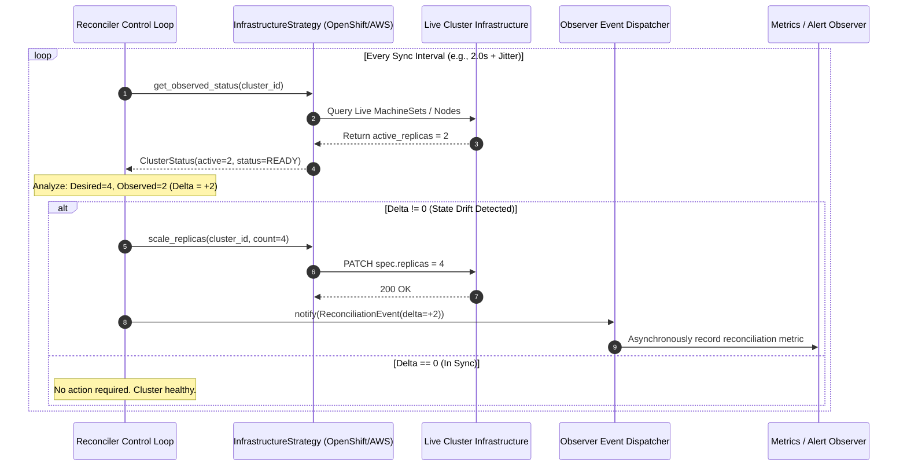

# Architectural Design Patterns & Control Loops in Python

> **Executive Summary:** Imperative cloud automation scripts break when transient API errors leave infrastructure in partial, orphaned states. Cloud-native control planes replace imperative scripts with declarative reconciliation control loops. By leveraging modern Python 3.12+ structural subtyping (`typing.Protocol`), extensible factories, asynchronous observer dispatchers, and level-triggered convergence loops, platform engineers can build self-healing infrastructure operators directly in Python.

---

# 1. Interactive Concept Breakdown

## 1.1 The Production Crucible (The Why Before The How)

A platform engineering team managed multi-cloud Kubernetes clusters using an imperative Python automation script executed via Jenkins. The script was 3,500 lines of procedural code containing deep `if/elif/else` branches to provision VPCs, subnets, and node pools across AWS, Azure, and OpenShift.

```python
# The Imperative Fragility Anti-Pattern
def provision_infrastructure(provider, cluster_id, nodes):
    if provider == "aws":
        vpc = create_aws_vpc(cluster_id)
        subnet = create_aws_subnet(vpc)
        # CRASH POINT: Network timeout during node provisioning
        instances = launch_ec2_instances(subnet, count=nodes) 
    elif provider == "openshift":
        machineset = create_ocp_machineset(cluster_id, count=nodes)
```

During a scheduled scale-out event at 03:00 AM, AWS experienced a momentary regional API timeout (`504 Gateway Timeout`) while launching the third EC2 instance. The script raised an uncaught `botocore.exceptions.ConnectTimeoutError` and crashed immediately.

```
IMPERATIVE FAILURE POST-MORTEM (ORPHANED INFRASTRUCTURE)
03:00:00 ── [Job Started]    ── VPC & Subnets created successfully ($0 / hr)
03:01:15 ── [EC2 Scale API]  ── Provisioning instance 1 & 2 succeeded
03:01:45 ── [API Timeout]    ── ConnectTimeoutError on instance 3 -> Script exits with code 1
03:02:00 ── [State Diverged] ── Jenkins marks build FAILED; instances 1 & 2 remain orphaned
03:05:00 ── [Manual Re-run]  ── Script attempts to re-create VPC -> FAILS with "VPC Already Exists"
```

### Why Imperative Automation Collapses
1. **Lack of Idempotency:** The script assumed it was always starting from a blank slate. Running it a second time crashed because the VPC and initial instances already existed.
2. **State Blindness:** The script had no concept of the *actual* environment state; it blindly executed mutation commands without first querying the live infrastructure.
3. **Rigid Coupling:** Adding a new bare-metal or OpenShift provider required modifying the core orchestration function, causing frequent regressions.

The solution to this instability is the **Declarative Reconciliation Loop** (the foundational pattern powering the Kubernetes Control Plane).

---

## 1.2 First-Principles Mental Model: Level-Triggered Reconciliation

In distributed systems, control theory categorizes automation into two operational modes:

```
[Edge-Triggered (Imperative Events)]
Event: "Add 2 Nodes" ---> [ Execute +2 ] ---> Fails! ---> State is permanently out of sync.

[Level-Triggered (Declarative Reconciliation)]
Desired State: 5 Nodes
                                  +------------------------------+
Live State:    3 Nodes ---------> | Delta Calculation: (5 - 3) = +2 |
                                  +------------------------------+
                                                 |
                                                 v
                                  Apply idempotent correction (+2)
                                                 |
                                                 v
                                  Poll Live State until Delta == 0
```

### The Level-Triggered Invariant
$$\text{Observed State} \neq \text{Desired State} \implies \text{Apply Idempotent Delta Mutation}$$

Instead of issuing delta instructions ("add two servers"), the human or upstream orchestrator declares the **Desired State** ("this cluster must have 5 servers"). The control loop continuously executes three steps:
1. **Observe:** Inspect current live infrastructure to ascertain the **Observed State**.
2. **Analyze:** Compute the delta: $\Delta = \text{Desired} - \text{Observed}$.
3. **Act:** If $\Delta \neq 0$, issue idempotent mutation calls to close the gap.

If an API timeout occurs on step 3, the reconciler simply logs the transient error, backs off with jitter, and tries again on the next tick. Once the API recovers, the system converges automatically.

---

# 2. Visual Architecture

## 2.1 Reconciler Engine & Pattern Topology

```
+-----------------------------------------------------------------------------------------------+
|                       PYTHON CLOUD-NATIVE RECONCILER ENGINE                                   |
+-----------------------------------------------------------------------------------------------+
|                                                                                               |
|   +-----------------------+              +------------------------------------------------+   |
|   | ClusterSpec           |              | CloudNativeReconciliationEngine                |   |
|   | (Desired State Model) |              | - Continuous Reconcile Loop                    |   |
|   +-----------------------+              | - Jittered Backoff on Exception                |   |
|               |                          +------------------------------------------------+   |
|               | Reads Target                                     |                            |
|               v                                                  v                            |
|   +------------------------------------+         +------------------------------------+       |
|   | InfrastructureStrategy (Protocol)  |         | ReconciliationEventDispatcher      |       |
|   | <<Strategy Pattern>>               |         | <<Observer Pattern>>               |       |
|   | + get_observed_status()            |         | + subscribe(listener)              |       |
|   | + scale_replicas()                 |         | + notify(event)                    |       |
|   +------------------------------------+         +------------------------------------+       |
|               ^                                                  |                            |
|               | Instantiates via StrategyFactory                 v                            |
|      +--------+--------+                         +---------------+---------------+            |
|      |                 |                         |                               |            |
|  [OpenShift]     [AWS Karpenter]        [Prometheus Metric SLI]        [Slack Alert Bot]      |
|  Strategy        Strategy               Observer                       Observer               |
|                                                                                               |
+-----------------------------------------------------------------------------------------------+
```

## 2.2 End-to-End Reconciler Sequence



---

# 3. Real-World Code & Configuration

The companion production artifact for this module is located at [`artifacts/reconciler_control_loop.py`](./artifacts/reconciler_control_loop.py).

## 3.1 Production Implementation: Modern Python Control Loop Engine

```python
"""
Chapter 2: Strategy Pattern and Kubernetes-Style Reconciler in Modern Python
"""
from dataclasses import dataclass, field
from datetime import datetime, timezone
from enum import Enum
from typing import Callable, Coroutine, Protocol, runtime_checkable
import asyncio
import random


class ProvisioningStatus(str, Enum):
    PENDING = "PENDING"
    READY = "READY"
    DEGRADED = "DEGRADED"


@dataclass(frozen=True)
class ClusterSpec:
    """The Declarative Target State (Desired State)."""
    cluster_id: str
    target_replicas: int
    region: str


@dataclass
class ClusterStatus:
    """The Current Telemetry State (Observed State)."""
    cluster_id: str
    active_replicas: int
    status: ProvisioningStatus


@dataclass(frozen=True)
class ReconciliationEvent:
    cluster_id: str
    desired_replicas: int
    observed_replicas: int
    delta: int


# --- 1. STRATEGY PATTERN (typing.Protocol) ---

@runtime_checkable
class InfrastructureStrategy(Protocol):
    """Behavioral Strategy contract adhering to the Open/Closed Principle."""

    async def get_observed_status(self, cluster_id: str) -> ClusterStatus: ...
    async def scale_replicas(self, cluster_id: str, count: int) -> None: ...


class OpenShiftStrategy:
    """Concrete Strategy for OpenShift MachineSets."""

    def __init__(self, api_endpoint: str):
        self.api_endpoint = api_endpoint
        self._current_nodes = 2

    async def get_observed_status(self, cluster_id: str) -> ClusterStatus:
        await asyncio.sleep(0.02)
        return ClusterStatus(cluster_id=cluster_id, active_replicas=self._current_nodes, status=ProvisioningStatus.READY)

    async def scale_replicas(self, cluster_id: str, count: int) -> None:
        await asyncio.sleep(0.05)
        self._current_nodes = count
        print(f"[OpenShift API] Patched MachineSet {cluster_id} to {count} nodes.")


# --- 2. FACTORY PATTERN ---

class StrategyFactory:
    """Extensible Factory registry for infrastructure provisioners."""

    _registry: dict[str, Callable[..., InfrastructureStrategy]] = {}

    @classmethod
    def register(cls, provider: str, builder: Callable[..., InfrastructureStrategy]) -> None:
        cls._registry[provider.lower()] = builder

    @classmethod
    def create(cls, provider: str, **kwargs) -> InfrastructureStrategy:
        builder = cls._registry.get(provider.lower())
        if not builder:
            raise ValueError(f"Unknown infrastructure provider: '{provider}'")
        return builder(**kwargs)


StrategyFactory.register("openshift", lambda **kw: OpenShiftStrategy(api_endpoint=kw.get("api_endpoint", "https://api.ocp:6443")))


# --- 3. OBSERVER PATTERN ---

EventListener = Callable[[ReconciliationEvent], Coroutine[None, None, None]]


class ReconciliationEventDispatcher:
    def __init__(self):
        self._subscribers: list[EventListener] = []

    def subscribe(self, listener: EventListener) -> None:
        self._subscribers.append(listener)

    async def notify(self, event: ReconciliationEvent) -> None:
        if self._subscribers:
            await asyncio.gather(*(listener(event) for listener in self._subscribers), return_exceptions=True)


# --- 4. RECONCILIATION CONTROL LOOP ENGINE ---

class CloudNativeReconciliationEngine:
    def __init__(self, strategy: InfrastructureStrategy, dispatcher: ReconciliationEventDispatcher):
        self._strategy = strategy
        self._dispatcher = dispatcher
        self._running = False

    async def reconcile_step(self, spec: ClusterSpec) -> None:
        observed = await self._strategy.get_observed_status(spec.cluster_id)
        delta = spec.target_replicas - observed.active_replicas

        if delta == 0:
            return

        print(f"[RECONCILER] Delta detected ({delta:+d}). Converging to {spec.target_replicas}...")
        await self._strategy.scale_replicas(spec.cluster_id, spec.target_replicas)

        await self._dispatcher.notify(
            ReconciliationEvent(spec.cluster_id, spec.target_replicas, observed.active_replicas, delta)
        )

    async def start(self, spec: ClusterSpec, sync_interval_seconds: float = 2.0) -> None:
        self._running = True
        while self._running:
            try:
                await self.reconcile_step(spec)
            except Exception as err:
                print(f"[RECONCILER ERROR] Sync failed: {err}. Backing off...")
                await asyncio.sleep(sync_interval_seconds * 1.5)

            jitter = random.uniform(0.9, 1.1)
            await asyncio.sleep(sync_interval_seconds * jitter)
```

## 3.2 Line-by-Line "Under the Hood" Annotations

- **Lines 41–46 (`typing.Protocol` with `@runtime_checkable`):** Implements Python static structural subtyping (PEP 544). Any class implementing `get_observed_status` and `scale_replicas` conforms to `InfrastructureStrategy` without needing explicit subclass inheritance.
- **Lines 63–76 (`StrategyFactory` registry):** Eliminates hardcoded `if/elif` ladders. New infrastructure providers register dynamically via `StrategyFactory.register("azure", AzureStrategy)` without modifying existing engine logic.
- **Lines 84–97 (`ReconciliationEventDispatcher` with `asyncio.gather`):** Dispatches events to multiple listeners (Prometheus collectors, Datadog statsd, Slack webhooks) concurrently without blocking the core reconcile loop. `return_exceptions=True` prevents a faulty observer from crashing the dispatcher.
- **Lines 125–133 (`jitter = random.uniform(0.9, 1.1)`):** Decorrelates reconcile sync ticks across multiple controllers. Without jitter, hundreds of reconcilers synchronized on fixed intervals hit cloud provider APIs simultaneously, causing cascading HTTP 429 rate limit errors.

---

# 4. Edge Cases, Failure Modes & Trade-offs

## 4.1 Comparative Architectural Decision Matrix

| Control Architecture | State Convergence | Error Recovery | Implementation Complexity | When NOT to Use |
| :--- | :--- | :--- | :--- | :--- |
| **Imperative Scripts (Bash/Python)** | Non-convergent; relies on successful execution of every step | Requires manual rollback or human SRE intervention | Low (Procedural scripting) | Production cloud infrastructure, multi-tenant platforms |
| **Declarative Reconciliation Loop** | Continuous; converges to target state automatically | Automatic self-healing on next cycle | Medium (Protocols, State diffing, Async loops) | One-time non-idempotent migration operations |
| **BPMN / Workflow Engines (Temporal, Airflow)** | Deterministic event-sourcing with persisted state history | Retry policies per activity with saga rollbacks | High (Requires database clusters and server daemons) | High-frequency low-overhead internal controllers |
| **Edge-Triggered Event Handlers (Webhooks)** | Fragile; dropped webhook leads to silent permanent drift | Requires secondary catch-up sync sweep | Low-Medium | Mission-critical state synchronization |

---

## 4.2 Failure Mode & Blast Radius Analysis

### Failure Scenario 1: State Bouncing (Infinite Reconciliation Oscillation)
- **The Trigger:** A reconciler targets 5 replicas. Strategy patches MachineSet to 5. However, the underlying Kubernetes cluster enforces a namespace resource quota capping nodes at 4. The cloud provider rejects the 5th node and reverts observed status to 4.
- **The Blast Radius:** On every iteration (every 2s), the reconciler observes 4, attempts to scale to 5, fails or reverts, and spams the cloud API with tens of thousands of mutate requests, leading to account-level API throttling.
- **Mitigation & Guardrail:** Implement an exponential backoff circuit breaker. If state fails to converge after $K$ attempts, mark the resource `DEGRADED`, cease active mutation, and fire a high-priority PagerDuty incident.

### Failure Scenario 2: Split-Brain Multi-Controller Concurrency Conflict
- **The Trigger:** Two instances of the reconciliation engine are spawned concurrently in different availability zones without leader election. Controller A evaluates desired=5, while Controller B evaluates an older cached spec desired=3.
- **The Blast Radius:** Controller A scales up; Controller B scales down. The infrastructure experiences violent flapping, continuously terminating and launching nodes.
- **Mitigation & Guardrail:** Wrap the controller execution in a distributed lease (e.g., Kubernetes `coordination.k8s.io/v1` `Lease` object or Redis distributed lock) ensuring strictly one active leader controller per resource group.

---

## 4.3 Operational Triage & SRE Runbook

### Emergency Inspection & Debugging Commands

```bash
# 1. Run the reconciler locally in interactive debug mode
python3 -c "
import asyncio
from artifacts.reconciler_control_loop import (
    StrategyFactory, ReconciliationEventDispatcher, 
    CloudNativeReconciliationEngine, ClusterSpec
)

async def test_run():
    strategy = StrategyFactory.create('openshift')
    dispatcher = ReconciliationEventDispatcher()
    dispatcher.subscribe(lambda e: print(f'[TELEMETRY] Event: {e}'))
    engine = CloudNativeReconciliationEngine(strategy, dispatcher)
    spec = ClusterSpec(cluster_id='ocp-prod-01', target_replicas=5, region='us-east-1')
    await engine.start(spec, sync_interval_seconds=1.0, max_iterations=3)

asyncio.run(test_run())
"

# 2. Check for active controller leader election lease in Kubernetes
kubectl get lease -n platform-system

# 3. Inspect controller logs for continuous reconciliation flapping
kubectl logs -n platform-system -l app=infra-reconciler --tail=100 | grep -E "Delta detected|Sync failed"
```

### Emergency 3-Step SRE Triage Checklist
1. **Step 1: Identify Flapping Cycles**
   Check if the reconciler has executed more than 10 mutations within 60 seconds for the same target resource.
2. **Step 2: Check Quota Constraints vs Desired State**
   Verify whether cloud provider vCPU quotas or Kubernetes ResourceQuotas are actively blocking the desired replica scale.
3. **Step 3: Pause the Control Loop via Annotation**
   If the loop is trapped in an infinite retry storm, freeze reconciliation by applying an override annotation:
   ```bash
   kubectl annotate cluster/ocp-prod-01 platform.io/reconcile-paused="true" --overwrite
   ```
