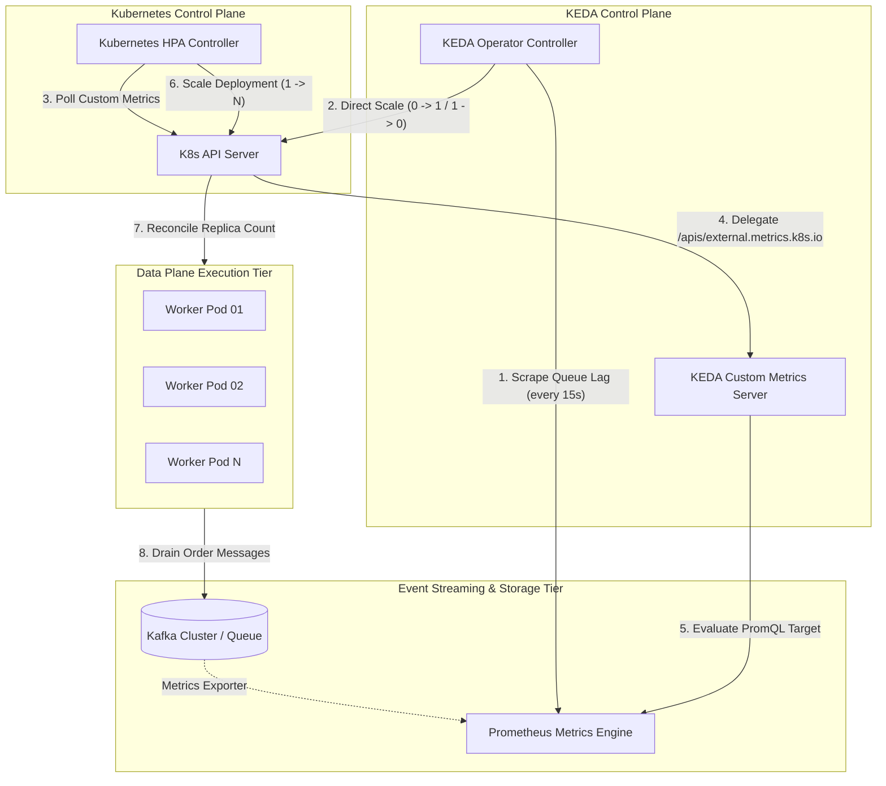

# KEDA Event-Driven Autoscaling Patterns

> **Executive Summary:** Standard Kubernetes Horizontal Pod Autoscalers (HPA) rely on resource saturation metrics (CPU and Memory) that fail to protect I/O-bound microservices from catastrophic queue lag. By decoupling scaling triggers from node resource usage and binding them directly to external event sources (Kafka, RabbitMQ, Prometheus, SQS), Kubernetes Event-driven Autoscaling (KEDA) enables reactive sub-minute horizontal scaling, scale-to-zero resource efficiency, and deterministic queue draining.

---

# 1. Interactive Concept Breakdown

## 1.1 The Production Crucible (The Why Before The How)

At 00:05 AM on Black Friday, an e-commerce platform launched a flash promotion. Within three minutes, incoming order events published to Kafka surged from **400 messages/sec** to **18,500 messages/sec**.

The engineering team had provisioned a Kubernetes Horizontal Pod Autoscaler (HPA) configured to maintain **70% average CPU utilization** across 4 worker pods. However, as the Kafka queue backlog skyrocketed past **650,000 pending orders**, the cluster did not scale out. In fact, total worker pod replicas remained locked at **4**.

```
PROMETHEUS TIME-SERIES TIMELINE (INCIDENT POST-MORTEM)
00:00:00 ── [Queue Lag: 120 msgs]      ── Pods: 4 ── CPU: 22%  (Normal Baseline)
00:03:00 ── [Queue Lag: 184,000 msgs]  ── Pods: 4 ── CPU: 26%  (Traffic Surge Starts)
00:07:00 ── [Queue Lag: 540,000 msgs]  ── Pods: 4 ── CPU: 24%  (Downstream DB Latency Increases)
00:12:00 ── [Queue Lag: 890,000 msgs]  ── Pods: 4 ── CPU: 19%  (Workers Blocked on I/O)
```

### Why Standard HPA Failed Catastrophically
The worker microservice was **I/O-bound, not CPU-bound**. Each worker thread fetched an order batch, performed credit card tokenization over HTTPS, and committed records to an external relational database. 

As the database connection pool saturated, network I/O wait times increased by **450%**. Because the CPU was idle waiting on TCP socket responses, average CPU utilization **dropped from 26% to 19%**. The standard HPA interpreted the low CPU usage as "idle capacity" and contemplated scaling *in*, while customers experienced order confirmation delays exceeding 45 minutes.

To fix this, autoscaling decisions cannot depend on symptoms observed inside the container; they must react to **upstream queue pressure** before latency deteriorates.

---

## 1.2 First-Principles Mental Model: Little's Law & Backpressure

To scale event-driven distributed systems deterministically, we must apply **Little's Law** from operational queuing theory:

$$L = \lambda \cdot W$$

Where:
- $L$ = Mean number of items pending in the queue (Queue Lag)
- $\lambda$ = Arrival rate of incoming events (throughput in msgs/sec)
- $W$ = Mean processing duration per event (service latency in seconds)

If each pod processes $C$ concurrent messages and takes $W$ seconds per message, the throughput capacity of a single pod is:

$$\text{Capacity}_{\text{pod}} = \frac{C}{W} \text{ msgs/sec}$$

To keep queue depth $L$ from diverging toward infinity ($\infty$), total cluster processing capacity must strictly exceed arrival rate $\lambda$:

$$N_{\text{replicas}} \ge \frac{\lambda \cdot W}{C} = \frac{L_{\text{target}}}{C}$$

Standard HPA is blind to $L$ and $\lambda$. KEDA resolves this by injecting an external metrics adapter into the Kubernetes control plane, converting raw queue depth into explicit target pod calculations.

---

## 1.3 Architectural Invariants & Core Definitions

When designing autoscaling architectures with KEDA, enforce the following non-negotiable rules:

1. **Separation of Activation vs. Scaling:** The KEDA Operator activates workloads from `0 -> 1` and cools them down from `1 -> 0`. The native Kubernetes HPA scales workloads from `1 -> N` and `N -> 1`.
2. **Deterministic Ceiling Guards:** Every `ScaledObject` MUST define a strict `maxReplicaCount` calculated against downstream database connection limits and thread pool capacities.
3. **Graceful Drain Guarantee:** Workload containers must intercept `SIGTERM` and implement a termination grace period greater than the longest processing batch duration to prevent message loss.
4. **Independent Metric Health Fallback:** If the external metric provider (Prometheus, CloudWatch, Datadog) becomes unreachable, KEDA must fall back to a safe operational baseline replica count rather than crashing to zero.

---

# 2. Visual Architecture

## 2.1 End-to-End System Topology



---

## 2.2 Control Plane vs. Data Plane Split

```
+-------------------------------------------------------------------------------+
|                       CONTROL PLANE (Metadata & Ingress)                      |
|                                                                               |
|   +-----------------------+              +--------------------------------+   |
|   | KEDA Operator         |              | KEDA Custom Metrics Server     |   |
|   | - CRD Reconciler      |              | - Implements External Metrics  |   |
|   | - 0 -> 1 Activator    |              | - Serves PromQL Values to HPA  |   |
|   +-----------------------+              +--------------------------------+   |
|              |                                           ^                    |
|              | Direct Sub-Resource Write                 | Metric Queries     |
|              v                                           |                    |
|   +---------------------------------------------------------------+           |
|   | Kubernetes API Server & Horizontal Pod Autoscaler (HPA)       |           |
|   +---------------------------------------------------------------+           |
+---------------------------------------|---------------------------------------+
                                        | Pod Scheduling & Eviction Loop
                                        v
+-------------------------------------------------------------------------------+
|                       DATA PLANE (Execution Tier)                             |
|                                                                               |
|   +-----------------------+   +-----------------------+   +---------------+   |
|   | Worker Replica 1      |   | Worker Replica 2      |   | Worker Pod N  |   |
|   | (Pulls Kafka Topic)   |   | (Pulls Kafka Topic)   |   | (Pulls Kafka) |   |
|   +-----------------------+   +-----------------------+   +---------------+   |
+-------------------------------------------------------------------------------+
```

---

## 2.3 Step-by-Step Request, Packet & Metric Flow

```
[Phase 1: Scale from 0 to 1]
1. Queue contains 0 pending orders. Target deployment is scaled to 0 replicas.
2. An upstream producer publishes 15 order events to Kafka.
3. KEDA Operator polls Prometheus trigger every 15s. Queue lag = 15.
4. Metric exceeds activationThreshold (1). KEDA Operator bypasses HPA and scales Deployment from 0 to 1.

[Phase 2: Scale from 1 to N]
5. Traffic spikes to 2,500 pending orders.
6. Kubernetes HPA reconciler queries the KEDA External Metrics Server endpoint.
7. KEDA evaluates PromQL query: lag = 2,500. Threshold = 100. Target replicas = ceil(2500 / 100) = 25.
8. HPA issues patch request to Deployment spec.replicas = 25.
9. Kubernetes scheduler binds 24 new worker pods across worker nodes.

[Phase 3: Scale from N to 0 (Cooldown & Hysteresis)]
10. Queue is drained to 0 pending messages.
11. HPA enters scale-down stabilization window (300s) to prevent flapping.
12. HPA scales Deployment down from 25 to 1.
13. KEDA Operator observes queue lag == 0 for the duration of cooldownPeriod (120s).
14. KEDA Operator scales Deployment from 1 to 0. Workload returns to idle hibernation.
```

---

# 3. Real-World Code & Configuration

All manifests referenced below are co-located in the [`artifacts/`](./artifacts/) directory for direct inspection and deployment.

## 3.1 Production Manifests & Declarative Configs

### 1. Hardened Worker Deployment (`artifacts/deployment.yaml`)
```yaml
apiVersion: apps/v1
kind: Deployment
metadata:
  name: order-processor
  namespace: order-fulfillment
spec:
  replicas: 1
  revisionHistoryLimit: 5
  selector:
    matchLabels:
      app.kubernetes.io/name: order-processor
  template:
    metadata:
      labels:
        app.kubernetes.io/name: order-processor
    spec:
      terminationGracePeriodSeconds: 60
      securityContext:
        runAsNonRoot: true
        runAsUser: 10001
        runAsGroup: 10001
        fsGroup: 10001
        seccompProfile:
          type: RuntimeDefault
      containers:
        - name: worker
          image: registry.enterprise.internal/ecommerce/order-processor:v2.4.1
          resources:
            requests:
              cpu: "500m"
              memory: "512Mi"
              ephemeral-storage: "1Gi"
            limits:
              cpu: "2000m"
              memory: "2048Mi"
              ephemeral-storage: "2Gi"
          securityContext:
            allowPrivilegeEscalation: false
            readOnlyRootFilesystem: true
            capabilities:
              drop: ["ALL"]
          livenessProbe:
            httpGet:
              path: /healthz/liveness
              port: 9090
            periodSeconds: 10
          readinessProbe:
            httpGet:
              path: /healthz/readiness
              port: 9090
            periodSeconds: 5
          lifecycle:
            preStop:
              exec:
                command: ["/bin/sh", "-c", "kill -SIGTERM 1 && sleep 15"]
```

### 2. KEDA ScaledObject with Flapping Defense (`artifacts/scaledobject-prometheus.yaml`)
```yaml
apiVersion: keda.sh/v1alpha1
kind: ScaledObject
metadata:
  name: order-processor-scaler
  namespace: order-fulfillment
spec:
  scaleTargetRef:
    apiVersion: apps/v1
    kind: Deployment
    name: order-processor
  pollingInterval: 15
  cooldownPeriod: 120
  idleReplicaCount: 0
  minReplicaCount: 1
  maxReplicaCount: 50
  fallback:
    failureThreshold: 3
    replicas: 5
  advanced:
    horizontalPodAutoscalerConfig:
      behavior:
        scaleUp:
          stabilizationWindowSeconds: 0
          policies:
            - type: Percent
              value: 100
              periodSeconds: 15
            - type: Pods
              value: 8
              periodSeconds: 15
          selectPolicy: Max
        scaleDown:
          stabilizationWindowSeconds: 300
          policies:
            - type: Percent
              value: 10
              periodSeconds: 60
  triggers:
    - type: prometheus
      metadata:
        serverAddress: http://prometheus-k8s.monitoring.svc.cluster.local:9090
        metricName: order_queue_pending_total
        query: sum(kafka_consumergroup_lag{consumergroup="order-processor-group", topic="orders-high-priority"})
        threshold: "100"
        activationThreshold: "1"
      authenticationRef:
        name: keda-prometheus-auth
```

---

## 3.2 Resilient Worker Implementation (Python 3.11+)

The following snippet implements graceful consumer draining upon receiving `SIGTERM` from the Kubernetes kubelet during scale-down:

```python
"""Production consumer worker with graceful shutdown handling."""
import asyncio
import signal
import sys
from pydantic import BaseModel, Field

class OrderEvent(BaseModel):
    order_id: str = Field(..., description="UUID v4 order identifier")
    account_id: str = Field(..., description="Customer tenant ID")
    amount_cents: int = Field(gt=0, description="Gross order amount in cents")

class ResilientConsumer:
    def __init__(self):
        self._is_terminating = False
        self._active_jobs = 0

    def register_signal_handlers(self):
        loop = asyncio.get_running_loop()
        for sig in (signal.SIGTERM, signal.SIGINT):
            loop.add_signal_handler(sig, self._handle_termination_signal)

    def _handle_termination_signal(self):
        print("[SHUTDOWN] Intercepted SIGTERM from kubelet. Halting queue fetch...")
        self._is_terminating = True

    async def process_event(self, event: OrderEvent):
        self._active_jobs += 1
        try:
            # Simulate I/O database commit & credit card tokenization
            await asyncio.sleep(0.08)
        finally:
            self._active_jobs -= 1

    async def run_loop(self):
        self.register_signal_handlers()
        print("[STARTUP] Order consumer initialized. Awaiting messages...")
        
        while not self._is_terminating:
            # Simulate pulling messages from Kafka broker
            events = [
                OrderEvent(order_id="ord-01", account_id="acc-99", amount_cents=4500)
            ]
            await asyncio.gather(*(self.process_event(e) for e in events))
            await asyncio.sleep(0.1)

        print(f"[DRAINING] Waiting for {self._active_jobs} active in-flight jobs to complete...")
        while self._active_jobs > 0:
            await asyncio.sleep(0.2)
        print("[CLEANUP] All in-flight jobs finalized. Exiting cleanly.")
```

---

## 3.3 Line-by-Line "Under the Hood" Annotations

- **`deployment.yaml` Lines 25-30 (`securityContext`):** Drops all Linux capabilities and enforces `readOnlyRootFilesystem: true`. Pods compromised via remote code execution cannot overwrite root system binaries or escalate privileges.
- **`deployment.yaml` Line 22 (`terminationGracePeriodSeconds: 60`):** Provides a 60-second window before Kubernetes issues an uncatchable `SIGKILL`, allowing the worker loop to complete pending database transactions.
- **`scaledobject-prometheus.yaml` Lines 17-21 (`fallback`):** Prevents silent cluster degradation. If the Prometheus server crashes or suffers networking partitions, KEDA pins replicas to **5** instead of dropping to zero.
- **`scaledobject-prometheus.yaml` Lines 31-35 (`scaleDown.stabilizationWindowSeconds: 300`):** Enforces a 5-minute cooldown floor on scale-down. This eliminates the "thundering herd flapping" anti-pattern where replicas are killed prematurely during momentary message ingestion pauses.

---

# 4. Edge Cases, Failure Modes & Trade-offs

## 4.1 Comparative Decision Matrix

| Autoscaling Architecture | Primary Sweet Spot | Known Failure Modes | Latency / Resource Profile | When NOT to Use |
| :--- | :--- | :--- | :--- | :--- |
| **Native Kubernetes HPA (CPU/RAM)** | CPU-intensive, long-lived computational jobs | Complete blindness to queue depth and network I/O block | Zero external overhead; reacts in 30-60s | I/O-bound microservices, event streaming, Kafka consumers |
| **KEDA Event-Driven ScaledObject** | Queue-backed services (Kafka, SQS, RabbitMQ, Redis, Prometheus) | Cascading DB connection exhaustion during burst scale | High agility; scales 0->1 in <15s; external query latency | Simple stateless web APIs without message queues |
| **Cron / Scheduled HPA** | Predictable, cyclical diurnal traffic spikes | Unprepared for off-cycle traffic shocks or sudden flash sales | Minimal compute cost; zero lag sensitivity | Unpredictable, sporadic, or event-driven workloads |
| **Knative Serving / Serverless** | HTTP microservices with scale-to-zero requirements | High cold-start penalties (JVM/Python); requires Knative mesh | Aggressive scale-to-zero; high infrastructure complexity | Continuous streaming consumers maintaining open TCP partitions |

---

## 4.2 Failure Mode & Blast Radius Analysis

### Failure Scenario 1: Downstream Database Connection Starvation
- **The Trigger:** A massive queue surge scales worker pods from 1 to the unconstrained maximum of 50 within 45 seconds. Each worker maintains a PostgreSQL connection pool of 20 connections ($50 \times 20 = 1,000$ connections).
- **The Blast Radius:** PostgreSQL max connection limit (400) is exceeded. The database rejects connections with `FATAL: remaining connection slots are reserved for non-replication superuser connections`, knocking out authentication, checkout, and inventory services simultaneously.
- **Mitigation & Guardrail:** Always set `maxReplicaCount` such that `maxReplicaCount * pod_connection_pool <= 0.6 * db_max_connections`. Deploy an intermediate connection pooler (e.g., PgBouncer) between the pods and the database tier.

### Failure Scenario 2: Scale-to-Zero Cold Start Tail Latency
- **The Trigger:** A service is scaled to 0 during quiet night periods. A high-priority order arrives.
- **The Blast Radius:** KEDA activates the pod, but the node must pull a 1.2 GB container image, run JVM/Python initializations, and establish external credentials. P99 latency spikes from 120ms to 24 seconds.
- **Mitigation & Guardrail:** Set `minReplicaCount: 1` during business hours and use `idleReplicaCount: 0` only in non-production environments or background batch pipelines where 30s latency is tolerated.

---

## 4.3 Operational Triage & Observability Runbook

### Critical Prometheus Alerts & SLIs

```promql
# Alert if KEDA Operator is unable to query metric triggers for > 2m
alert: KEDAScalerMetricQueryFailing
expr: sum(rate(keda_scaler_errors_total[2m])) by (scaledObject) > 0
for: 2m
labels:
  severity: critical
annotations:
  summary: "KEDA cannot retrieve scaling metrics for {{ $labels.scaledObject }}"

# Alert if consumer queue lag is growing despite being at maxReplicaCount
alert: ConsumerLagExhaustedMaxReplicas
expr: (order_queue_pending_total > 5000) and on(namespace) (kube_deployment_status_replicas{deployment="order-processor"} >= 50)
for: 3m
labels:
  severity: page
annotations:
  summary: "Order processor queue lag expanding while cluster is capped at max replicas (50)."
```

### Emergency 3-Step SRE Triage Checklist

1. **Step 1: Check KEDA Operator Reconciler Logs**
   ```bash
   kubectl logs -n keda -l app=keda-operator --tail=100 | grep -i "error"
   ```
2. **Step 2: Inspect ScaledObject Health Status & Fallback State**
   ```bash
   kubectl get scaledobject order-processor-scaler -n order-fulfillment -o yaml | grep -A 10 "status:"
   ```
3. **Step 3: Emergency Override to Static Replica Scale**
   If Prometheus or the external scaler is corrupting metric values, pause KEDA management and force a static replica override:
   ```bash
   # Temporarily disable KEDA by pausing ScaledObject
   kubectl annotate scaledobject order-processor-scaler -n order-fulfillment autoscaling.keda.sh/paused="true" --overwrite
   # Manually scale deployment to steady-state capacity
   kubectl scale deployment order-processor -n order-fulfillment --replicas=10
   ```
