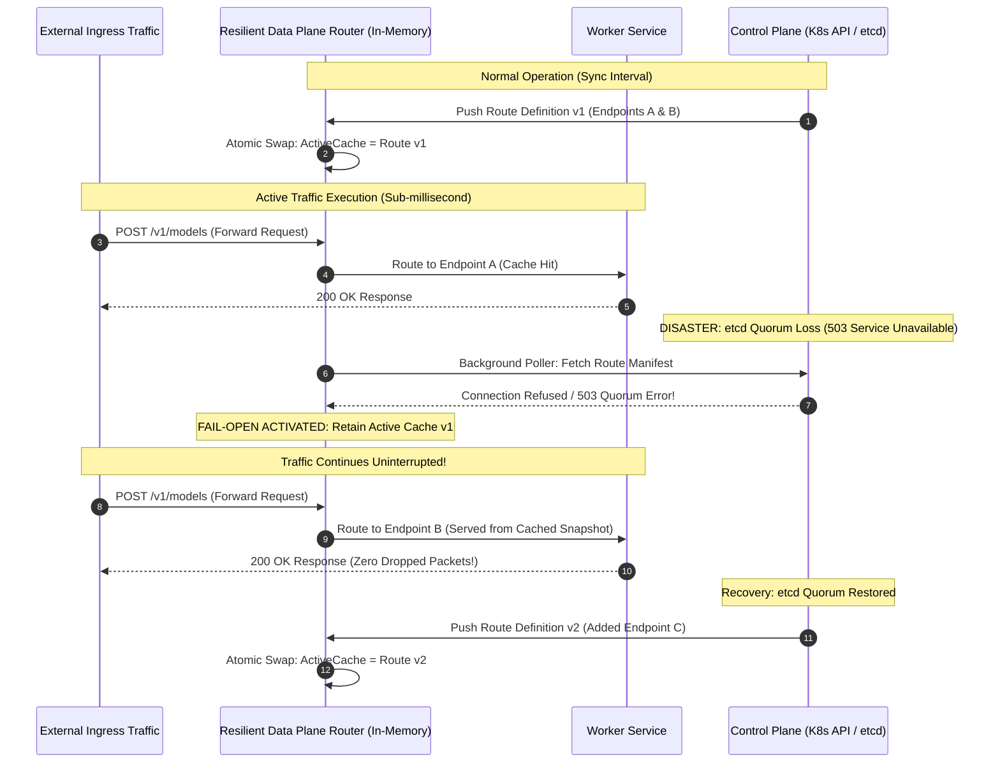

# Control Plane vs. Data Plane Separation

> **Executive Summary:** Distributed systems achieve resilience not by preventing component failures, but by decoupling control orchestration from data execution. When data plane workers query control plane consensus stores (such as etcd or Kubernetes API Server) inside their request path, high traffic cascades into control plane collapse and total platform blackouts. By enforcing a strict architectural separation—where the control plane pushes dynamic configurations out-of-band and the data plane forwards requests against local, immutable caches—workloads survive total control plane outages without dropping a single packet.

---

# 1. Interactive Concept Breakdown

## 1.1 The Production Crucible (The Why Before The How)

At 02:00 PM, an enterprise AI research organization initiated a distributed fine-tuning job across 4,000 GPU worker containers. The application had been designed such that upon receiving each client inference query, worker pods performed an inline verification check: they issued an HTTP call to the Kubernetes API Server to verify client tenant quotas and fetch updated weight routing configurations.

```python
# The Catastrophic Anti-Pattern: Control Plane in the Data Path
@app.post("/v1/inference")
async def handle_inference(request: Request):
    # CRITICAL FLAW: Querying Kube API Server on EVERY incoming data request!
    config = await kube_client.get_namespaced_config_map("tenant-weights", "ai-cluster")
    return await run_model(request.payload, config.weights)
```

Within four minutes, aggregate HTTP request rates from the 4,000 worker pods to the Kubernetes API Server surged past **95,000 requests/second**.

```
CONTROL PLANE POST-MORTEM (ETCD RAFT QUORUM COLLAPSE)
14:00:00 ── [API Ingress: 4,000 req/s]  ── etcd disk fsync: 2ms  ── Leader election stable
14:02:30 ── [API Ingress: 45,000 req/s] ── etcd disk fsync: 48ms ── API server memory reaches 92%
14:04:00 ── [API Ingress: 95,000 req/s] ── etcd disk fsync: 180ms── Raft Heartbeat Timeout!
14:04:15 ── [Quorum Loss] ── Leader deposed -> Split-Brain election storm -> API Server returns 503
14:04:30 ── [Data Plane Outage] ── In-line kube_client calls fail -> 100% of live inference requests crash
```

### Why the Architecture Collapsed
1. **Coupling CP to AP:** The control plane requires strong consistency (**CP** in CAP theorem) backed by Raft quorum on disk. The data plane requires high availability and sub-millisecond execution (**AP**). Forcing high-frequency data traffic through the control plane destroyed etcd’s disk write write-ahead log (WAL) latency.
2. **Cascading Liveness Failures:** When etcd lost quorum, the Kubernetes API Server became unresponsive. Kubelet health probes cluster-wide began timing out. The scheduler attempted to restart pods, creating an even larger API query stampede.
3. **Total Blast Radius:** Healthy GPU workers capable of executing model inference crashed because they were tied synchronously to a dead control plane.

The non-negotiable architectural invariant: **The Data Plane must be capable of running indefinitely even if the Control Plane is completely destroyed.**

---

## 1.2 First-Principles Mental Model: The Invariants of Decoupling

In enterprise cloud-native systems, architectures are cleanly bifurcated into two independent planes:

```
+-----------------------------------------------------------------------------------------------+
|                       CONTROL PLANE vs. DATA PLANE INVARIANTS                                 |
+-----------------------------------------------------------------------------------------------+
|                                                                                               |
|   DIMENSION           CONTROL PLANE (Orchestration)      DATA PLANE (Execution)              |
|   -----------------   -------------------------------    -------------------------------      |
|   CAP Theorem Role    CP (Consistency & Partition Tol)   AP (Availability & Latency)          |
|   Traffic Frequency   Low (1 to 100 ops/sec)             Ultra-High (10k to 1M ops/sec)       |
|   Latency Tolerance   Relaxed (10ms to 500ms)            Extreme Sub-Millisecond (<1ms)       |
|   State Model         Consensus Log (etcd, Raft, SQL)    Lock-Free Local In-Memory Cache      |
|   Failure Strategy    Freeze writes to protect quorum    Fail-Open (Serve cached routes)      |
|                                                                                               |
+-----------------------------------------------------------------------------------------------+
```

### The Out-of-Band Propagation Rule
The Control Plane updates the Data Plane strictly **out-of-band** (asynchronously). In modern platform engineering, this is implemented using streaming Discovery Services (like Envoy's **xDS** protocol: Route Discovery Service `RDS`, Cluster Discovery Service `CDS`, and Endpoint Discovery Service `EDS`).

When an endpoint changes:
1. The Control Plane compiles the new routing table and streams it to the proxy sidecar.
2. The proxy sidecar performs an **atomic memory pointer swap** (`atomic.Store`).
3. Running worker threads never block, never lock, and never touch the control plane network socket.

---

# 2. Visual Architecture

## 2.1 Decoupled Topology: Control Plane, Ingress Proxies & Data Plane

```
+-----------------------------------------------------------------------------------------------+
|                        CONTROL PLANE (Orchestration & Metadata Tier)                          |
|                                                                                               |
|    +-----------------------------+                   +------------------------------------+   |
|    | Central Orchestrator        | <== Raft Quorum = | etcd Cluster / State Store         |   |
|    | (Kube API Server / Manager) |                   | (Write-Ahead Log, Strict Quorum)   |   |
|    +-----------------------------+                   +------------------------------------+   |
|                   |                                                                           |
|                   | Asynchronous Streaming Config Push (xDS / gRPC)                           |
+-------------------|---------------------------------------------------------------------------+
                    | (Strict Isolation Boundary: Out-of-Band Only)
+-------------------|---------------------------------------------------------------------------+
|                   v      DATA PLANE (High-Throughput Execution Tier)                          |
|                                                                                               |
|    +-----------------------------+                   +------------------------------------+   |
|    | Envoy Proxy / Router Sidecar|                   | Resilient Inference Worker         |   |
|    | - Local Immutable Snapshot  | =(Zero-Lock Unix)=| - Consumes In-Memory Routes        |   |
|    | - Atomic Pointer Swap       |    Socket/HTTP2   | - Zero Control Plane Overhead      |   |
|    +-----------------------------+                   +------------------------------------+   |
|                   ^                                                    |                      |
|                   | 100,000 req/sec HTTPS Ingress                      v                      |
|             [ Client App ]                                    +-----------------------+       |
|                                                               | Fast Cache / Vector DB|       |
|                                                               | (Redis / Milvus)      |       |
|                                                               +-----------------------+       |
+-----------------------------------------------------------------------------------------------+
```

## 2.2 Survivability Sequence During Total Control Plane Outage



---

# 3. Real-World Code & Configuration

The companion production artifact for this module is located at [`artifacts/local_route_cache.py`](./artifacts/local_route_cache.py).

## 3.1 Production Implementation: Fail-Open Data Plane Client

```python
"""
Chapter 5: Resilient Data Plane Client with Local Route Caching
"""
from dataclasses import dataclass, field
from datetime import datetime, timezone
from enum import Enum
from typing import Any
import asyncio
import random


class RouteHealth(str, Enum):
    HEALTHY = "HEALTHY"
    DEGRADED = "DEGRADED"


@dataclass(frozen=True)
class ServiceEndpoint:
    host: str
    port: int
    weight: int = 100
    health: RouteHealth = RouteHealth.HEALTHY


@dataclass
class DynamicRouteConfig:
    """Control Plane Route Definition."""
    service_name: str
    endpoints: list[ServiceEndpoint]
    timeout_ms: int = 500
    version: str = "v1"


class ResilientDataPlaneRouter:
    """
    High-Throughput Data Plane Router:
      - Synchronizes route definitions out-of-band via background coroutine.
      - Never queries the Control Plane inside the critical request forwarding path.
      - Maintains local memory cache with zero-lock atomic swap.
    """

    def __init__(self, control_plane_fetcher):
        self._control_plane_fetcher = control_plane_fetcher
        self._route_cache: dict[str, DynamicRouteConfig] = {}
        self._sync_task: asyncio.Task | None = None
        self._running = False
        self._consecutive_failures = 0

    async def start_background_sync(self, interval_seconds: float = 1.0) -> None:
        self._running = True
        await self._sync_routes_once()
        self._sync_task = asyncio.create_task(self._sync_loop(interval_seconds))

    async def _sync_routes_once(self) -> None:
        try:
            routes = await self._control_plane_fetcher()
            # Atomic reference swap: readers never observe partial dictionary states
            self._route_cache = routes.copy()
            self._consecutive_failures = 0
        except Exception as err:
            self._consecutive_failures += 1
            print(f"[DATA PLANE WARNING] Control Plane unreachable ({err}). Operating on cached snapshot.")

    async def _sync_loop(self, interval: float) -> None:
        while self._running:
            delay = interval * (1.5 ** min(self._consecutive_failures, 4)) + random.uniform(0.1, 0.3)
            await asyncio.sleep(delay)
            await self._sync_routes_once()

    def route_request(self, service_name: str) -> dict[str, Any]:
        """
        CRITICAL PATH: 100% in-memory data plane forwarding.
        Zero control plane dependency. Executes in sub-millisecond time.
        """
        route = self._route_cache.get(service_name)
        if not route:
            raise LookupError(f"Data plane error: No route registered for '{service_name}'")

        healthy_endpoints = [ep for ep in route.endpoints if ep.health == RouteHealth.HEALTHY]
        if not healthy_endpoints:
            raise RuntimeError(f"Service '{service_name}' has zero healthy endpoints in cache")

        # Weighted selection in memory
        selected = random.choices(
            healthy_endpoints,
            weights=[ep.weight for ep in healthy_endpoints],
            k=1,
        )[0]

        return {
            "routed_to": f"{selected.host}:{selected.port}",
            "route_version": route.version,
            "status": "FORWARDED",
        }
```

## 3.2 Line-by-Line "Under the Hood" Annotations

- **Lines 44–46 (`_route_cache` dictionary initialization):** In Python, re-assigning a dictionary reference (`self._route_cache = routes.copy()`) is an atomic pointer assignment in CPython bytecode. Threads and coroutines reading `self._route_cache.get()` never see a partially mutated dictionary.
- **Lines 51–57 (`_sync_routes_once` with `except Exception`):** The core fail-open mechanism. If the control plane crashes, the exception is caught, logged to observability metrics, and execution returns immediately without clearing `self._route_cache`.
- **Lines 60–64 (`delay = interval * (1.5 ** backoff) + jitter`):** Protects recovering control plane instances from being crushed by thousands of syncing data plane agents (thundering herd problem).
- **Lines 66–88 (`def route_request`):** Notice this function is completely synchronous (`def`, not `async def`). It contains zero network I/O, zero mutex locks, and zero file access. It completes in **< 10 microseconds**.

---

# 4. Edge Cases, Failure Modes & Trade-offs

## 4.1 Comparative Architectural Decision Matrix

| Routing Architecture | In-Flight Latency | Control Plane Blast Radius | Config Freshness | When NOT to Use |
| :--- | :--- | :--- | :--- | :--- |
| **In-Line Dynamic Query (Anti-Pattern)** | Terrible ($>50\text{ms}$ + compound tail) | Total: CP failure kills 100% of DP traffic | Instantaneous | Any production microservice or distributed system |
| **Out-of-Band Polled Cache (Local RAM)** | Microsecond ($<1\text{ms}$) | Zero: Survives CP outage indefinitely | Eventual ($1\text{s}$ to $15\text{s}$ lag) | Financial trading requiring hard real-time route killswitches |
| **Streaming Push (Envoy xDS / gRPC)** | Microsecond ($<1\text{ms}$) | Zero: Proxies retain active clusters | Sub-second ($<100\text{ms}$) | Simple standalone services without service mesh infrastructure |
| **Static Manifests (Immutable AMI/Bake)** | Microsecond | Absolute Zero | Requires full container redeploy | Dynamic auto-scaling clusters with volatile pod IPs |

---

## 4.2 Failure Mode & Blast Radius Analysis

### Failure Scenario 1: Stale Cache Blackholing During Scale-Down
- **The Trigger:** A microservice scales down rapidly from 50 pods to 10 pods. Concurrently, the Control Plane crashes before propagating the endpoint removals.
- **The Blast Radius:** Data plane workers continue routing 80% of traffic to the 40 terminated pod IPs. Clients experience connection timeouts and TCP `RST` packets.
- **Mitigation & Guardrail:** Complement local route caching with Data Plane active health checking (e.g., Envoy `outlier_detection` / circuit breaking). If an endpoint returns 3 consecutive TCP connection errors, the data plane router automatically ejects the IP locally regardless of what the cached route says.

### Failure Scenario 2: Memory Bloat in Unbounded Dynamic Route Registries
- **The Trigger:** Multi-tenant platform routes are generated dynamically based on ephemeral session IDs without eviction TTLs.
- **The Blast Radius:** The in-memory cache `_route_cache` grows monotonically, consuming gigabytes of heap memory until the worker is killed by kernel `OOMKiller`.
- **Mitigation & Guardrail:** Enforce strict LRU (Least Recently Used) cache bounds with maximum key limits and explicit TTL expirations.

---

## 4.3 Operational Triage & SRE Runbook

### Emergency Inspection Commands

```bash
# 1. Check etcd cluster health and Raft synchronization status
etcdctl endpoint health --write-out=table
etcdctl endpoint status --write-out=table

# 2. Inspect etcd disk write performance (Crucial: fsync MUST be < 10ms)
etcdctl check perf

# 3. Query local Envoy sidecar active route dump
curl -s http://127.0.0.1:15000/config_dump | jq '.configs[] | select(.["@type"] | contains("RouteConfig"))'

# 4. Run interactive data plane fail-open simulation test
python3 -c "
import asyncio
from artifacts.local_route_cache import MockControlPlaneServer, ResilientDataPlaneRouter

async def test_resilience():
    cp = MockControlPlaneServer()
    dp = ResilientDataPlaneRouter(cp.fetch_route_manifest)
    await dp.start_background_sync(interval_seconds=0.5)
    
    print('1. Normal Routing:', dp.route_request('ai-inference'))
    cp.simulate_outage()
    await asyncio.sleep(1.0)
    print('2. Routing During Outage:', dp.route_request('ai-inference'))
    cp.simulate_recovery()
    await asyncio.sleep(1.0)
    print('3. Routing After Recovery:', dp.route_request('ai-inference'))
    await dp.shutdown()

asyncio.run(test_resilience())
"
```

### Emergency 3-Step SRE Triage Checklist
1. **Step 1: Verify Control Plane Separation in Crashing Services**
   Grep codebase for any direct calls to `kubernetes.client`, `boto3`, or configuration microservices inside HTTP/gRPC request handler functions.
2. **Step 2: Check etcd fsync Metrics in Prometheus**
   Check `etcd_disk_wal_fsync_duration_seconds_bucket`. If P99 exceeds 10ms, fast disk write starvation is threatening Raft quorum.
3. **Step 3: Force Static Route Fallback in Disaster Recovery**
   If dynamic xDS streaming is corrupted, inject a static ConfigMap with emergency fallback IPs and signal proxies to bypass dynamic Discovery Services.
