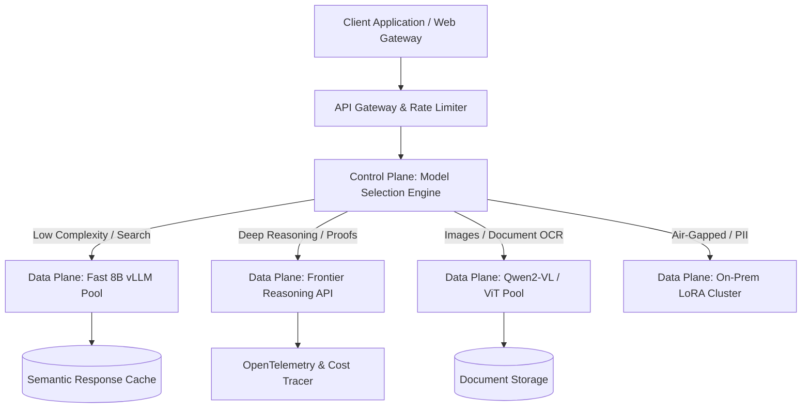

# Model Taxonomy & Selection: Architectural Tiers and Dynamic Routing

> **Executive Summary:** Modern enterprise AI platforms cannot rely on a single foundation model. By decoupling high-throughput associative lookups from compute-heavy test-time reasoning and multi-modal vision parsing, a declarative control plane model router minimizes Time-To-First-Token (TTFT) and slashes inference expenditure by over 70% while guaranteeing strict latency SLAs.

---

# 1. Interactive Concept Breakdown

## 1.1 The Production Crucible (The Why Before The How)

At a multinational financial services firm, the customer operations platform routed 100% of incoming user requests to a premier reasoning model (frontier o-series class). The architectural premise was that deploying the most capable benchmark-winning model would eliminate customer escalations.

Within four weeks of general availability:
1. **Financial Runaway:** Monthly API expenditure reached **$185,000**, exceeding the entire annual operational budget allocated for generative AI experimentation.
2. **Interactive Frustration:** The mean **Time-To-First-Token (TTFT)** was **9.4 seconds**. On routine navigation queries ("How do I download my 1099 form?"), users frequently reloaded the page, generating duplicate in-flight reasoning calls.
3. **The Catastrophic Quick-Fix:** Under executive pressure, platform engineering abruptly rerouted all traffic to an un-tuned 8B parameter open-weights model. While latency plummeted to 240ms, hallucination rates on multi-jurisdiction tax exemptions soared to **28%**, triggering severe compliance warnings.

```
TIME-SERIES POST-MORTEM (STATIC ROUTING BOTTLENECK)
09:00:00 ── [Inbound: 2,500 req/min] ── All Routed to Frontier Reasoning Model
09:02:00 ── Average TTFT hits 9.4s   ── 34% Client Connection Timeouts / Retries
09:05:00 ── Token Queue Deepens      ── GPU Compute Bill Explodes ($0.06/query avg)
09:10:00 ── Naive 8B Swap            ── 28% Regulatory Hallucination Rate Spikes
```

The underlying issue was structural: 82% of user requests required simple associative information retrieval, 14% required moderate synthesis, and only 4% required deep multi-step algorithmic or logical deduction. Static routing violates the core principle of **Right-Sized Compute Allocation**.

---

## 1.2 First-Principles Mental Model: The Inference Compute-Time Frontier

Foundation model inference cost and latency are governed by the relationship between **Parametric Memory** ($N$ parameters) and **Test-Time Search Compute** ($T$ reasoning tokens). Total floating-point operations scale as:

$$\text{FLOPs} \approx 2N \cdot (L_{\text{prompt}} + L_{\text{reasoning}} + L_{\text{output}})$$

```
COMPUTE-TIME PARETO FRONTIER
^ Reasoning / Accuracy
|                                [ Frontier Reasoning: o1/R1 ]
|                                (Deep test-time search, high latency)
|
|                     [ Balanced Instruct: 70B ]
|                     (Good synthesis, moderate cost)
|
|   [ Fast Tier: 8B ]
|   (Sub-second associative recall)
+------------------------------------------------------------> Inference Latency / Cost
```

1. **Fast-Inference Tier (3B - 8B Parameters):** Highly optimized for low-latency token generation ($>80\text{ tokens/sec}$ per stream), high concurrency, and low memory footprint. Ideal for intent classification, document tagging, and single-turn FAQ answers.
2. **Reasoning Tier (Test-Time Search Compute):** Models that dynamically scale compute during inference by executing chain-of-thought exploration, self-correction, or Monte Carlo Tree Search before producing an output token. Essential for mathematical validation, multi-hop code generation, and complex regulatory compliance.
3. **Vision-Language Tier (VLMs):** Incorporate visual encoders (Vision Transformers / ViT) coupled to language decoders via projection layers. Designed for document OCR, chart dissection, and spatial grounding.
4. **Specialized & Distilled Models:** 1B to 7B parameter models fine-tuned with LoRA or distilled from frontier models. They operate with deterministic output formats, air-gapped security, and minimal operational overhead.

---

## 1.3 Architectural Invariants & Core Definitions

- **Invariant 1: Regulatory Invariants Override Cost Heuristics.** Queries flagged with Personally Identifiable Information (PII) or HIPAA constraints must never escape to external public model endpoints, regardless of reasoning complexity.
- **Invariant 2: Deterministic Pre-Filtering.** The model routing decision must be computed in $<10\text{ms}$ using deterministic structural heuristics or ultra-fast embedding similarity—never by blocking on an expensive secondary LLM evaluation call.
- **Invariant 3: Bounded Graceful Degradation.** Every reasoning request must define a strict deadline SLA and an automatic fallback path to a cached response or an instruction-tuned model.

---

# 2. Visual Architecture

## 2.1 End-to-End System Topology



## 2.2 Control Plane vs. Data Plane Split

```
+--------------------------------------------------------------------------+
|                       CONTROL PLANE (Routing & Policy Engine)            |
|                                                                          |
|   Inbound Query ──> [ PII / Compliance Guard ] ──> [ Modality Detector ] |
|                                                           |              |
|                                                           v              |
|   Target Pool  <── [ Fallback Circuit Breaker ] <── [ Complexity Scorer] |
+-----------------------------------------------------------|--------------+
                                                            |
                                        +-------------------+
                                        | Dispatches Payload
                                        v
+--------------------------------------------------------------------------+
|                       DATA PLANE (Inference Execution Pools)             |
|                                                                          |
|   +------------------------------------+  +--------------------------+   |
|   | Fast Tier (vLLM Cluster / 8B)      |  | Frontier Reasoning Pool  |   |
|   | - Latency: < 300ms                 |  | - Latency: 5s - 20s      |   |
|   | - Throughput: 1,200 req/s          |  | - Cost: High ($0.04/req) |   |
|   +------------------------------------+  +--------------------------+   |
|                                                                          |
|   +------------------------------------+  +--------------------------+   |
|   | Vision-Language Workers (Qwen2-VL) |  | On-Prem Air-Gapped LoRA  |   |
|   | - Document Image Processing        |  | - Zero External Exfil    |   |
|   +------------------------------------+  +--------------------------+   |
+--------------------------------------------------------------------------+
```

## 2.3 Step-by-Step Request Flow

1. **Ingress & Policy Evaluation:** The API gateway inspects headers and streams the raw payload into the Model Selection Router.
2. **Security & Air-Gap Filter:** Payload is analyzed for regulated data attributes. If compliance flags trigger, request immediately diverts to the local air-gapped LoRA cluster.
3. **Modality Triage:** If binary image buffers or PDF streams are present, the router dispatches to the Vision-Language processing pool.
4. **Complexity Scoring:** For text-only requests, algorithmic heuristics assess code blocks, formal logic tokens, and question length.
5. **Execution & Telemetry Feedback:** The chosen engine executes inference; metrics (TTFT, total tokens, latency, cost) are streamed to OpenTelemetry collector.

---

# 3. Real-World Code & Configuration

## 3.1 Production Manifests & Declarative Configs

Below is the declarative model routing policy (`artifacts/model-router-policy.json`):

```json
{
  "$schema": "https://enterprise.internal/schemas/model-routing-v1.json",
  "routing_rules": [
    {
      "rule_id": "pii_regulated_path",
      "description": "Routes privacy-sensitive and regulated payloads to on-prem air-gapped instances",
      "conditions": { "contains_pii": true },
      "target_pool": "on_prem_llama_guard",
      "timeout_ms": 1500,
      "fallback": "reject"
    },
    {
      "rule_id": "multimodal_vision_path",
      "description": "Routes documents, charts, and image payloads to dedicated Vision-Language Models",
      "conditions": { "has_images": true },
      "target_pool": "vlm_document_parser",
      "timeout_ms": 6000,
      "fallback": "fast_instruct_tier"
    },
    {
      "rule_id": "deep_reasoning_eval",
      "description": "Routes high-entropy, multi-step math/code/logic problems to reasoning frontier engines",
      "conditions": { "reasoning_complexity_score_gte": 0.75 },
      "target_pool": "frontier_reasoning_engine",
      "timeout_ms": 25000,
      "fallback": "fast_instruct_tier"
    },
    {
      "rule_id": "default_fast_tier",
      "description": "Default fast-path routing for high-throughput sub-second queries",
      "conditions": { "reasoning_complexity_score_lt": 0.75 },
      "target_pool": "fast_instruct_tier",
      "timeout_ms": 2000,
      "fallback": "cached_deflection"
    }
  ]
}
```

## 3.2 Implementation Code

Below is the production asynchronous Python router (`artifacts/router.py`):

```python
"""Production model tier dynamic router with fallback circuit breakers and entropy analysis."""
import asyncio
from enum import Enum
from typing import Optional, Dict
from pydantic import BaseModel, Field

class ModelTier(str, Enum):
    FAST_INFERENCE = "fast_inference_8b"
    REASONING = "deep_reasoning_frontier"
    VISION_LANGUAGE = "vlm_document_parser"
    SPECIALIZED_LOCAL = "on_prem_fine_tuned"

class RoutingDecision(BaseModel):
    selected_tier: ModelTier
    target_endpoint: str
    estimated_cost_usd: float = Field(ge=0.0)
    sla_timeout_ms: int = Field(gt=0)
    trace_id: str
    complexity_score: float = Field(ge=0.0, le=1.0)
    fallback_tier: Optional[ModelTier] = None

class ModelSelectionEngine:
    """Control Plane routing engine evaluating payload characteristics and latency SLAs."""
    def __init__(self, high_complexity_threshold: float = 0.70):
        self.threshold = high_complexity_threshold
        self._endpoints: Dict[ModelTier, str] = {
            ModelTier.FAST_INFERENCE: "http://vllm-fast-pool.ai-serving.svc:8000/v1",
            ModelTier.REASONING: "https://api.frontier-reasoning.internal/v1",
            ModelTier.VISION_LANGUAGE: "http://vlm-worker.ai-serving.svc:8000/v1",
            ModelTier.SPECIALIZED_LOCAL: "http://airgap-lora.secure.svc:8000/v1",
        }

    async def evaluate_request(
        self, prompt: str, has_images: bool, is_airgapped: bool, trace_id: str
    ) -> RoutingDecision:
        if is_airgapped:
            return RoutingDecision(
                selected_tier=ModelTier.SPECIALIZED_LOCAL,
                target_endpoint=self._endpoints[ModelTier.SPECIALIZED_LOCAL],
                estimated_cost_usd=0.0001,
                sla_timeout_ms=1200,
                trace_id=trace_id,
                complexity_score=0.0
            )
        
        if has_images:
            return RoutingDecision(
                selected_tier=ModelTier.VISION_LANGUAGE,
                target_endpoint=self._endpoints[ModelTier.VISION_LANGUAGE],
                estimated_cost_usd=0.0035,
                sla_timeout_ms=5000,
                trace_id=trace_id,
                complexity_score=0.5,
                fallback_tier=ModelTier.FAST_INFERENCE
            )

        complexity = await self._calculate_complexity_heuristics(prompt)
        
        if complexity >= self.threshold:
            return RoutingDecision(
                selected_tier=ModelTier.REASONING,
                target_endpoint=self._endpoints[ModelTier.REASONING],
                estimated_cost_usd=0.0450,
                sla_timeout_ms=25000,
                trace_id=trace_id,
                complexity_score=complexity,
                fallback_tier=ModelTier.FAST_INFERENCE
            )

        return RoutingDecision(
            selected_tier=ModelTier.FAST_INFERENCE,
            target_endpoint=self._endpoints[ModelTier.FAST_INFERENCE],
            estimated_cost_usd=0.0004,
            sla_timeout_ms=800,
            trace_id=trace_id,
            complexity_score=complexity
        )

    async def _calculate_complexity_heuristics(self, prompt: str) -> float:
        code_markers = sum(prompt.count(t) for t in ["```", "def ", "class ", "SELECT ", "WHERE "])
        logic_markers = sum(prompt.count(t) for t in ["prove", "optimize", "contrast", "deduce", "calculate"])
        length_penalty = min(0.3, (len(prompt) / 4000) * 0.3)
        code_score = min(0.35, code_markers * 0.08)
        logic_score = min(0.35, logic_markers * 0.10)
        return min(1.0, length_penalty + code_score + logic_score)
```

## 3.3 Line-by-Line "Under the Hood" Annotations

- **Lines 31-40:** Regulatory air-gap checks execute first, eliminating any path where sensitive tokens could leak to cloud endpoints.
- **Lines 42-50:** Modality multiplexing avoids sending binary image references to text-only tokenizers.
- **Lines 69-76:** The `_calculate_complexity_heuristics` method executes in $<0.2\text{ms}$ in Python native string operations, preventing control plane bottlenecks.

---

# 4. Edge Cases, Failure Modes & Trade-offs

## 4.1 Comparative Decision Matrix

| Model Tier | Primary Sweet Spot | Known Failure Modes | P99 Latency | Cost / 1M Tokens | When NOT to Use |
| :--- | :--- | :--- | :--- | :--- | :--- |
| **Fast Inference (3B-8B)** | Semantic routing, extraction, summary, intent triage | Subtle hallucinations under nested constraints | 150ms - 450ms | $0.10 - $0.40 | Relying on it for legal proof deduction |
| **Reasoning (o-Series/R1)** | Multi-step mathematical proof, code synthesis, planning | Token inflation via run-away thinking loops | 5,000ms - 25,000ms | $15.00 - $60.00 | Trivial search FAQ deflection |
| **Vision-Language (VLM)** | Scanned PDFs, architectural blueprints, charts | Spatial grounding errors, tiny font OCR drops | 1,200ms - 4,000ms | $2.00 - $8.00 | Ingesting pure text raw strings |
| **Distilled / Task-Specific** | High-throughput structured JSON output, PII boundary | Catastrophic forgetting outside domain | 80ms - 250ms | $0.02 - $0.15 | Open-ended exploratory conversation |

## 4.2 Failure Mode & Blast Radius Analysis

### Failure Scenario 1: Run-Away Reasoning Loops (Token Exhaustion)
- **Trigger:** A user submits an adversarial prompt with self-referential paradoxes to a reasoning model.
- **Blast Radius:** Model generates internal thinking tokens up to its maximum ceiling (32,000 tokens), locking worker resources for 45 seconds and incurring maximal token charges.
- **Mitigation:** Implement strict token budget caps (`max_thinking_tokens: 4096`) and wall-clock client timeouts with fallback deflection.

### Failure Scenario 2: Router Complexity Misclassification
- **Trigger:** A user query uses polite, informal conversational language to ask an exceptionally complex legal liability calculation.
- **Blast Radius:** Algorithmic heuristic assigns a low complexity score ($<0.70$) and routes to the 8B model, producing a plausible hallucination that passes automated review.
- **Mitigation:** Incorporate secondary confidence scoring on the 8B output. If output logit entropy is high, trigger automatic step-up promotion to the reasoning tier.

## 4.3 Operational Triage & Observability Runbook

### Key SLIs & Prometheus Metrics
- `model_router_decision_duration_seconds{quantile="0.99"}`: Target $< 15\text{ms}$.
- `model_inference_ttft_seconds{tier="fast_inference"}`: Target $< 400\text{ms}$.
- `model_routing_fallback_total{reason="timeout"}`: Alert if $> 1\%$ over a 5-minute rolling window.

### Emergency Triage Checklist
1. **Step 1 (Throttle Frontier Spend):** If monthly billing rates cross budget thresholds, raise the `reasoning_complexity_score_gte` threshold from `0.75` to `0.90` to divert 80% of borderline queries to the fast instruct tier.
2. **Step 2 (Isolate Failing Endpoints):** If the external reasoning API experiences 503 outages, toggle the circuit breaker to route incoming requests to local fallback models.
3. **Step 3 (Monitor Token Inflation):** Review Grafana dashboards for `mean_reasoning_tokens_per_request` to detect prompt injection attacks.
