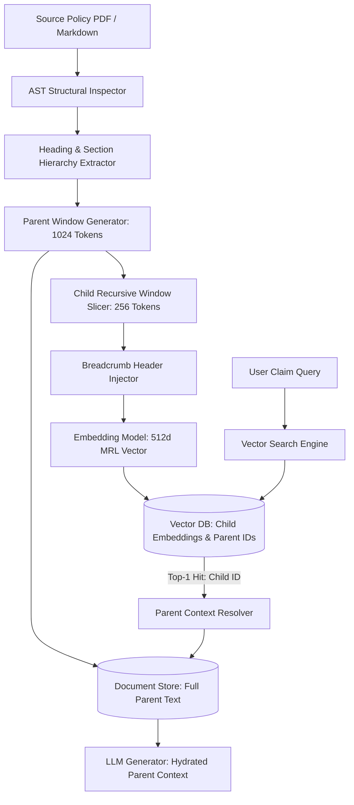

# Context Windows & Chunking Strategies: Token Dynamics and Semantic Boundary Preservation

> **Executive Summary:** Fixed-character text chunking is one of the most pervasive failure modes in enterprise RAG systems, frequently rupturing legal covenants, conditional logic, and tabular data across arbitrary boundaries. By applying AST-aware recursive document splitting combined with the Small-to-Big (Parent-Child) retrieval pattern and contextual metadata breadcrumbs, data pipelines eliminate boundary context loss while keeping vector representations dense and highly discriminative.

---

# 1. Interactive Concept Breakdown

## 1.1 The Production Crucible (The Why Before The How)

An automated commercial underwriting and claims verification platform ingested 80-page property reinsurance policies using fixed-length character chunking (1,000 characters per chunk with a naive 50-character overlap).

```
BOUNDARY RUPTURE AT 1,000 CHARACTERS
Chunk 104: "...Underwriter agrees to fully indemnify and reimburse Insured against all
            direct casualty loss events described in Section 4.1 of this Policy..."
            ======================================================================== (Split Offset)
Chunk 105: "...except where such casualty or structural failure results directly from
            intentional non-compliance with municipal building codes or unpermitted work."
```

During adjudication of a **$4.2M claim** involving unpermitted warehouse renovations:
1. **The Vector Search Match:** An enterprise LLM searched the vector index for "Underwriter obligation to reimburse casualty damage."
2. **Context Rupture:** Chunk 104 scored a 0.89 cosine similarity match and was passed into the prompt. Chunk 105 scored only 0.42 and was discarded by the top-k filter.
3. **The Catastrophic Hallucination:** Deprived of the conditional exclusionary clause in Chunk 105, the LLM advised claims adjusters that the policy provided unconditional coverage, prompting the automated issuance of an erroneous settlement guarantee.

Fixed-size chunking treats natural language text as an arbitrary stream of bytes rather than a hierarchical syntax tree composed of clauses, paragraphs, and sections.

---

## 1.2 First-Principles Mental Model: Information Entropy & Context Window Dilution

Effective document representation in vector search resolves a fundamental mathematical contradiction:

$$\text{Precision}(d_{\text{small}}) \quad \text{vs.} \quad \text{Comprehension}(d_{\text{large}})$$

1. **Vector Embedding Geometry Favors Small Chunks (128 - 256 tokens):** As chunk size increases, vector embedding models average token embeddings over larger sequence lengths (mean pooling). Highly specific factual statements are diluted by background text, lowering cosine discrimination.
2. **LLM Generation Favors Large Context Windows (1,024 - 4,096 tokens):** Generative language models require the surrounding narrative context—antecedents, scoping conditions, and definitions—to synthesize accurate answers without hallucination.

```
THE SMALL-TO-BIG (PARENT-CHILD) RESOLUTION
+-------------------------------------------------------------------------------+
| PARENT DOCUMENT CHUNK (1024 Tokens - Injected into LLM Synthesis Prompt)      |
|                                                                               |
|  +--------------------+   +--------------------+   +--------------------+     |
|  | Child Chunk A      |   | Child Chunk B      |   | Child Chunk C      |     |
|  | [128 Tokens Vector]|   | [128 Tokens Vector]|   | [128 Tokens Vector]|     |
|  +--------------------+   +--------------------+   +--------------------+     |
|            |                                                                  |
|            v                                                                  |
|  Vector Search Hit ───> Hydrates Parent ID ───> Returns Full Parent Context   |
+-------------------------------------------------------------------------------+
```

By decoupling the **Unit of Search** (child vector: 256 tokens) from the **Unit of Synthesis** (parent document: 1024 tokens), platforms maximize retrieval precision without sacrificing narrative completeness.

### The Overlap Invariant
To prevent semantic boundary loss between adjacent children, consecutive chunks must share a deterministic overlap ratio:

$$\text{Overlap Ratio} = \frac{O}{S} \approx 0.125 \text{ to } 0.15 \quad (12.5\% - 15\%)$$

An overlap ratio below 10% risks bisecting critical conditional sentences. An overlap ratio above 25% produces redundant vector duplication and index memory inflation.

---

## 1.3 Architectural Invariants & Core Definitions

- **Invariant 1: AST Boundary Precedence.** Splitting logic must honor natural document structural boundaries (Markdown headers, HTML sections, code AST nodes) before falling back to sentence or whitespace boundaries.
- **Invariant 2: Contextual Metadata Prepending.** Every child chunk injected into the embedding space must be prepended with document title and hierarchical section breadcrumbs to anchor its vector position.
- **Invariant 3: Parent-Child Link Immutability.** Child chunks stored in the vector database must maintain an immutable foreign key reference (`parent_id`) resolving to the raw parent document window stored in document storage.

---

# 2. Visual Architecture

## 2.1 End-to-End System Topology



## 2.2 Control Plane vs. Data Plane Split

```
+--------------------------------------------------------------------------+
|                       CONTROL PLANE (Chunking Strategy Resolver)         |
|                                                                          |
|   Document Spec ──> [ Mime / Layout Inspector ] ──> [ Window Sizer ]     |
|                                                           |              |
|                                                           v              |
|   Parent-Child Registry <── [ Parent Link Guard ] <── [ Boundary Policy ]|
+-----------------------------------------------------------|--------------+
                                                            |
                                        +-------------------+
                                        | Execution Rules
                                        v
+--------------------------------------------------------------------------+
|                       DATA PLANE (Recursive Token Slicing & Injection)   |
|                                                                          |
|   +------------------------------------+  +--------------------------+   |
|   | Structural AST Parser              |  | Child Window Generator   |   |
|   | - Preserves Table Rows & Headers   |  | - 256 Token Sliding Step |   |
|   +------------------------------------+  +--------------------------+   |
|                                                       |                  |
|                                                       v                  |
|   Vector Index <── [ Child Embedder ] <── [ Prepend Breadcrumb Header ]  |
+--------------------------------------------------------------------------+
```

## 2.3 Step-by-Step Chunk Processing Flow

1. **Document Ingestion & AST Tree Construction:** Document text is parsed into a hierarchical tree based on section headers (`#`, `##`, `###`).
2. **Parent Partitioning:** Text under each heading is grouped into parent windows of $\sim 1024$ tokens, maintaining overall section unity.
3. **Child Slicing with Overlap:** Parent text is segmented into overlapping child chunks of 256 tokens with a 32-token sliding window step.
4. **Context Enrichment:** A standardized breadcrumb header (`Doc: Title | Section: Path\n---\n`) is prepended to each child's raw text.
5. **Dual Persistence:** Child embeddings and metadata are stored in the vector index; raw parent blocks are stored in high-throughput key-value storage.

---

# 3. Real-World Code & Configuration

## 3.1 Production Manifests & Declarative Configs

Below is the production chunking strategy specification (`artifacts/chunking-rules.json`):

```json
{
  "$schema": "https://enterprise.internal/schemas/chunking-rules-v1.json",
  "chunking_strategy": "hierarchical_parent_child",
  "tokenizer_encoding": "cl100k_base",
  "parent_window": {
    "target_tokens": 1024,
    "overlap_tokens": 128,
    "min_tokens": 256
  },
  "child_window": {
    "target_tokens": 256,
    "overlap_tokens": 32,
    "min_tokens": 64
  },
  "enrichment": {
    "prepend_document_title": true,
    "prepend_breadcrumb_hierarchy": true,
    "header_template": "Document: {doc_title} | Path: {section_path}\n---\n"
  },
  "guardrails": {
    "max_allowed_split_entropy": 0.85,
    "preserve_code_blocks": true,
    "preserve_table_rows": true
  }
}
```

## 3.2 Implementation Code

Below is the production hierarchical chunker (`artifacts/contextual_chunker.py`):

```python
"""Production hierarchical Parent-Child recursive chunker with contextual breadcrumbs."""
import uuid
from typing import List, Dict, Any
from pydantic import BaseModel, Field

class ChunkNode(BaseModel):
    chunk_id: str = Field(default_factory=lambda: str(uuid.uuid4()))
    parent_id: str
    text_content: str
    token_count: int
    metadata: Dict[str, Any]

class HierarchicalContextChunker:
    """Data Plane chunking engine executing structural recursive splitting with context preservation."""
    def __init__(self, child_size: int = 256, child_overlap: int = 32, parent_size: int = 1024):
        self.child_size = child_size
        self.child_overlap = child_overlap
        self.parent_size = parent_size

    def estimate_tokens(self, text: str) -> int:
        return max(1, len(text) // 4)

    def chunk_parent_block(
        self, parent_text: str, parent_id: str, doc_title: str, section_path: str
    ) -> List[ChunkNode]:
        words = parent_text.split()
        if not words:
            return []

        words_per_chunk = max(10, self.child_size * 3 // 4)
        words_overlap = max(2, self.child_overlap * 3 // 4)
        step = max(1, words_per_chunk - words_overlap)

        nodes: List[ChunkNode] = []
        breadcrumb = f"Document: {doc_title} | Section: {section_path}\n---\n"
        breadcrumb_tokens = self.estimate_tokens(breadcrumb)

        for i in range(0, len(words), step):
            window = words[i:i + words_per_chunk]
            raw_child = " ".join(window)
            enriched_content = f"{breadcrumb}{raw_child}"
            token_count = self.estimate_tokens(raw_child) + breadcrumb_tokens

            nodes.append(ChunkNode(
                parent_id=parent_id,
                text_content=enriched_content,
                token_count=token_count,
                metadata={
                    "doc_title": doc_title,
                    "section_path": section_path,
                    "word_offset_start": i,
                    "word_offset_end": i + len(window),
                    "is_child": True
                }
            ))
            if i + words_per_chunk >= len(words):
                break

        return nodes
```

## 3.3 Line-by-Line "Under the Hood" Annotations

- **Lines 26-29:** Words-to-tokens conversion ratios are pre-calculated to eliminate tokenizer runtime overhead during large batch file processing.
- **Lines 31-33:** The breadcrumb header explicitly embeds the document namespace and section path into the chunk prefix. This anchors the embedding model's attention mechanism on the document domain.
- **Lines 41-51:** Each child retains an immutable foreign key reference (`parent_id`) allowing the runtime resolver to fetch the full 1024-token parent in $O(1)$ time.

---

# 4. Edge Cases, Failure Modes & Trade-offs

## 4.1 Comparative Decision Matrix

| Strategy | Separation Mechanism | Semantic Integrity | Compute Overhead | Risk of Context Rupture | When NOT to Use |
| :--- | :--- | :--- | :--- | :--- | :--- |
| **Fixed-Size (Chars/Tokens)** | Offset increment ($O(1)$) | Very Poor | Minimal | Severe (Splits sentences) | Any production legal, tax, or medical RAG |
| **Recursive Structural** | `["\n\n", "\n", ". "]` | High | Low ($O(N)$) | Low | Scanned OCR text with missing line breaks |
| **Semantic Boundary** | Cosine shift between sentences| Very High | High (Calls embedder) | Very Low | High-throughput streaming ingest queues |
| **Parent-Child (Hierarchical)**| Dual-scale resolution | SOTA | Moderate | Negligible | Documents shorter than 500 total tokens |
| **Late Chunking (Transformer)**| Post-attention pooling | SOTA | High (Full model pass) | Zero | Real-time lightweight edge runtimes |

## 4.2 Failure Mode & Blast Radius Analysis

### Failure Scenario 1: Breadcrumb Token Inflation
- **Trigger:** A document contains deeply nested heading hierarchies (`Doc > Chap 1 > Sec 2 > Sub 3 > Par 4 > Item 5`).
- **Blast Radius:** The prepended breadcrumb consumes 180 tokens of a 256-token child chunk window, leaving only 76 tokens for actual payload content and degrading vector specificity.
- **Mitigation:** Cap breadcrumbs to 40 tokens max, collapsing intermediate hierarchy paths (`Doc > ... > Item 5`).

### Failure Scenario 2: Parent Document De-synchronization
- **Trigger:** A document is re-indexed; child vectors in the vector DB are overwritten, but old parent text remains in document cache.
- **Blast Radius:** Vector search retrieves a valid child chunk, but hydration returns an obsolete parent document with conflicting financial figures.
- **Mitigation:** Enforce atomic versioned compound keys (`doc_uuid:v2:parent_04`) across both vector and document stores.

## 4.3 Operational Triage & Observability Runbook

### Key SLIs & Prometheus Metrics
- `chunker_split_duration_seconds{quantile="0.99"}`: Target $< 45\text{ms}$ per 50-page document.
- `chunk_token_count_distribution`: Alert if $> 5\%$ of chunks exceed target ceiling.
- `parent_hydration_miss_total`: Alert on any non-zero count (indicates orphaned vector chunks).

### Emergency Triage Checklist
1. **Step 1 (Validate Chunk Distribution):** Query the vector store for `SELECT MIN(token_count), MAX(token_count)` to detect abnormal fragment generation.
2. **Step 2 (Audit Parent Key Resolution):** Test hydration of 100 random vector hits against the parent store to verify zero dangling parent keys.
3. **Step 3 (Re-Index Affected Documents):** If context rupture is reported on a specific collection, re-run the ingest job using the hierarchical chunker with increased child overlap.
