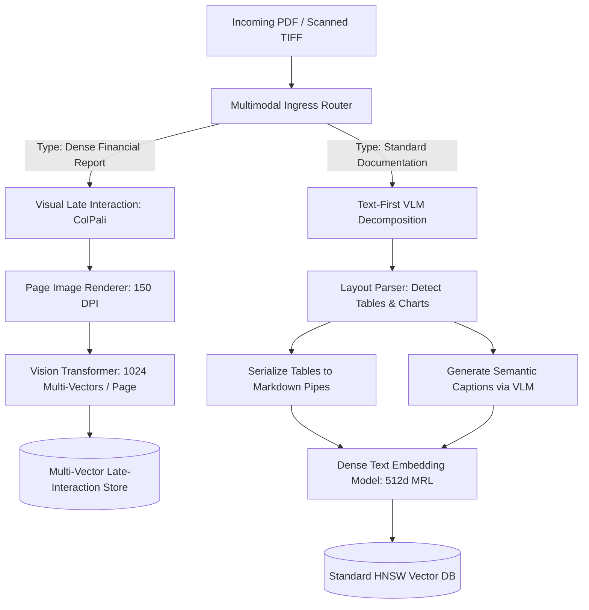

# Multimodal Data Pipelines: Mixed-Input Ingestion, Table Preservation, and Visual Late Interaction

> **Executive Summary:** Ingestion pipelines that flatten visual documents and complex 2D tables into raw plaintext destroy geometric relationships and cause catastrophic numerical hallucinations. By contrasting Text-First VLM Markdown decomposition with Visual Late-Interaction architectures (ColPali), enterprise platforms can reliably search, extract, and ground multi-modal payloads spanning balance sheets, scanned forms, and technical diagrams without brittle OCR heuristics.

---

# 1. Interactive Concept Breakdown

## 1.1 The Production Crucible (The Why Before The How)

A quantitative hedge fund deployed an automated pipeline to ingest quarterly earnings reports (10-K filings) across 1,200 publicly traded companies. Documents were processed through a standard high-throughput optical character recognition (OCR) engine that extracted plaintext by reading characters left-to-right, top-to-bottom.

```
THE 2D TABLE FLATTENING DISASTER
Original Visual PDF Grid:
+-------------------+---------+---------+---------+---------+
| Metric            | Q1 2024 | Q2 2024 | Q3 2024 | Q4 2024 |
+-------------------+---------+---------+---------+---------+
| Operating Loss    | ($42M)  | ($18M)  | $5M     | $12M    |
| Free Cash Flow    | ($15M)  | ($4M)   | $2M     | $8M     |
+-------------------+---------+---------+---------+---------+

Linearized Plaintext Output (Naive OCR):
"Metric Q1 2024 Q2 2024 Q3 2024 Q4 2024 Operating Loss ($42M) ($18M) $5M $12M Free Cash Flow ($15M) ($4M) $2M $8M"
```

During a volatile earnings morning:
1. **The Retrieval Disconnect:** A portfolio manager queried the system: *"What was the Operating Loss in Q1 2024?"*
2. **Column Misalignment:** The linearized text lost vertical bounding-box coordinates. The LLM read `Operating Loss` and paired it with the adjacent tokens `$5M` and `$12M`, completely missing the parentheses denoting negative values.
3. **The Erroneous Trade:** The system synthesized a report declaring that the target company was *"solidly profitable throughout early 2024 with positive cash flows,"* prompting an automated long position that resulted in a **$1.8M loss** when audited against audited SEC filings.

Text-only extraction strips 2D documents of their foundational spatial geometry.

---

## 1.2 First-Principles Mental Model: Text-First Transcription vs. Visual Late Interaction

Enterprise multimodal document processing splits into two fundamentally competing architectural paradigms:

### Paradigm A: Text-First Decomposition (Transcription Pipeline)
Uses Vision-Language Models (VLMs) or layout models (e.g., LayoutLMv3) to recognize structural boundaries and serialize them into structured text representations (Markdown pipe tables and natural language image captions).
- **Advantage:** Downstream vectors fit cleanly into standard single-vector dense text indices (HNSW).
- **Vulnerability:** Brittle multi-stage pipeline; hallucinations during table transcription propagate down to the embedding layer.

### Paradigm B: Visual Late-Interaction (ColPali Pipeline)
Instead of extracting text through OCR, the document page image is passed directly into a Vision Transformer (ViT). The vision model generates multi-vector patch embeddings ($128\text{d}$ vectors for each spatial patch of the page).

During search, query text tokens are matched directly against visual patches using **Late-Interaction Maximum Cosine Similarity**:

$$S(Q, D) = \sum_{q \in Q} \max_{d \in D} (q \cdot d)$$

```
COLPALI VISUAL LATE-INTERACTION MECHANICS
Query: "Operating Loss Q1 2024"  ──> Text Query Tokens: [ q1, q2, q3 ]
                                                |
                                                v  (Max-Sim Patch Alignment)
Document Page (Rendered Image)   ──> 1024 Visual Patches: [ p1, p2, ... p1024 ]
(Directly aligns the token "Operating Loss" with the exact spatial coordinates of the table cell!)
```

This bypasses OCR entirely: the model "sees" bold fonts, parenthetical financial notation, and flowchart arrows directly in image space.

---

## 1.3 Architectural Invariants & Core Definitions

- **Invariant 1: Two-Dimensional Grid Preservation.** Any structured tabular data extracted into text must be formatted as Markdown pipe tables with intact header dividers, never as linearized comma-separated strings.
- **Invariant 2: Multi-Modal Bounding Box Grounding.** Extracted charts and image descriptions must retain page number and bounding box coordinates `[ymin, xmin, ymax, xmax]` for auditability.
- **Invariant 3: Late-Interaction Normalization.** In ColPali multi-vector models, all query token embeddings and document patch embeddings must be L2-normalized so inner products represent true cosine similarities.

---

# 2. Visual Architecture

## 2.1 End-to-End System Topology



## 2.2 Control Plane vs. Data Plane Split

```
+--------------------------------------------------------------------------+
|                       CONTROL PLANE (Multimodal Ingestion Router)        |
|                                                                          |
|   Inbound Document ──> [ MIME & Layout Detector ] ────────────────────+  |
|                                                                       |  |
|   Routing Registry <─── [ Strategy: ColPali vs Text-First ] <─────────+  |
+---------------------------------------------------------------|----------+
                                                                |
                                        +-----------------------+
                                        | Dispatches Pipeline
                                        v
+--------------------------------------------------------------------------+
|                       DATA PLANE (Parallel Ingestion Lanes)              |
|                                                                          |
|   +------------------------------------+  +--------------------------+   |
|   | Lane A: Text-First VLM Ingestion   |  | Lane B: ColPali ViT Pool |   |
|   | - Converts Tables to MD Pipes      |  | - Direct 150 DPI Images  |   |
|   | - Generates Image Summaries        |  | - 1024 Patches / Page    |   |
|   | - Dense 512d HNSW Index            |  | - Max-Sim Query Scoring  |   |
|   +------------------------------------+  +--------------------------+   |
+--------------------------------------------------------------------------+
```

## 2.3 Step-by-Step Processing Flow

1. **Ingress Inspection:** The control plane analyzes document MIME type, page count, and layout density to determine whether to route to ColPali or Text-First VLM decomposition.
2. **Layout Partitioning:** For text-first paths, the layout parser segments pages into discrete text, table, and figure blocks.
3. **Table & Figure Standardization:** Tables are formatted into Markdown pipe tables; figures are captioned using an instruction-tuned VLM.
4. **ColPali Visual Encoding:** For visually dense paths, pages are rasterized to 150 DPI images and passed into the Vision Transformer patch encoder.
5. **Index Registration:** Extracted content is registered with provenance metadata (page numbers, bounding boxes, and document IDs).

---

# 3. Real-World Code & Configuration

## 3.1 Production Manifests & Declarative Configs

Below is the production multimodal ingestion configuration (`artifacts/multimodal-pipeline.json`):

```json
{
  "$schema": "https://enterprise.internal/schemas/multimodal-pipeline-v1.json",
  "pipeline_id": "enterprise_hybrid_multimodal_v1",
  "document_types": [
    "application/pdf",
    "image/png",
    "image/jpeg",
    "application/vnd.openxmlformats-officedocument.wordprocessingml.document"
  ],
  "routing_policy": {
    "dense_financial_reports": "colpali_visual_late_interaction",
    "structured_forms_and_invoices": "vlm_markdown_decomposition",
    "plain_documentation": "text_recursive_extraction"
  },
  "table_extraction": {
    "target_format": "markdown_pipe_table",
    "validate_header_integrity": true,
    "max_columns": 64
  },
  "vision_transformer": {
    "model_name": "vidore/colpali-v1.2",
    "image_dpi": 150,
    "patch_dimension": 128
  },
  "guardrails": {
    "sanitize_hidden_text": true,
    "preserve_reading_order": true
  }
}
```

## 3.2 Implementation Code

Below is the production multimodal document packager (`artifacts/multimodal_pipeline.py`):

```python
"""Production multimodal document extraction and structured payload packager."""
from enum import Enum
from typing import List, Optional, Dict, Any
from pydantic import BaseModel, Field

class IngestModality(str, Enum):
    STRUCTURED_TABLE = "table_markdown"
    VISUAL_IMAGE = "visual_chart_summary"
    NARRATIVE_TEXT = "narrative_text"

class ExtractedContentNode(BaseModel):
    page_number: int = Field(ge=1)
    modality: IngestModality
    payload: str = Field(..., description="Markdown table, chart summary, or text")
    bounding_box: Optional[List[float]] = Field(default=None, description="[ymin, xmin, ymax, xmax]")
    confidence_score: float = Field(default=1.0, ge=0.0, le=1.0)
    metadata: Dict[str, Any] = Field(default_factory=dict)

class MultimodalDocumentPackager:
    """Data Plane transformation service unifying heterogeneous multimodal extractions."""
    def format_for_indexing(self, nodes: List[ExtractedContentNode], doc_name: str) -> str:
        assembled_chunks: List[str] = [f"# Document Manifest: {doc_name}\n"]
        
        for node in nodes:
            if node.modality == IngestModality.STRUCTURED_TABLE:
                header = f"\n[PAGE {node.page_number} - FINANCIAL DATA TABLE]\n"
                assembled_chunks.append(f"{header}{node.payload}\n[/END TABLE]\n")
            elif node.modality == IngestModality.VISUAL_IMAGE:
                header = f"\n[PAGE {node.page_number} - VISUAL CHART DESCRIPTION]\n"
                assembled_chunks.append(f"{header}{node.payload}\n[/END VISUAL]\n")
            else:
                assembled_chunks.append(f"\n[PAGE {node.page_number}]\n{node.payload}\n")
                
        return "".join(assembled_chunks)
```

## 3.3 Line-by-Line "Under the Hood" Annotations

- **Lines 11-18:** The `ExtractedContentNode` Pydantic model enforces strict typing, bounding box coordinates, and extraction confidence thresholds.
- **Lines 26-36:** Explicit boundary tokens (`[PAGE X - FINANCIAL DATA TABLE]` ... `[/END TABLE]`) allow downstream retrieval and generation models to distinguish structured tabular assertions from narrative prose.

---

# 4. Edge Cases, Failure Modes & Trade-offs

## 4.1 Comparative Decision Matrix

| Multimodal Architecture | Tabular Data Accuracy | Visual Diagram Grasp | Memory Footprint | Query P99 Latency | Critical Weakness |
| :--- | :--- | :--- | :--- | :--- | :--- |
| **Linear OCR + Raw Text** | Unacceptable (Breaks columns)| Zero (Discards images)| Minimal ($1\times$) | 12ms | Hallucinated numerical metrics |
| **VLM Text Decomposition** | High (Markdown tables) | Good (Captions) | Moderate ($2\times$) | 35ms (Search) | OCR hallucination on low-contrast fonts |
| **Joint Embedding (SigLIP)** | Poor (Loses cell tokens) | Strong (Scene context) | Low ($1.5\times$) | 22ms | Cannot match exact numerical figures |
| **ColPali (Late-Interaction)**| SOTA (Matches cell patch) | SOTA (Native ViT) | Very High ($10\times$ vectors)| 140ms | High vector RAM requirements |

## 4.2 Failure Mode & Blast Radius Analysis

### Failure Scenario 1: Multi-Vector RAM Exhaustion under ColPali
- **Trigger:** A 100,000-page document corpus is indexed with ColPali without vector quantization.
- **Blast Radius:** At 1,024 vectors per page, the collection expands to 102,400,000 vectors, requiring over 50 GB of memory and exhausting cluster capacity.
- **Mitigation:** Apply token pruning (filtering background whitespace patch vectors) and INT4/INT8 scalar quantization to reduce patch vector storage by 70%.

### Failure Scenario 2: Hallucinated Table Cells in VLM Decomposition
- **Trigger:** A complex financial PDF has low-resolution scans with faint grid lines.
- **Blast Radius:** The VLM hallucinates missing column borders, producing a syntactically valid Markdown table with shifted row values.
- **Mitigation:** Compare cell count heuristics between OCR bounding boxes and extracted Markdown columns; flag discrepancies for manual human-in-the-loop audit.

## 4.3 Operational Triage & Observability Runbook

### Key SLIs & Prometheus Metrics
- `multimodal_ingest_page_seconds{modality="colpali"}`: Target $< 400\text{ms}$ per page on A10G GPU.
- `table_extraction_validation_failure_total`: Alert if $> 2\%$ of processed tables have header-row mismatch.
- `colpali_query_latency_seconds{quantile="0.99"}`: Target $< 200\text{ms}$.

### Emergency Triage Checklist
1. **Step 1 (Check Layout Parser Drift):** If financial table extraction complaints spike, inspect recent `table_markdown` logs to verify table pipe delimiters remain balanced.
2. **Step 2 (Throttle High-DPI Rendering):** If ingestion workers encounter CUDA OOM errors during PDF rasterization, decrease image rendering DPI from 200 to 150.
3. **Step 3 (Fall Back to Text-First Lane):** If ColPali worker nodes experience GPU driver crashes, toggle the control plane route to divert document traffic through the text-first VLM lane.
