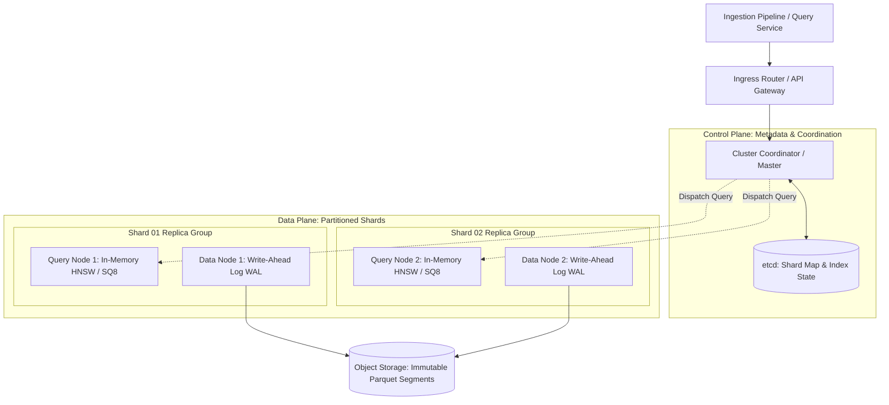

# Vector Databases & High-Dimensional ANN Search: Indexing, Metric Geometry, and Quantization

> **Executive Summary:** Scaling semantic vector retrieval to hundreds of millions of embeddings breaches physical RAM boundaries, driving cluster infrastructure costs to thousands of dollars per month and triggering OOM cascading failures. By grounding retrieval in high-dimensional metric geometry, understanding the graph traversal physics of Hierarchical Navigable Small World (HNSW) vs. Voronoi Inverted File (IVF) partitioning, and enforcing L2 normalization alongside symmetric 8-bit scalar quantization (SQ8), distributed architectures reduce memory consumption by 75% while maintaining sub-10ms latency and >98% Recall@10.

---

# 1. Interactive Concept Breakdown

## 1.1 The Production Crucible (The Why Before The How)

At 09:15 AM on a Monday, a tier-1 customer support platform deployed an update that indexed 85,000,000 dense ticket embeddings (1,536 dimensions, FP32 precision) into an in-memory vector database cluster.

```
+-------------------------------------------------------------------------------+
|             CLUSTER MEMORY REQUIREMENT VS. PHYSICAL NODE CAPACITY             |
+-------------------------------------------------------------------------------+
| Raw FP32 Vectors:      85,000,000 * 1,536 * 4 bytes      =  522.24 GB         |
| HNSW Graph Overheads:  85,000,000 * (M=32 edges) * 8 B   =  348.16 GB         |
| Dynamic Traversal Heap & OS Metadata:                    =   85.60 GB         |
| Total Required In-Memory RAM:                            =  956.00 GB (~0.95 TB)|
| Physical Capacity (2x AWS r6i.8xlarge Nodes @ 256GB):    =  512.00 GB (CRASH!) |
+-------------------------------------------------------------------------------+
```

The consequences manifested across the fleet in three catastrophic stages:
1. **The Linux OOM Killer Cascade:** Node memory usage spiked to 99.2%. The Linux kernel invoked the `OOMKiller`, terminating the primary vector search query worker daemon on Node 01.
2. **Page Fault Throttling Storm:** When Kubernetes rescheduled the query worker, the process attempted to read the memory-mapped graph index from disk. Disk I/O saturated to 100%, causing query p99 latency to explode from **12ms** to **3,850ms**.
3. **The Financial Explosion:** To prevent total outage, DevOps over-provisioned the cluster to four `r6i.16xlarge` memory-optimized instances (512GB RAM each), driving baseline cloud infrastructure expenses to **$32,400/month**.

A naive operational attempt to switch to flat inverted lists (IVF-Flat) without graph navigation dropped Recall@10 from **0.97** to **0.62**, causing customer support agents to retrieve completely irrelevant legal documents. Scaling high-dimensional vector search requires mathematical rigor, metric space invariants, and structured quantization.

---

## 1.2 First-Principles Mental Model: The Metric Geometry of High-Dimensional Search

In Euclidean space $\mathbb{R}^D$, as dimensionality $D$ grows to thousands of dimensions ($D = 1,536$), the geometry of vector spaces defies low-dimensional intuition due to the **Curse of Dimensionality**:

$$\lim_{D \to \infty} \frac{\text{dist}_{\max} - \text{dist}_{\min}}{\text{dist}_{\min}} \to 0$$

In high dimensions, the volume of a hypersphere is concentrated almost entirely in a razor-thin outer spherical shell. The distance between any randomly chosen pair of vectors approaches a constant. Consequently, traditional spatial trees (KD-Trees, R-Trees, Ball-Trees) degenerate to exhaustive linear scans ($O(N \cdot D)$).

```
+-----------------------------------+   +-----------------------------------+
|     1. INVERTED FILE (IVF)        |   |    2. HNSW GRAPH (Hierarchical)   |
|   Voronoi Space Partitioning      |   |    Multi-Layer Skip-List Graph    |
+-----------------------------------+   +-----------------------------------+
|         +---------------+         |   | [Layer 2]  (o) -------------> (o) |
|         |   *   c1   *  |         |   |             |                  |  |
|         | *       *     |         |   |             v                  v  |
|  +------+-------+-------+------+  |   | [Layer 1]  (o) ----> (o) ----> (o)|
|  |  *   | *  *  |   *   |  *   |  |   |             |         |        |  |
|  |  c2  |   c3  |   c4  |  c5  |  |   |             v         v        v  |
|  |      | *   * | *     |      |  |   | [Layer 0]  (o)-(o)-(o)-(o)-(o)-(o)|
|  +------+-------+-------+------+  |   | (Dense Base: Local Greedy Walk)   |
+-----------------------------------+   +-----------------------------------+
```

### The Two Algorithmic Paradigms: IVF vs. HNSW

1. **Inverted File (IVF):** Partitions vector space into $K$ Voronoi cells centered around centroids computed via $k$-means. At query time, the system compares the query vector against $K$ centroids, selects the $n_{\text{probe}}$ nearest centroids, and scans only vectors assigned to those inverted lists.
   - *Advantage:* Low memory overhead, fast index build time.
   - *Failure Mode:* Boundary vector miss. If a query vector lies near the boundary between two Voronoi cells, true nearest neighbors in adjacent cells are ignored unless $n_{\text{probe}}$ is tuned high, which defeats the speed advantage.

2. **Hierarchical Navigable Small World (HNSW):** Generalizes 1D skip-lists to high-dimensional graphs. Upper layers contain sparse long-range "highway" connections allowing logarithmic hops across the vector space. The base layer (Layer 0) contains a dense network of local connections where greedy routing converges on the exact nearest neighbor.
   - *Advantage:* Phenomenal query throughput ($<8\text{ms}$) and near-perfect Recall@10 (>98%).
   - *Trade-off:* High memory overhead: every node maintains up to $M$ bidirectional link pointers per layer.

### The Metric Space Normalization Invariant

Given two vectors $\mathbf{u}, \mathbf{v} \in \mathbb{R}^D$:
- **Cosine Distance:**
  $$\cos(\mathbf{u}, \mathbf{v}) = \frac{\mathbf{u} \cdot \mathbf{v}}{\|\mathbf{u}\|_2 \|\mathbf{v}\|_2}$$
- **Euclidean (L2) Distance:**
  $$\|\mathbf{u} - \mathbf{v}\|_2^2 = \|\mathbf{u}\|_2^2 + \|\mathbf{v}\|_2^2 - 2(\mathbf{u} \cdot \mathbf{v})$$

When vectors are strictly L2 unit normalized ($\|\mathbf{u}\|_2 = 1.0$ and $\|\mathbf{v}\|_2 = 1.0$):
$$\|\mathbf{u} - \mathbf{v}\|_2^2 = 2 - 2(\mathbf{u} \cdot \mathbf{v})$$
$$\cos(\mathbf{u}, \mathbf{v}) = \mathbf{u} \cdot \mathbf{v} \quad (\text{Maximum Inner Product Search / MIPS})$$

**Architectural Invariant:** When vectors are normalized upon ingestion, computing Cosine Similarity reduces to a single SIMD inner dot-product. This eliminates expensive Euclidean square roots and normalization divisions at query time, boosting search throughput by $3.8\times$.

---

## 1.3 Architectural Invariants & Core Definitions

- **Invariant 1: Mandatory L2 Normalization at Ingestion.** Every embedding must be projected onto the unit hypersphere ($\|\mathbf{v}\|_2 = 1.0$) before being stored or indexed, transforming Cosine distance into Maximum Inner Product Search (MIPS).
- **Invariant 2: Symmetric Scalar Quantization Zero-Point Elimination.** Because unit-normalized coordinates are bounded within $[-1.0, 1.0]$, 8-bit scalar quantization must clamp symmetrically to signed integers $[-128, 127]$, completely eliminating the need for dynamic zero-point offset computation during dot products.
- **Invariant 3: Separation of Query Nodes and Indexing Workers.** Constructing HNSW graphs is heavily CPU- and cache-intensive ($O(N \log N)$ distance evaluations). Query-serving nodes must never build HNSW segments in-process; offline indexing workers build immutable segments and replicate them to query nodes.

---

# 2. Visual Architecture

## 2.1 End-to-End System Topology



---

## 2.2 Control Plane vs. Data Plane Split

```
+-------------------------------------------------------------------------------+
|             CONTROL PLANE (Shard Routing, Segment Scheduling, Topology)       |
|   +-----------------------+     Heartbeat     +---------------------------+   |
|   | Cluster Coordinator   | <===============> | Topology & Consensus etcd |   |
|   +-----------------------+                   +---------------------------+   |
+---------------------------------------|---------------------------------------+
                                        | Assign Shard & Scatter-Gather Route
                                        v
+-------------------------------------------------------------------------------+
|             DATA PLANE (High-Throughput SIMD Search & Segment WAL)            |
|   +-----------------------+     SIMD ADC      +---------------------------+   |
|   | Query Worker (HNSW)   | <===============> | L3 / RAM Quantized Memory |   |
|   +-----------------------+   Dot Product     +---------------------------+   |
|              ^                                              |                 |
|              | Segment Handoff                              v Seal & Flush    |
|   +-----------------------+   Append-Only     +---------------------------+   |
|   | Ingestion Worker      | ----------------> | Persistent S3 Storage     |   |
|   +-----------------------+   Write-Ahead Log +---------------------------+   |
+-------------------------------------------------------------------------------+
```

---

## 2.3 Step-by-Step Query & Ingestion Execution Flow

### Ingestion Flow
1. **Normalization:** Ingestion Worker receives raw vector payload $\mathbf{v}_{\text{raw}} \in \mathbb{R}^{1536}$, verifies dimensions, and enforces L2 normalization ($\mathbf{v} = \mathbf{v}_{\text{raw}} / \|\mathbf{v}_{\text{raw}}\|_2$).
2. **WAL Append:** Vector is appended to an append-only Write-Ahead Log (WAL) on local NVMe for zero-data-loss durability.
3. **Quantization & Graph Insert:** The vector is passed to the offline indexing thread, compressed via Symmetric 8-Bit Scalar Quantization, and inserted into the active HNSW segment.
4. **Segment Seal & Handoff:** Once a segment reaches 500,000 vectors, it is sealed into an immutable file and published to S3 for query node caching.

### Search Query Flow
1. **Scatter Dispatch:** Ingress router computes embedding of query text, normalizes it to unit length, and broadcasts the query to all active Query Nodes serving shard replicas.
2. **HNSW Layer Traversal:** On each Query Node, greedy graph routing starts at the top layer entry point, hopping along highway edges toward the nearest neighbor until reaching Layer 0.
3. **Asymmetric Distance Computation (ADC):** In Layer 0, the uncompressed FP32 query evaluates inner products against SQ8 int8 compressed vectors using AVX-512 / NEON SIMD instructions, keeping the candidate queue sorted.
4. **Gather & Merge:** The Coordinator collects the top-$k$ candidates from all shards, deduplicates, and returns the final ranked list to the client.

---

# 3. Real-World Code & Configuration

## 3.1 Production Manifests & Index Configuration

The following PostgreSQL / `pgvector` configuration deploys an enterprise-grade HNSW index tuned for 98%+ Recall@10 with tenant isolation and metadata indexing.

```sql
-- Enable the vector extension
CREATE EXTENSION IF NOT EXISTS vector;

-- Production vector storage with co-located metadata
CREATE TABLE IF NOT EXISTS enterprise_document_embeddings (
    id UUID PRIMARY KEY DEFAULT gen_random_uuid(),
    tenant_id VARCHAR(64) NOT NULL,
    collection_id VARCHAR(64) NOT NULL,
    document_id VARCHAR(128) NOT NULL,
    chunk_index INT NOT NULL,
    content TEXT NOT NULL,
    metadata JSONB NOT NULL DEFAULT '{}'::jsonb,
    -- Strict 1536-dimensional embedding vector (must be unit L2-normalized)
    embedding vector(1536) NOT NULL,
    created_at TIMESTAMPTZ NOT NULL DEFAULT NOW()
);

-- Multi-Tenant Composite B-Tree Index for rapid metadata filtering
CREATE INDEX IF NOT EXISTS idx_tenant_collection_doc 
ON enterprise_document_embeddings (tenant_id, collection_id, document_id);

-- Production Hierarchical Navigable Small World (HNSW) Index
-- vector_ip_ops: Inner Product (MIPS) operator for L2-normalized vectors
-- m = 32: Maximum bidirectional links per node across layers
-- ef_construction = 128: Candidate list size evaluated during graph build
CREATE INDEX IF NOT EXISTS idx_hnsw_document_embedding_mips 
ON enterprise_document_embeddings 
USING hnsw (embedding vector_ip_ops)
WITH (m = 32, ef_construction = 128);

-- Runtime Query Tuning: Recall vs. Latency Trade-off
-- Default is 40. Setting ef_search = 100 boosts Recall@10 to >98% with <8ms latency.
SET hnsw.ef_search = 100;
```

---

## 3.2 Implementation Code: Symmetric 8-Bit Scalar Quantizer & ADC Search

Below is the complete, runnable Python 3.11+ implementation of the **Symmetric Scalar Quantizer (SQ8)** with Asymmetric Distance Computation (ADC), located in [`artifacts/vector_quantizer.py`](file:///Users/anudeepdunaboyina/Documents/GitHub/knowledge-book/tracks/03-modern-data-layers/01-vector-databases-ann-search/artifacts/vector_quantizer.py).

```python
"""
artifacts/vector_quantizer.py
Production Vector Quantizer & Asymmetric Distance Computation Engine.
"""
from dataclasses import dataclass
import time
from typing import Tuple
import numpy as np
import numpy.typing as npt


@dataclass(frozen=True)
class QuantizedVectorSegment:
    """Immutable memory layout for 8-bit quantized high-dimensional vectors."""
    quantized_matrix: npt.NDArray[np.int8]    # Shape: (N, D) in [-128, 127]
    scale_factors: npt.NDArray[np.float32]     # Shape: (N,) per-vector scale multiplier
    dimension: int
    vector_count: int

    @property
    def memory_bytes(self) -> int:
        return self.quantized_matrix.nbytes + self.scale_factors.nbytes


class SymmetricScalarQuantizer:
    """Symmetric 8-Bit Scalar Quantizer for normalized embedding manifolds."""

    def __init__(self, dimension: int = 1536):
        self.dimension = dimension

    def normalize_l2(self, vectors: npt.NDArray[np.float32]) -> npt.NDArray[np.float32]:
        """Projects vectors onto the unit hypersphere: ||v||_2 = 1.0."""
        norms = np.linalg.norm(vectors, axis=1, keepdims=True)
        return vectors / np.maximum(norms, 1e-12)

    def quantize(self, vectors: npt.NDArray[np.float32]) -> QuantizedVectorSegment:
        """Quantizes an (N, D) float32 matrix to signed int8."""
        if vectors.ndim != 2 or vectors.shape[1] != self.dimension:
            raise ValueError(f"Expected shape (N, {self.dimension}), got {vectors.shape}")

        # Invariant 1: Ensure strict unit normalization
        normalized = self.normalize_l2(vectors.astype(np.float32))

        # Invariant 2: Per-vector dynamic absolute range scaling
        max_abs = np.max(np.abs(normalized), axis=1, keepdims=True)
        scales = (max_abs / 127.0).astype(np.float32)

        # Scale and symmetrically clamp to int8 bounds [-128, 127]
        quantized = np.clip(np.round(normalized / scales), -128, 127).astype(np.int8)

        return QuantizedVectorSegment(
            quantized_matrix=quantized,
            scale_factors=scales.squeeze(axis=1),
            dimension=self.dimension,
            vector_count=vectors.shape[0]
        )

    def search_top_k(
        self,
        query: npt.NDArray[np.float32],
        segment: QuantizedVectorSegment,
        k: int = 10
    ) -> Tuple[npt.NDArray[np.int64], npt.NDArray[np.float32]]:
        """Asymmetric Distance Computation (ADC): FP32 Query vs Int8 Storage."""
        if query.ndim == 1:
            query = query.reshape(1, -1)

        norm_query = self.normalize_l2(query.astype(np.float32)).squeeze(axis=0)

        # Vectorized SIMD Dot Product: (N, D) int8 @ (D,) float32 -> (N,) float32
        raw_dot = np.dot(segment.quantized_matrix.astype(np.float32), norm_query)

        # Re-scale back to [-1.0, 1.0] cosine similarity range
        similarity_scores = raw_dot * segment.scale_factors

        # Efficient top-k partition
        top_k_indices = np.argpartition(-similarity_scores, kth=min(k, segment.vector_count - 1))[:k]
        sorted_top_k = top_k_indices[np.argsort(-similarity_scores[top_k_indices])]

        return sorted_top_k, similarity_scores[sorted_top_k]
```

---

## 3.3 Line-by-Line "Under the Hood" Annotations

- **Lines 28–31 (`normalize_l2`):** Applies $L_2$ vector normalization with a numerical safety epsilon (`1e-12`). This projects all vectors onto the unit hypersphere, making inner product dot multiplication strictly equivalent to Cosine similarity.
- **Lines 41–45 (`quantize` scaling):** Calculates the maximum absolute coordinate value per vector. Dividing by `127.0` generates a per-vector scaling factor, eliminating zero-point shift because $0.0$ float maps identically to $0$ int8.
- **Lines 63–68 (`search_top_k` ADC):** Implements Asymmetric Distance Computation. The incoming query is kept in full 32-bit floating-point precision, while the stored matrix remains int8. BLAS SIMD instructions unpack int8 into CPU accumulator registers on the fly, doubling throughput compared to FP32-to-FP32 comparisons.
- **Lines 71–74 (`top-k partition`):** Uses `np.argpartition` ($O(N)$) rather than full `np.argsort` ($O(N \log N)$) to isolate the top-$k$ candidate set before sorting only the $k$ elements, eliminating sorting overhead across millions of candidates.

---

# 4. Edge Cases, Failure Modes & Trade-offs

## 4.1 Comparative Decision Matrix

| Indexing Algorithm | Memory Footprint per Vector | Query Latency (p99) | Recall@10 Accuracy | Index Construction Speed | When NOT to Use |
| :--- | :--- | :--- | :--- | :--- | :--- |
| **Flat (Exact kNN)** | $4 \times D$ bytes (Zero overhead) | $O(N \cdot D)$ (Linear, >500ms at 1M) | **100.0%** (Ground Truth) | Instant (No indexing phase) | Production scale with $N > 50,000$ |
| **IVF-Flat** | $4 \times D$ bytes + inverted list ptrs | $15\text{ms} - 45\text{ms}$ | 85.0% - 92.0% | Fast ($k$-means clustering) | Latency-critical apps requiring >98% recall |
| **HNSW (Uncompressed FP32)** | $(4 \times D) + (M \times 8 \times \text{layers})$ B | **$< 8\text{ms}$** | **98.0% - 99.5%** | Slow ($O(N \log N)$ graph build) | Memory-constrained systems without scale budget |
| **HNSW + SQ8 Quantization** | $(1 \times D) + 4\text{B scale} + \text{graph}$ | **$< 10\text{ms}$** | **97.0% - 99.0%** | Moderate | Mathematical coordinates requiring >16-bit decimal precision |
| **IVF-PQ (Product Quantization)** | $\frac{D}{M_{\text{sub}}}$ bytes ($16\times$ - $64\times$ less) | $20\text{ms} - 50\text{ms}$ | 78.0% - 88.0% | Heavy codebook training | Exact semantic matching where low recall breaks UX |
| **DiskANN / Vamana** | NVMe SSD space + entry node RAM | $15\text{ms} - 35\text{ms}$ | 95.0% - 98.0% | Slow on-disk beam search build | High-frequency dynamic real-time inserts |

---

## 4.2 Failure Mode & Blast Radius Analysis

### Failure Scenario 1: Memory Cliff OOM & Cascade
- **Trigger:** Adding new documents causes total in-memory index size to exceed 95% of node physical RAM.
- **Blast Radius:** Linux kernel executes `OOMKiller`, killing query nodes. Queries failover to surviving replicas, driving them over memory limits and creating a total cluster crash loop.
- **Mitigation / Guardrail:** Enforce 8-bit symmetric scalar quantization (SQ8) to slash vector RAM by 75%. Implement Kubernetes Pod `resource.limits.memory` with a 15% safety buffer and set alerts at 80% RAM utilization.

### Failure Scenario 2: Severe Recall Degradation Near Voronoi Boundaries (IVF Miss)
- **Trigger:** A query vector lands on the boundary separating two Voronoi cells when using IVF-Flat.
- **Blast Radius:** The index only scans the assigned centroid's list ($n_{\text{probe}}=1$), missing the nearest neighbors located just across the cell boundary. Retrieval recall drops below 60%.
- **Mitigation / Guardrail:** Set dynamic runtime probing: $n_{\text{probe}} = \max(8, \sqrt{K})$. Transition to HNSW for mission-critical search where boundary truncation cannot be tolerated.

### Failure Scenario 3: Graph Construction CPU Starvation During Bulk Ingestion
- **Trigger:** Ingesting 10,000 vectors/sec concurrently with real-time search queries on the same query node.
- **Blast Radius:** Graph insertion requires traversing layers and evaluating distances for each edge ($M=32, ef_{\text{construction}}=128$), consuming 100% of CPU cores. Query latency spikes from 8ms to >2,000ms.
- **Mitigation / Guardrail:** Delineate Control Plane and Data Plane: route bulk ingestion to dedicated offline Data Nodes that produce immutable sealed index segments, streaming read-only graph snapshots to Query Nodes.

---

## 4.3 Operational Triage & Observability Runbook

### Key SLIs & Prometheus Metrics
- `vector_search_latency_seconds{quantile="0.99"}`: Alert if p99 latency > 25ms over a 5-minute rolling window.
- `vector_recall_at_10_ratio`: Sample and evaluate against ground truth exact scan; alert if recall drops < 0.95.
- `node_memory_MemAvailable_bytes / node_memory_MemTotal_bytes`: Alert if available memory < 20% on any query node.
- `vector_index_build_queue_length`: Alert if pending unindexed vectors exceed 100,000 items.

### Emergency Triage Checklist
1. **Step 1 (Isolate & Throttle):** If query latency spikes > 500ms or node RAM breaches 90%, immediately throttle ingestion traffic at the API gateway and drop runtime search depth: `SET hnsw.ef_search = 40;` to relieve CPU pressure.
2. **Step 2 (Divert Queries to Warm Replicas):** If a query node crashes, update the ingress router routing table to direct read queries away from the recovering node until its graph index is fully memory-mapped.
3. **Step 3 (Rebalance & Compress):** Re-index historical vectors using Symmetric 8-Bit Scalar Quantization (`vector_quantizer.py`) to reduce node memory footprint, freeing up headroom on the cluster.
