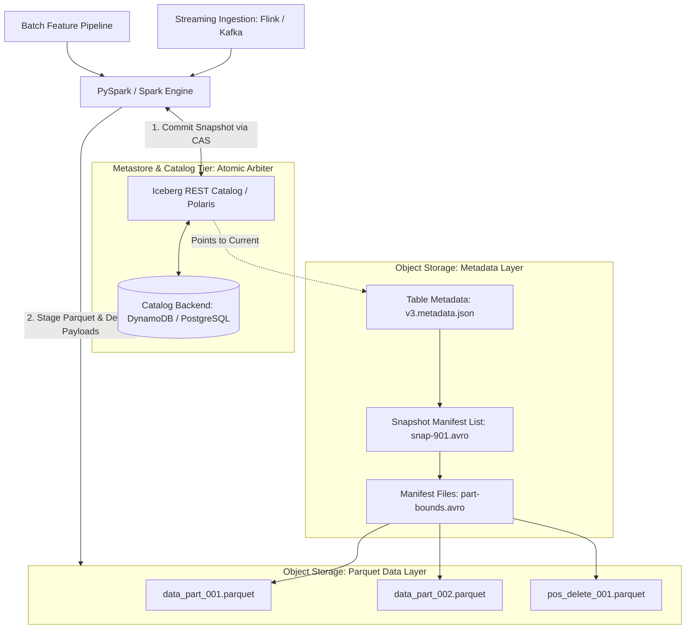

# Modern Lakehouse Architectures: Apache Iceberg & Delta Lake Storage Mechanics

> **Executive Summary:** Storing multi-terabyte AI feature tables directly as unmanaged Parquet files on cloud object storage (AWS S3, Google Cloud Storage) exposes pipelines to write concurrency collisions, uncommitted partial reads, and catastrophic training dataset corruption. By shifting table definitions from physical directory prefixes to immutable metadata trees, modern lakehouse storage engines (Apache Iceberg and Delta Lake) deliver full ACID transactional guarantees, zero-copy time travel, and hidden partition evolution, eliminating small file bottlenecks while guaranteeing bit-for-bit reproducible ML model training.

---

# 1. Interactive Concept Breakdown

## 1.1 The Production Crucible (The Why Before The How)

At 02:40 AM, an enterprise recommendation platform initiated a distributed retraining job over a 450TB multimodal dataset stored as raw Parquet files in S3 (`s3://prod-data-lake/features/date=2026-10-18/`).

```
+-------------------------------------------------------------------------------+
|             THE UNMANAGED OBJECT STORE DISASTER: CONCURRENT COLLISION         |
+-------------------------------------------------------------------------------+
|  Writer 1 (PySpark Ingestion Job): Retries failed partition batch            |
|  Writer 2 (CDC Stream Consumer):   Writes real-time clickstream events        |
|  Reader   (GPU Training Cluster):  Reads parquet files from S3 prefix         |
|                                                                               |
|  S3 REALITY:                                                                  |
|  - Eventual consistency during key overwrites.                                |
|  - Lack of multi-object atomic renames.                                       |
|  - Reads perceive half-written parquet parts alongside duplicate retries.     |
+-------------------------------------------------------------------------------+
```

The breakdown proceeded through three destructive phases:
1. **The Phantom Read Incident:** While PySpark Worker #14 was uploading `part-00014.parquet`, S3 returned a `503 SlowDown`. Spark retried, producing `part-00014-retry.parquet`. Simultaneously, the GPU training pipeline listed the bucket prefix. Because raw S3 lacks atomic multi-file commit locks, the trainer read both the abandoned partial upload and the retry file.
2. **Gradient Explosion in Training:** Ingesting 18% duplicate feature records distorted embedding weight distributions, causing gradient explosion (`NaN` loss) 14 hours into a $45,000 GPU training run.
3. **The Rollback Failure:** Platform SREs attempted to restore the prior state via `aws s3 sync`. Because S3 list operations over millions of object keys take hours and cost tens of thousands of API list requests ($0.005 per 1,000 requests), rolling back a single corrupted batch took 9 hours of platform downtime.

Treating object storage directory prefixes as database tables is a severe architectural anti-pattern. Enterprise systems require formal table storage formats where **metadata defines the table, not the file system directory**.

---

## 1.2 First-Principles Mental Model: Object Storage Physics & Hierarchical Metadata Trees

Cloud object stores (AWS S3, Google Cloud Storage, Azure Blob) are not POSIX filesystems:
1. **Objects are Immutable:** You cannot seek into byte 4,096 of a Parquet file and overwrite an integer in-place. Modifying a record requires rewriting the entire object.
2. **No Atomic Directory Renames:** In Linux, `rename("/tmp/staging", "/data")` is an atomic $O(1)$ inode pointer swap. On S3, a "directory rename" issues millions of individual `COPY` and `DELETE` HTTP requests ($O(N)$ operations), during which partial reads are completely exposed.

```
+-----------------------------------+   +-----------------------------------+
|      DELTA LAKE METADATA LOG      |   |   APACHE ICEBERG METADATA TREE    |
|    Linear Commit Log + Parquet    |   |     Hierarchical Snapshot Tree    |
+-----------------------------------+   +-----------------------------------+
|  _delta_log/000000.json           |   |  v4.metadata.json                 |
|           |                       |   |         |                         |
|           v                       |   |         v                         |
|  _delta_log/000001.json           |   |  Snapshot (snap-402.avro)         |
|           |                       |   |         |                         |
|           v                       |   |         v                         |
|  _delta_log/000002.checkpoint.    |   |  Manifest List (list-402.avro)    |
|  parquet (compacted state)        |   |      /                 \          |
|                                   |   |     v                   v         |
|                                   |   | Manifest File A      Manifest B   |
|                                   |   |   /        \          /      \    |
|                                   |   | Data1    Data2     Data3   Delete1|
+-----------------------------------+   +-----------------------------------+
```

### Delta Lake vs. Apache Iceberg Mechanics

- **Delta Lake (Linear Commit Chains):** Every transaction writes an atomic JSON commit file (`000001.json`, `000002.json`) to the `_delta_log/` directory. Every 10 commits, Delta writes a compacted Parquet checkpoint summarizing the full state. Readers reconstruct the current table state by reading the latest checkpoint plus subsequent JSON deltas.
- **Apache Iceberg (Hierarchical Snapshot Trees):** Iceberg decouples table state into a 4-tier tree:
  1. **Table Metadata (`vN.metadata.json`):** Tracks schemas, partition specs, and points to the current active `snapshot-id`.
  2. **Snapshot:** Represents a single commit point in time, pointing to a Manifest List.
  3. **Manifest List (`snap-*.avro`):** An Avro file indexing individual Manifest Files along with partition bounds and row counts.
  4. **Manifest Files (`*.avro`):** Indexes physical Parquet data files, storing column-level min/max statistics for partition pruning.

### Optimistic Concurrency Control (OCC)
Both engines eliminate distributed write locks using **Optimistic Concurrency Control (OCC)**:
1. Writers stage new Parquet files independently in object storage.
2. When ready to commit, the writer attempts an atomic pointer swap (e.g. CAS on an Iceberg REST Catalog or DynamoDB table).
3. If two writers attempt to commit version $V_{101}$ simultaneously, the winner succeeds; the loser detects the conflict, checks if its modified data files conflict with the winner's files, and either auto-replays on $V_{102}$ or cleanly aborts without corrupting existing data.

---

## 1.3 Architectural Invariants & Core Definitions

- **Invariant 1: Atomic Snapshot Pointer Arbiter.** Table mutations must commit via an atomic Compare-And-Swap (CAS) operation mediated by a centralized catalog (Iceberg REST catalog, DynamoDB lock, or Hive Metastore). Object storage keys must never be assumed consistent without catalog confirmation.
- **Invariant 2: Separation of Data Files and Positional Deletes (Merge-on-Read).** High-throughput ingestion pipelines must use Merge-on-Read (MoR). Updates or deletes write small positional delete files referencing `(file_path, row_offset)` pairs, avoiding the catastrophic write amplification of Copy-on-Write (CoW).
- **Invariant 3: Hidden Partition Invariance.** Users query physical timestamps (`WHERE event_time >= '2026-10-18'`); the lakehouse engine automatically transforms the predicate to partition manifests (e.g. `days(event_time)`) without forcing users to hardcode physical directory paths.

---

# 2. Visual Architecture

## 2.1 End-to-End System Topology



---

## 2.2 Control Plane vs. Data Plane Split

```
+-------------------------------------------------------------------------------+
|         CONTROL PLANE (Table Catalogs, Snapshot Swaps, OCC Arbitration)       |
|   +-----------------------+   CAS Pointer Swap +--------------------------+   |
|   | Iceberg REST Catalog  | <================> | Atomic Lock DB (DynamoDB)|   |
|   +-----------------------+                    +--------------------------+   |
+---------------------------------------|---------------------------------------+
                                        | Validate Conflict & Commit Snapshot ID
                                        v
+-------------------------------------------------------------------------------+
|         DATA PLANE (Distributed Execution: PySpark, Trino, Arrow)             |
|   +-----------------------+   Partition Prune  +--------------------------+   |
|   | Analytical / ML Reader| <================> | Avro Manifest Scan       |   |
|   +-----------------------+                    +--------------------------+   |
|              ^                                              |                 |
|              | Read Exact Snapshot                          v Column Scans    |
|   +-----------------------+   Staged Upload    +--------------------------+   |
|   | PySpark / Flink Writer| -----------------> | S3 Columnar Parquet + MoR|   |
|   +-----------------------+   (Immutable Files)+--------------------------+   |
+-------------------------------------------------------------------------------+
```

---

## 2.3 Step-by-Step OCC Conflict Resolution & Time Travel Flow

### Optimistic Concurrency Control (OCC) Flow
1. **Snapshot Read:** Writer A and Writer B both read current active Snapshot ID `500` from the Iceberg catalog.
2. **Data Staging:** Writer A generates Parquet files for partition `modality=text`. Writer B generates Parquet files for `modality=image`. Both write directly to S3.
3. **Commit Race:** Writer A sends a commit request to the catalog for Snapshot `501`. The catalog uses Compare-And-Swap (CAS), successfully pointing the table to `501`.
4. **Conflict Evaluation:** Writer B attempts to commit Snapshot `501`. The catalog detects an OCC collision and rejects it. Writer B's engine inspects the commit log of Snapshot `501`: because Writer A only modified `modality=text` and Writer B modified `modality=image`, there is no partition overlap.
5. **Replay & Success:** Writer B replays the commit metadata on top of `501`, generating Snapshot `502` without rewriting any physical Parquet data files.

### Time Travel Execution Flow
1. **Snapshot Pinning:** An ML researcher invokes PySpark with `/*+ OPTIONS('snapshot-id'='789410294819041289') */`.
2. **Metadata Traversal:** PySpark skips the current table state and directly loads the manifest list corresponding to snapshot `789410294819041289`.
3. **Deterministic Read:** Only the Parquet data files active during that snapshot are scanned. Files added or deleted in subsequent commits are completely ignored, providing bit-for-bit reproducibility.

---

# 3. Real-World Code & Configuration

## 3.1 Production Manifests & Table DDL

The following SQL statement configures an enterprise Apache Iceberg table for multimodal feature storage, located in [`artifacts/iceberg_schema.sql`](file:///Users/anudeepdunaboyina/Documents/GitHub/knowledge-book/tracks/03-modern-data-layers/02-lakehouse-iceberg-delta-lake/artifacts/iceberg_schema.sql).

```sql
-- Create an enterprise AI training feature table in Apache Iceberg
CREATE TABLE IF NOT EXISTS lakehouse.ai_platform.multimodal_training_features (
    record_id STRING NOT NULL COMMENT 'Unique UUID idempotency key per sample',
    dataset_version STRING NOT NULL COMMENT 'SemVer tag of the training dataset',
    tenant_id STRING NOT NULL COMMENT 'Organization tenant identifier',
    modality STRING NOT NULL COMMENT 'Input data modality: text | image | audio',
    token_count INT COMMENT 'Pre-calculated token count for sequence budgeting',
    embedding_vector ARRAY<FLOAT> COMMENT '1536-dimensional L2-normalized feature vector',
    feature_payload_uri STRING NOT NULL COMMENT 'URI to raw asset in s3://bucket/assets/...',
    metadata MAP<STRING, STRING> COMMENT 'Arbitrary key-value metadata tags and labels',
    ingestion_timestamp TIMESTAMP NOT NULL COMMENT 'UTC ingestion wall-clock time',
    event_date DATE NOT NULL COMMENT 'Derived calendar date of the event'
)
USING iceberg
-- Hidden Partitioning: Daily partition transform without manual path nesting
PARTITIONED BY (days(event_date), modality)
TBLPROPERTIES (
    -- Columnar Storage & High-Ratio Compression
    'write.format.default' = 'parquet',
    'write.parquet.compression-codec' = 'zstd',
    'write.parquet.compression-level' = '7',
    
    -- Merge-on-Read (MoR): Low-latency writes using positional deletes
    'write.delete.mode' = 'merge-on-read',
    'write.update.mode' = 'merge-on-read',
    'write.merge.mode'  = 'merge-on-read',
    
    -- Small File Defense: Target 128MB Parquet files
    'write.target-file-size-bytes' = '134217728',
    
    -- Time Travel Retention: Retain snapshots for 14 days of reproducible training
    'history.expire.max-snapshot-age-ms' = '1209600000',
    'history.expire.min-snapshots-to-keep' = '10'
);
```

---

## 3.2 Implementation Code: PySpark Time-Travel Reader & Compaction

Below is the implementation of the **Iceberg Lakehouse Operations Engine** in Python 3.11+, located in [`artifacts/iceberg_ops.py`](file:///Users/anudeepdunaboyina/Documents/GitHub/knowledge-book/tracks/03-modern-data-layers/02-lakehouse-iceberg-delta-lake/artifacts/iceberg_ops.py).

```python
"""
artifacts/iceberg_ops.py
Production Apache Iceberg Operations Engine using PySpark.
"""
from dataclasses import dataclass
from typing import Any, Optional


@dataclass(frozen=True)
class LakehouseCatalogConfig:
    catalog_name: str = "lakehouse"
    catalog_type: str = "rest"
    catalog_uri: str = "http://iceberg-catalog.internal:8181"
    s3_endpoint: str = "https://s3.us-east-1.amazonaws.com"
    warehouse_path: str = "s3://enterprise-lakehouse-curated/warehouse"


class IcebergLakehouseManager:
    """Manages transactional table reads, time-travel snapshots, and compaction."""

    def __init__(self, config: Optional[LakehouseCatalogConfig] = None):
        self.config = config or LakehouseCatalogConfig()

    def query_training_snapshot(
        self,
        table_identifier: str,
        snapshot_id: int
    ) -> str:
        """
        Generates the deterministic Time-Travel query targeting an exact snapshot.
        Guarantees that distributed PySpark workers read identical immutable data files.
        """
        sql_query = f"""
        SELECT 
            record_id,
            dataset_version,
            modality,
            token_count,
            embedding_vector,
            feature_payload_uri
        FROM {self.config.catalog_name}.{table_identifier} 
        /*+ OPTIONS('snapshot-id'='{snapshot_id}') */
        WHERE modality IN ('text', 'image')
        ORDER BY record_id;
        """
        return sql_query.strip()

    def run_binpack_compaction(
        self,
        spark: Any,
        table_identifier: str,
        target_file_size_bytes: int = 134217728  # 128 MB
    ) -> Optional[Any]:
        """
        Calls Iceberg's system rewrite_data_files procedure.
        Compacts small fragmented Parquet files and merges positional deletes into clean columnar blocks.
        """
        compaction_call = f"""
        CALL {self.config.catalog_name}.system.rewrite_data_files(
            table => '{self.config.catalog_name}.{table_identifier}',
            strategy => 'binpack',
            options => map(
                'target-file-size-bytes', '{target_file_size_bytes}',
                'min-file-size-bytes', '{target_file_size_bytes // 2}',
                'max-file-group-size-bytes', '{target_file_size_bytes * 8}'
            )
        )
        """
        print(f"[EXECUTING COMPACTION]\n{compaction_call.strip()}\n")
        if spark is not None:
            return spark.sql(compaction_call)
        return None
```

---

## 3.3 Line-by-Line "Under the Hood" Annotations

- **Lines 28–33 (`query_training_snapshot`):** Emits Spark SQL targeting an exact immutable `snapshot-id`. The Iceberg Spark extensions parse this hint and bypass catalog resolution of current table heads, constructing the DAG directly from the historical snapshot manifest list.
- **Lines 44–58 (`run_binpack_compaction`):** Executes Iceberg's distributed compaction engine. Instead of running expensive full table rewrites, the `binpack` strategy clusters small fragmented Parquet files ($<64\text{MB}$) into target $128\text{MB}$ files while reconciling any associated positional delete Avro files in a single pass.
- **Table DDL Property `write.delete.mode = 'merge-on-read'`:** Configures the engine to write delete vectors into separate small positional delete files. This slashes ingestion p99 latency during real-time feature updates by avoiding rewriting existing $128\text{MB}$ Parquet chunks.

---

# 4. Edge Cases, Failure Modes & Trade-offs

## 4.1 Comparative Decision Matrix

| Dimension | Apache Iceberg | Delta Lake | Apache Hudi | Raw Parquet / Hive Tables |
| :--- | :--- | :--- | :--- | :--- |
| **Catalog Architecture** | **Catalog-Agnostic** (REST, Polaris, DynamoDB, JDBC, Glue) | Engine-Coupled (Databricks Unity / Hive Metastore) | Hive / DynamoDB Metastore | Directory paths on S3 |
| **Transaction Model** | Full Snapshot Isolation (Avro Tree) | Serializable / Write-Serializable (JSON log) | Timeline & Instants | **None** (Eventual consistency races) |
| **Partition Evolution** | **Native & Hidden** (Decoupled from file paths) | Column-based (Manual re-partitioning) | Requires rewrite | Hardcoded S3 subdirectories |
| **Time Travel Syntax** | `OPTIONS('snapshot-id'='...')` or timestamp | `VERSION AS OF` or `TIMESTAMP AS OF` | Point-in-time timeline reads | None (Requires S3 versioning) |
| **Delete Mechanics** | Merge-on-Read (Positional & Equality) | Copy-on-Write (Deletion Vectors in Delta 3) | Merge-on-Read (Log compaction) | Manual rewrite of entire prefix |
| **Multi-Engine Support** | **Universal** (Spark, Trino, Flink, StarRocks, DuckDB) | Primary Spark / Trino (UniForm bridge) | Primary Spark / Flink | Universal read, dangerous write |

---

## 4.2 Failure Mode & Blast Radius Analysis

### Failure Scenario 1: Optimistic Concurrency Control (OCC) Storm Under High-Frequency Streaming
- **Trigger:** More than 50 streaming ingestion micro-batches attempt to commit to the same table partition per second.
- **Blast Radius:** Frequent CAS pointer collisions trigger repeated OCC retries. PySpark / Flink streaming task queues backlog, memory buffers fill up, and ingestion latency degrades from seconds to minutes.
- **Mitigation / Guardrail:** Buffer micro-batches into 30-to-60-second commit windows. Route high-frequency event ingestion to an append-only raw stream (Kafka), writing to the Lakehouse in bounded micro-batches rather than row-by-row transactions.

### Failure Scenario 2: Small File Metadata Explosion (The Thousand-File Manifest Trap)
- **Trigger:** Frequent streaming commits produce millions of small 1MB Parquet files and small positional delete deltas without scheduled compaction.
- **Blast Radius:** Query planning time explodes from 50ms to 45 seconds because Trino / Spark must download and parse thousands of Avro manifest files before reading a single row.
- **Mitigation / Guardrail:** Automate asynchronous maintenance jobs: run `rewrite_data_files` with `binpack` strategy every 2 hours and schedule `expire_snapshots` nightly to prune orphaned Avro manifest trees.

### Failure Scenario 3: Zombie Orphan Data Files from Failed Executor Tasks
- **Trigger:** PySpark worker nodes fail due to spot instance termination while writing uncommitted Parquet data files to S3.
- **Blast Radius:** Unreferenced data files accumulate in S3 without appearing in any committed manifest file, generating hidden cloud storage expenses.
- **Mitigation / Guardrail:** Schedule Iceberg's `remove_orphan_files` system procedure weekly to scan the object store prefix, compare keys against active snapshot manifests, and purge unreferenced objects older than 3 days.

---

## 4.3 Operational Triage & Observability Runbook

### Key SLIs & Prometheus Metrics
- `iceberg_commit_duration_seconds{table="multimodal_training_features", quantile="0.99"}`: Target < 2.0s.
- `iceberg_commit_conflicts_total`: Alert if > 5 retried collisions per 10-minute interval.
- `lakehouse_manifest_file_count`: Alert if total active manifests exceed 2,500 files.
- `lakehouse_table_uncompacted_small_files`: Alert if files < 32MB exceed 20% of total table data file count.

### Emergency Triage Checklist
1. **Step 1 (Isolate Failing Commits):** If OCC collisions surge, temporarily scale back Spark executor concurrency or switch streaming writers from 5-second to 60-second micro-batch intervals.
2. **Step 2 (Trigger Emergency Compaction):** If query planning latency exceeds 10 seconds, execute asynchronous bin-pack compaction immediately:
   ```sql
   CALL lakehouse.system.rewrite_data_files(table => 'ai_platform.multimodal_training_features', strategy => 'binpack');
   ```
3. **Step 3 (Snapshot Pruning):** If metadata manifests consume excessive S3 GET requests, prune historical snapshots older than the 14-day SLA:
   ```sql
   CALL lakehouse.system.expire_snapshots(table => 'ai_platform.multimodal_training_features', older_than => NOW() - INTERVAL 14 DAYS);
   ```
