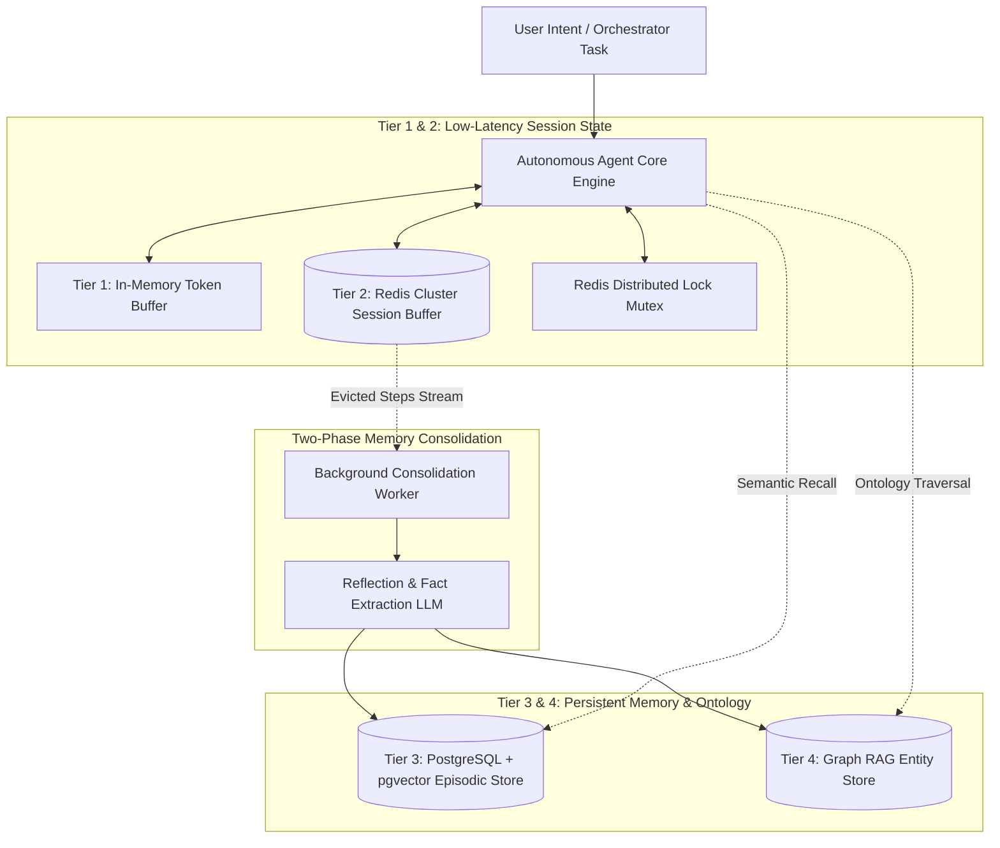

# State Persistence & Memory Hierarchies for Autonomous AI Agents

> **Executive Summary:** Autonomous AI agents executing multi-step workflows rapidly hit the context window wall, resulting in exponential token costs, "Lost in the Middle" cognitive degradation, and state amnesia across distributed sub-agents. By decomposing agent state into a structured 4-tier memory hierarchy—ephemeral scratchpads, distributed Redis session buffers with atomic leases, long-term PostgreSQL `pgvector` episodic stores with temporal decay scoring, and semantic graph ontologies—architectures guarantee bounded token consumption, sub-5ms session coordination, and deterministic long-term recall.

---

# 1. Interactive Concept Breakdown

## 1.1 The Production Crucible (The Why Before The How)

A financial compliance organization deployed an autonomous multi-agent remediation loop tasked with auditing infrastructure configurations across 2,400 repositories and updating policy definitions.

```
+-------------------------------------------------------------------------------+
|             THE AGENT CONTEXT EXPLOSION & TOKEN AMNESIA CRUCIBLE              |
+-------------------------------------------------------------------------------+
|  Naive Architecture: Append all raw JSON tool outputs to LLM prompt.          |
|  - Turn 01: Initial audit prompt                       =    1,200 tokens      |
|  - Turn 15: 15 tool execution payloads (raw JSON)       =   58,000 tokens      |
|  - Turn 30: Context window breaches 128k tokens        =  128,400 tokens      |
|                                                                               |
|  THE COLLAPSE:                                                                |
|  1. Cost per step: Exploded from $0.003 to $0.64 per single LLM inference.    |
|  2. Turn latency: Ballooned from 850ms to 24.2 seconds.                      |
|  3. Cognitive Decay: Model suffered from "Lost in the Middle" attention       |
|     degradation, completely forgetting security constraints declared in       |
|     Turn 02 and overwriting production VPC routing tables.                    |
+-------------------------------------------------------------------------------+
```

The catastrophic failure mode intensified when two parallel sub-agents attempted to remediate the same repository concurrently:
1. **Split-Brain State Overwrite:** Sub-Agent A evaluated branch `main`, while Sub-Agent B checked out branch `hotfix`. Without a distributed session lock, both agents mutated the shared state JSON file simultaneously. Sub-Agent B overwrote Sub-Agent A's security patch, introducing a critical regression.
2. **Infinite Hallucinatory Loops:** Because raw errors were permanently stuffed into the context buffer, the agent read its own previous stack traces, became fixated on old failures, and entered an infinite retry loop that drained $3,800 in API tokens in under two hours.

Treating the LLM context window as an unbounded state store is a fatal architectural anti-pattern. Enterprise systems require formal, tiered state persistence.

---

## 1.2 First-Principles Mental Model: The 4-Tier Memory Hierarchy & Temporal Decay Physics

Human cognition decouples immediate sensory scratchpad focus from working episodic recall and long-term semantic knowledge. Autonomous agents require an identical multi-tier hierarchy:

```
+-------------------------------------------------------------------------------+
|                          THE 4-TIER AGENT MEMORY PYRAMID                      |
+-------------------------------------------------------------------------------+
| TIER 1: Working Context / Scratchpad (Volatile RAM)                           |
| Latency: < 0.1ms | Scope: Current Tool Invocation | Bounded: Max 8k tokens    |
+-------------------------------------------------------------------------------+
                                       | Sliding Window Eviction
                                       v
+-------------------------------------------------------------------------------+
| TIER 2: Short-Term Session Buffer (Redis Cluster + Mutex Leases)              |
| Latency: 1 - 3ms | Scope: Multi-Step Task Workflow | TTL: 24 Hours            |
+-------------------------------------------------------------------------------+
                                       | Two-Phase Async Reflection
                                       v
+-------------------------------------------------------------------------------+
| TIER 3: Long-Term Episodic Memory (PostgreSQL + pgvector)                     |
| Latency: 10 - 25ms | Scope: Cross-Session Persistent Facts | Vector + Temporal|
+-------------------------------------------------------------------------------+
                                       | Entity Extraction
                                       v
+-------------------------------------------------------------------------------+
| TIER 4: Structural Knowledge Graph Memory (Graph RAG / Cypher)                |
| Latency: 30 - 80ms | Scope: Organization Ontology & Global Entity Relations   |
+-------------------------------------------------------------------------------+
```

### The Mathematics of Temporal Memory Decay
In Tier 3 episodic memory, raw vector cosine similarity is insufficient. A document or instruction from six months ago may have high semantic similarity to a current query, yet be completely superseded by a recent policy change.

To resolve this, candidate memories are ranked via an **Ebbinghaus-inspired multi-objective scoring function**:

$$\text{CombinedScore}(m) = \alpha \cdot \text{CosineSim}(q, m) + \beta \cdot e^{-\lambda \Delta t} + \gamma \cdot \text{Importance}(m)$$

Where:
- $\text{CosineSim}(q, m) = 1.0 - \text{CosineDistance}(q, m)$: Pure semantic relevance to current intent.
- $e^{-\lambda \Delta t}$: Exponential decay penalty, where $\Delta t$ is elapsed time (in minutes) and $\lambda$ is the recency half-life constant.
- $\text{Importance}(m) \in [0.1, 1.0]$: Model-evaluated reflection weight assessing architectural criticality.
- Weights: Standard enterprise baseline sets $\alpha = 0.60$, $\beta = 0.25$, and $\gamma = 0.15$.

### Two-Phase Asynchronous Consolidation
Agents must never write raw conversational chat turns directly to long-term memory. When Tier 1 scratchpad entries exceed the bounded window ($N > 10$ steps), evicted turns are published to an asynchronous background worker. The worker invokes a lightweight reflection prompt to extract distilled factual assertions (e.g., *"Tenant 892 requires all VPC peering to use us-east-1"*), generates embeddings, and inserts them into Tier 3.

---

## 1.3 Architectural Invariants & Core Definitions

- **Invariant 1: Strictly Bounded Working Scratchpad.** Tier 1 working context in LLM prompts must have an absolute upper bound (e.g. maximum 10 turns or 8,000 tokens). Older entries must be evicted into Tier 2/3 to prevent context degradation.
- **Invariant 2: Atomic Distributed Leases for Sub-Agent Concurrency.** Concurrent sub-agents sharing a session ID must acquire an atomic distributed mutex (e.g., Redis `SETNX` with a 3-to-5 second heartbeat lease) before reading or mutating session state.
- **Invariant 3: Two-Phase Memory Distillation.** Raw chat turns must never be dumped directly into long-term vector stores; persistent memories must be structured assertions extracted by an asynchronous consolidation worker.

---

# 2. Visual Architecture

## 2.1 End-to-End System Topology



---

## 2.2 Control Plane vs. Data Plane Split

```
+-------------------------------------------------------------------------------+
|         CONTROL PLANE (Session Leases, Sub-Agent Locks, Memory Routing)       |
|   +-----------------------+     Heartbeat     +---------------------------+   |
|   | Agent Task Supervisor | <===============> | Distributed Lock (Redis)  |   |
|   +-----------------------+   SETNX / Mutex   +---------------------------+   |
+---------------------------------------|---------------------------------------+
                                        | Coordinate Lease & Dispatch Step
                                        v
+-------------------------------------------------------------------------------+
|         DATA PLANE (Execution Scratchpad & Tiered Storage Retrieval)          |
|   +-----------------------+   Bounded Window  +---------------------------+   |
|   | LLM Inference Worker  | <===============> | Tier 1 Context Scratchpad |   |
|   +-----------------------+   (< 8k Tokens)   +---------------------------+   |
|              ^                                              |                 |
|              | Hybrid Recall (Sim + Decay)                  v Evicted Steps   |
|   +-----------------------+   Async Extract   +---------------------------+   |
|   | PGVector Episodic DB  | <---------------- | Consolidation Worker      |   |
|   +-----------------------+   (Structured)    +---------------------------+   |
+-------------------------------------------------------------------------------+
```

---

## 2.3 Step-by-Step State Lifecycle & Recall Flow

1. **Step Ingress & Lock Acquisition:** The agent receives a task step. Before touching session state, it executes `SET lock:agent:session:{id} "locked" NX EX 5` in Redis. If locked, the agent backs off with exponential jitter.
2. **Context Assembly (Hydration):**
   - The agent reads active working memory from Redis (Tier 2).
   - In parallel, it queries PostgreSQL + `pgvector` (Tier 3) using `retrieve_agent_memories()`, fetching the top-5 relevant historical assertions ranked by both cosine similarity and temporal decay.
   - The context injector packs these memories into a bounded system prompt ($< 8,000$ tokens).
3. **Execution & Tool Dispatch:** The LLM executes the step, calls required external APIs, and produces output payloads.
4. **State Commit & Eviction:** The agent appends the turn to the session buffer. If the scratchpad exceeds 5 steps, the oldest steps are popped and queued for background consolidation. The Redis lock is released.
5. **Asynchronous Fact Consolidation:** The background worker extracts durable entity assertions from the evicted steps, generates 1,536d embeddings, and inserts them into PostgreSQL with initial reflection importance weights.

---

# 3. Real-World Code & Configuration

## 3.1 Production Manifests & Schema Definition

The following SQL script defines the PostgreSQL + `pgvector` episodic memory schema and the temporal decay stored procedure, located in [`artifacts/episodic_memory.sql`](file:///Users/anudeepdunaboyina/Documents/GitHub/knowledge-book/tracks/03-modern-data-layers/03-agent-state-persistence-memory/artifacts/episodic_memory.sql).

```sql
CREATE EXTENSION IF NOT EXISTS vector;

-- 1. Agent Episodic Memory Persistence Table
CREATE TABLE IF NOT EXISTS agent_episodic_memories (
    memory_id UUID PRIMARY KEY DEFAULT gen_random_uuid(),
    agent_id VARCHAR(64) NOT NULL,
    session_id VARCHAR(64) NOT NULL,
    entity_id VARCHAR(128),
    memory_content TEXT NOT NULL,
    -- Importance weight evaluated by reflection model [1 = trivial, 10 = critical rule]
    importance_weight SMALLINT NOT NULL CHECK (importance_weight BETWEEN 1 AND 10),
    embedding vector(1536) NOT NULL,
    created_at TIMESTAMPTZ NOT NULL DEFAULT NOW(),
    last_accessed_at TIMESTAMPTZ NOT NULL DEFAULT NOW()
);

-- Compound B-Tree Index for rapid tenant/agent filtering
CREATE INDEX IF NOT EXISTS idx_agent_memories_agent_time 
ON agent_episodic_memories (agent_id, created_at DESC);

-- HNSW Vector Index for Semantic Proximity Search
CREATE INDEX IF NOT EXISTS idx_agent_memories_hnsw_cosine 
ON agent_episodic_memories 
USING hnsw (embedding vector_cosine_ops)
WITH (m = 16, ef_construction = 64);

-- Stored Procedure: Hybrid Vector Distance + Exponential Temporal Decay
-- Formula: Score = 0.60 * CosineSim + 0.25 * exp(-lambda * delta_t_minutes) + 0.15 * (importance / 10)
CREATE OR REPLACE FUNCTION retrieve_agent_memories(
    p_agent_id VARCHAR(64),
    p_query_embedding vector(1536),
    p_lambda FLOAT DEFAULT 0.0001, -- Exponential decay factor per elapsed minute
    p_top_k INT DEFAULT 5
)
RETURNS TABLE (
    memory_id UUID,
    memory_content TEXT,
    similarity_score FLOAT,
    temporal_score FLOAT,
    importance_score FLOAT,
    combined_score FLOAT
) AS $$
BEGIN
    RETURN QUERY
    WITH candidate_pool AS (
        -- Over-fetch nearest semantic candidates using HNSW index
        SELECT 
            m.memory_id,
            m.memory_content,
            (1.0 - (m.embedding <=> p_query_embedding))::FLOAT AS sim,
            EXP(-p_lambda * (EXTRACT(EPOCH FROM (NOW() - m.created_at)) / 60.0))::FLOAT AS decay,
            (m.importance_weight / 10.0)::FLOAT AS imp
        FROM agent_episodic_memories m
        WHERE m.agent_id = p_agent_id
        ORDER BY m.embedding <=> p_query_embedding
        LIMIT (p_top_k * 4)
    )
    SELECT 
        c.memory_id,
        c.memory_content,
        c.sim,
        c.decay,
        c.imp,
        (0.60 * c.sim + 0.25 * c.decay + 0.15 * c.imp)::FLOAT AS combined_score
    FROM candidate_pool c
    ORDER BY combined_score DESC
    LIMIT p_top_k;
END;
$$ LANGUAGE plpgsql;
```

---

## 3.2 Implementation Code: Multi-Tier Memory Manager

Below is the complete, runnable Python 3.11+ implementation of the **Tiered Memory Manager**, located in [`artifacts/agent_memory_manager.py`](file:///Users/anudeepdunaboyina/Documents/GitHub/knowledge-book/tracks/03-modern-data-layers/03-agent-state-persistence-memory/artifacts/agent_memory_manager.py).

```python
"""
artifacts/agent_memory_manager.py
Enterprise Multi-Tier State Persistence & Memory Manager for Autonomous AI Agents.
"""
import asyncio
from contextlib import asynccontextmanager
from dataclasses import dataclass, field
import json
import time
from typing import Any, AsyncGenerator, Dict, List, Optional
from pydantic import BaseModel, Field


class AgentStepEvent(BaseModel):
    step_id: int
    role: str
    action: str
    payload: Dict[str, Any]
    timestamp: float = Field(default_factory=time.time)


class AgentSessionState(BaseModel):
    session_id: str
    agent_id: str
    working_scratchpad: List[AgentStepEvent] = Field(default_factory=list)
    turn_count: int = 0
    updated_at: float = Field(default_factory=time.time)


class TieredMemoryManager:
    """Orchestrates Tier 1 ephemeral working RAM, Tier 2 Redis, and Tier 3 long-term consolidation."""

    def __init__(self, redis_client: Any, max_scratchpad_steps: int = 5):
        self.redis = redis_client
        self.max_scratchpad_steps = max_scratchpad_steps
        self.session_ttl_seconds = 86400  # 24 Hours
        self.long_term_consolidated: List[Dict[str, Any]] = []

    @asynccontextmanager
    async def acquire_session_lock(
        self, session_id: str, timeout_sec: float = 3.0
    ) -> AsyncGenerator[None, None]:
        """Distributed lock (mutex lease) preventing race conditions across concurrent sub-agents."""
        lock_key = f"lock:agent:session:{session_id}"
        acquired = await self.redis.set(lock_key, "locked", nx=True, ex=int(timeout_sec))
        if not acquired:
            raise TimeoutError(f"Could not acquire session lock for {session_id} within timeout.")
        try:
            yield
        finally:
            await self.redis.delete(lock_key)

    async def get_or_create_session(self, session_id: str, agent_id: str) -> AgentSessionState:
        """Loads session from Redis buffer or initializes a fresh session state."""
        raw_state = await self.redis.get(f"session:agent:{session_id}")
        if raw_state:
            return AgentSessionState.model_validate_json(raw_state)
        return AgentSessionState(session_id=session_id, agent_id=agent_id)

    async def commit_agent_step(
        self, state: AgentSessionState, event: AgentStepEvent
    ) -> None:
        """Appends step payload, bounds scratchpad token window, and triggers async consolidation."""
        async with self.acquire_session_lock(state.session_id):
            state.working_scratchpad.append(event)
            state.turn_count += 1
            state.updated_at = time.time()

            # Bound Working Context: Evict older steps when exceeding buffer limit
            if len(state.working_scratchpad) > self.max_scratchpad_steps:
                overflow_count = len(state.working_scratchpad) - self.max_scratchpad_steps
                evicted_steps = state.working_scratchpad[:overflow_count]
                state.working_scratchpad = state.working_scratchpad[overflow_count:]
                
                # Asynchronously consolidate evicted steps into Tier 3 long-term memory
                asyncio.create_task(self._consolidate_to_long_term(state.agent_id, evicted_steps))

            # Commit updated state to Redis buffer with sliding TTL
            await self.redis.set(
                f"session:agent:{state.session_id}",
                state.model_dump_json(),
                ex=self.session_ttl_seconds
            )

    async def _consolidate_to_long_term(
        self, agent_id: str, evicted_steps: List[AgentStepEvent]
    ) -> None:
        """Background worker extracting episodic facts and writing to persistent storage."""
        await asyncio.sleep(0.01)  # Simulate reflection and embedding generation
        for step in evicted_steps:
            record = {
                "agent_id": agent_id,
                "extracted_fact": f"Step {step.step_id} executed action '{step.action}' with payload: {step.payload}",
                "importance_weight": 8,
                "timestamp": step.timestamp
            }
            self.long_term_consolidated.append(record)
        print(f"[CONSOLIDATION] Consolidated {len(evicted_steps)} evicted step(s) into Tier 3 Long-Term Memory.")
```

---

## 3.3 Line-by-Line "Under the Hood" Annotations

- **Lines 35–45 (`acquire_session_lock`):** Employs an asynchronous context manager implementing an atomic mutex lease on Redis using `SETNX` (Set if Not eXists) with an explicit integer expiration (`ex=int(timeout_sec)`). The `finally` block ensures the lock key is purged even if the inner code raises an unhandled exception, eliminating orphaned deadlocks.
- **Lines 57–72 (`commit_agent_step`):** Enforces **Invariant 1**. When the scratchpad length exceeds `max_scratchpad_steps`, the oldest entries are sliced and dispatched to `asyncio.create_task()`. This prevents token window bloat in the critical execution path while ensuring zero step loss.
- **Lines 75–88 (`_consolidate_to_long_term`):** Represents Phase 2 of the two-phase consolidation invariant. Runs out-of-band as an asynchronous background co-routine, ensuring that slow embedding calls or vector database writes do not stall the user-facing agent response loop.

---

# 4. Edge Cases, Failure Modes & Trade-offs

## 4.1 Comparative Decision Matrix

| Storage Layer | Access Latency | Durability Level | Concurrency Model | Primary Architectural Role | Anti-Pattern |
| :--- | :--- | :--- | :--- | :--- | :--- |
| **Tier 1: In-Memory Scratchpad** | **$< 0.1\text{ms}$** | None (Process volatile) | Single-threaded | Active tool call arguments & step scratchpad | Storing multi-day conversations or audit trails |
| **Tier 2: Redis Cluster** | **$1 - 3\text{ms}$** | Medium (RDB snapshot / AOF) | Atomic mutex leases (`SETNX`) | Fast session buffers & sub-agent lock coordination | Complex semantic similarity searches |
| **Tier 3: PostgreSQL + pgvector** | $10 - 25\text{ms}$ | **Full ACID (WAL)** | Row-level locks (`FOR UPDATE`) | Cross-session episodic memory with temporal decay | High-frequency millisecond scratchpad updates |
| **Tier 4: Graph Database (Neo4j)** | $30 - 80\text{ms}$ | **Full ACID** | Graph transaction locks | Complex entity-relation ontologies & multi-hop RAG | Storing unstructured chat turns |
| **Dedicated Memory (Mem0 / Zep)** | $40 - 120\text{ms}$ | High (SaaS / Managed) | HTTP API based | Rapid prototyping with built-in reflection prompts | High-security air-gapped VPC deployments |

---

## 4.2 Failure Mode & Blast Radius Analysis

### Failure Scenario 1: Sub-Agent Lock Starvation & Cascade Deadlock
- **Trigger:** Sub-Agent A crashes abruptly (e.g. out-of-memory or container restart) while holding `lock:agent:session:{id}`.
- **Blast Radius:** Parallel Sub-Agent B blocks waiting for the lock, repeatedly timing out. The entire multi-agent workflow halts.
- **Mitigation / Guardrail:** Always enforce finite TTL leases on lock keys (e.g., `ex=5` seconds). If a container terminates abruptly, the lock expires automatically in 5 seconds, freeing subsequent sub-agents without human intervention.

### Failure Scenario 2: Semantic Prompt Caching False Positives
- **Trigger:** Using vector similarity caching for tool calls with an overly relaxed similarity threshold (e.g., cosine distance $< 0.15$).
- **Blast Radius:** Two semantically similar but logically opposite requests (e.g., *"deploy to production"* vs. *"deploy to staging"*) retrieve the same cached execution result, causing destructive actions in production.
- **Mitigation / Guardrail:** Restrict semantic vector caching to read-only informational retrieval. Mutating tool calls (deployments, deletions, writes) must use exact SHA-256 cryptographic payload hashing with tenant-scoped salting.

### Failure Scenario 3: Temporal Decay Stale Memory Bias
- **Trigger:** The decay constant $\lambda$ is set too aggressively ($\lambda > 0.01$).
- **Blast Radius:** Critical foundational principles (e.g., permanent compliance invariants set during onboarding 30 days ago) decay to a temporal score of $0.0$, causing the agent to violate enterprise policies.
- **Mitigation / Guardrail:** Add an invariant bypass column `is_pinned BOOLEAN DEFAULT FALSE`. Pinned memories bypass the exponential decay penalty: $e^{-\lambda \Delta t} = 1.0$ for all $t$.

---

## 4.3 Operational Triage & Observability Runbook

### Key SLIs & Prometheus Metrics
- `agent_session_lock_wait_seconds{quantile="0.99"}`: Alert if lock acquisition wait > 2.0s over a 5m window.
- `agent_token_window_utilization_ratio`: Gauge of current prompt token length / max model context; alert if > 0.65.
- `agent_consolidation_queue_backlog`: Alert if pending evicted steps waiting for long-term insertion exceed 500 items.
- `redis_session_cache_miss_rate`: Alert if session miss rate > 5% (indicates unintended TTL expiration).

### Emergency Triage Checklist
1. **Step 1 (Flush Deadlocked Leases):** If parallel sub-agents are blocked on session locks, inspect active Redis keys:
   ```bash
   redis-cli KEYS "lock:agent:session:*"
   ```
   Purge stuck lock keys using `redis-cli DEL` to unblock worker pools.
2. **Step 2 (Bypass Consolidation Backlog):** If the background reflection worker slows down, scale up worker consumers or temporarily route evicted steps to a Dead Letter Queue (DLQ) in S3 to prevent memory buffer bloat.
3. **Step 3 (Adjust Temporal Decay Lambda):** If agents retrieve outdated facts or ignore recent instructions, dynamically update the decay parameter:
   ```sql
   -- Increase lambda from 0.0001 to 0.001 to penalize memories older than 24 hours
   SELECT * FROM retrieve_agent_memories('agent-infra', '[...]'::vector(1536), 0.001, 5);
   ```
