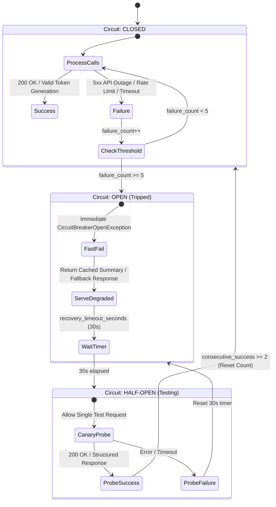
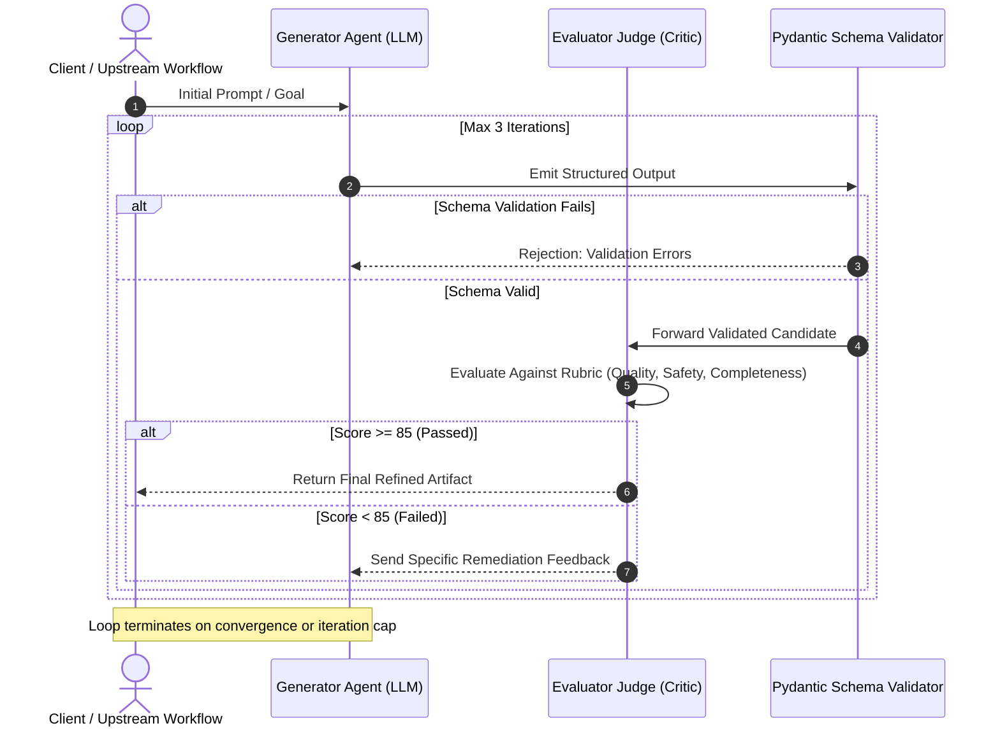

# Design Patterns in the AI & Cloud-Native Era (Python)

> **Executive Summary:** Classical software engineering relies on deterministic functions $f(x) \rightarrow y$, where identical inputs yield identical outputs. In contrast, LLM-driven and agentic systems introduce stochastic probability distributions $P(y \mid x, \theta)$. Taming this non-determinism in mission-critical applications requires evolving classical design patterns (Circuit Breaker, Strategy, Repository) into agentic architectural patterns (Semantic Router, Supervisor-Worker, Evaluator-Optimizer) implemented in clean, asynchronous Python 3.11+.

---

# 1. Interactive Concept Breakdown

## 1.1 The Production Crucible (The Why Before The How)

At 02:40 PM, a tier-1 customer support autonomous agent suffered a cascading failure. The system was designed to resolve enterprise billing disputes by interpreting customer queries, generating database queries, and drafting resolution letters.

The engineering team implemented standard microservice retries: when a downstream component returned an error or unexpected output, the system retried up to 5 times.

```
EXECUTION TRACE (INCIDENT ROOT CAUSE)
[User Query]: "My invoice shows tax for Oregon, but we have tax-exempt status #OR-9912."
  └─ Step 1: LLM generates malformed SQL query with invalid column alias.
  └─ Step 2: Database returns: "SyntaxError: column 'tax_exempt_status' does not exist".
  └─ Step 3: Unbounded Retry Loop triggers. The error is appended to LLM prompt.
  └─ Step 4: LLM re-attempts, hallucinating an alternative non-existent table 'accounts_tax'.
  └─ Step 5: Database returns table error. Prompt context grows by 2,400 tokens per loop.
  └─ Step 6: 12 concurrent customer sessions enter mutual retry loops.
  └─ Incident Impact: Context window saturated; $4,200 token spend burned in 8 minutes; API rate limits tripped globally.
```

### Why Classical Patterns Alone Broke Down
In traditional microservices, retries assume that downstream failures are **transient network blips** (e.g., dropped TCP packet or momentary 503). Retrying identical logic against deterministic code often succeeds once network connectivity restores.

With Large Language Models, however, errors are frequently **semantic or cognitive**. If an LLM misinterprets a schema or generates an unparseable response, resending the identical prompt will often produce identical hallucinations. Furthermore, naive string-based retries bloat the prompt history, accelerating token consumption and exacerbating rate-limit exhaustion.

To build robust AI systems, engineers must combine **deterministic circuit breakers** (to protect external APIs and token budgets) with **stochastic agentic feedback loops** (Semantic Routers, Supervisor-Worker topologies, and Evaluator-Optimizer critics).

---

## 1.2 First-Principles Mental Model: Deterministic vs. Stochastic Computation

```
CLASSICAL MICROSERVICE PIPELINE (DETERMINISTIC)
Input (x) ────> [ Pure Function: f(x) ] ────> Output (y)
* Guarantees: Constant complexity, repeatable state transitions, predictable exception types.

AGENTIC REASONING PIPELINE (STOCHASTIC)
Input (x) ────> [ Probabilistic LLM: P(y|x) ] ────> Candidate Output (y')
                       ^                                 │
                       │             Critique            ▼
                       └───────── [ Evaluator ] <─── Schema Validation
* Realities: Non-deterministic outputs, latency variance, risk of runaway loops.
```

The fundamental goal of Modern AI Design Patterns is to **wrap stochastic, probabilistic models inside rigorous, deterministic contracts**. Pydantic v2 models establish inviolable data schemas, Circuit Breakers establish hard financial and rate boundaries, and Evaluator-Optimizers provide automated self-correction before responses exit the trust boundary.

---

## 1.3 Architectural Invariants & Core Definitions

Every production AI pattern implementation must honor four non-negotiable invariants:

1. **Hard Iteration & Budget Ceilings:** Every agentic loop (reflection, tool execution, evaluator) MUST enforce a hard maximum iteration counter (`max_iterations <= 3`) and strict token budget.
2. **Schema-Enforced Boundary Handoffs:** Agents must communicate with other agents or backend databases exclusively using strongly-typed data transfer objects (Pydantic v2 schemas), never unvalidated raw strings.
3. **Fail-Safe Fallback Degradation:** When an agent loop fails or its circuit trips, the system must degrade gracefully (e.g., return cached data or route to a human operator) rather than propagating unhandled exceptions.
4. **Separation of Reasoning (Supervisor) from Execution (Worker):** The agent orchestrating task decomposition must never execute low-level database or API operations directly; it must delegate to specialized, scoped worker functions.

---

# 2. Visual Architecture

## 2.1 Circuit Breaker State Transition Machine



---

## 2.2 Multi-Agent Supervisor-Worker & Semantic Router Topology

```
+-------------------------------------------------------------------------------+
|                       INGRESS & SEMANTIC ROUTING LAYER                        |
|                                                                               |
|   +-----------------------+              +--------------------------------+   |
|   | User / API Request    | -----------> | Semantic Intent Router         |   |
|   +-----------------------+              | (Classifies Intent & Bounds)   |   |
|                                          +--------------------------------+   |
|                                                          |                    |
+----------------------------------------------------------|--------------------+
                                                           v
+-------------------------------------------------------------------------------+
|                       SUPERVISOR ORCHESTRATION LAYER                          |
|                                                                               |
|   +-----------------------------------------------------------------------+   |
|   | Supervisor Agent (Decomposes Goal into Typed SubTasks)                |   |
|   | - Schema: AggregatedPlan [SubTask_1, SubTask_2, SubTask_N]            |   |
|   +-----------------------------------------------------------------------+   |
|                      |                                   |                    |
|                      v (Parallel Dispatch)               v (Parallel Dispatch)|
|   +------------------------------------+   +------------------------------+   |
|   | Data Extraction Specialist Worker  |   | Code Generation Specialist   |   |
|   | (Pulls SQL / Relational Data)      |   | (Produces Python Solution)   |   |
|   +------------------------------------+   +------------------------------+   |
|                      │                                   │                    |
|                      └─────────────────┬─────────────────┘                    |
|                                        v                                      |
|   +-----------------------------------------------------------------------+   |
|   | Evaluator-Optimizer Engine (Judge & Self-Correction Refinement Loop)  |   |
|   | - Verifies schema compliance, token limits, and quality score >= 85   |   |
|   +-----------------------------------------------------------------------+   |
+-------------------------------------------------------------------------------+
```

---

## 2.3 Evaluator-Optimizer Self-Correction Flow



---

# 3. Real-World Code & Configuration

All executable Python scripts are co-located in the [`artifacts/`](./artifacts/) directory.

## 3.1 Classic Microservices Resilience in Modern Python

From [`artifacts/classic_resilience.py`](./artifacts/classic_resilience.py):

### 1. Resilient Circuit Breaker with Tenacity Exponential Backoff
```python
class ResilientHTTPClient:
    """Combines Tenacity exponential backoff with stateful Circuit Breaker protection."""

    def __init__(self, breaker: Optional[CircuitBreaker] = None):
        self.breaker = breaker or CircuitBreaker(failure_threshold=5, recovery_timeout_seconds=30.0)
        self.client = httpx.AsyncClient(timeout=10.0)

    @retry(
        stop=stop_after_attempt(3),
        wait=wait_exponential(multiplier=1, min=1, max=4),
        retry=retry_if_exception_type((httpx.ConnectError, httpx.TimeoutException)),
        reraise=True,
    )
    async def _execute_with_retry(self, url: str) -> Dict[str, Any]:
        resp = await self.client.get(url)
        resp.raise_for_status()
        return resp.json()

    async def call(self, url: str, fallback_data: Optional[Dict[str, Any]] = None) -> Dict[str, Any]:
        if not await self.breaker.can_execute():
            if fallback_data is not None:
                return fallback_data
            raise CircuitBreakerOpenException(f"Circuit Breaker is OPEN for endpoint {url}")

        try:
            result = await self._execute_with_retry(url)
            await self.breaker.record_success()
            return result
        except Exception as exc:
            await self.breaker.record_failure()
            if fallback_data is not None:
                return fallback_data
            raise
```

### 2. Strategy Pattern with `typing.Protocol`
```python
@runtime_checkable
class LLMInferenceStrategy(Protocol):
    """Protocol establishing the structural contract for model providers."""
    async def generate(self, payload: InferencePayload) -> InferenceResponse:
        ...

class VLLMLocalStrategy:
    async def generate(self, payload: InferencePayload) -> InferenceResponse:
        # Local vLLM tensor generation
        return InferenceResponse(
            generated_text=f"[vLLM Local Output for: '{payload.prompt[:20]}...']",
            tokens_used=128,
            provider="vLLM-Local-H100",
            latency_ms=18.4,
        )

class ModelInferenceContext:
    def __init__(self, strategy: LLMInferenceStrategy):
        self._strategy = strategy

    def set_strategy(self, strategy: LLMInferenceStrategy):
        self._strategy = strategy

    async def execute(self, payload: InferencePayload) -> InferenceResponse:
        return await self._strategy.generate(payload)
```

---

## 3.2 AI & Agentic Design Patterns

From [`artifacts/agentic_patterns.py`](./artifacts/agentic_patterns.py):

### 1. Semantic Router with Confidence Thresholds
```python
class SemanticRouter:
    async def classify_intent(self, query: str) -> RouteDecision:
        lowered = query.lower()
        if any(keyword in lowered for keyword in ("sql", "select", "table", "postgres")):
            return RouteDecision(
                query=query,
                selected_route=IntentRoute.DATABASE_QUERY,
                confidence_score=0.94,
                routing_rationale="Detected relational database keywords.",
            )
        return RouteDecision(
            query=query,
            selected_route=self.fallback_route,
            confidence_score=0.65,
            routing_rationale="No specialized domain keywords matched; routing to general LLM.",
        )
```

### 2. Evaluator-Optimizer Engine with Convergence Guards
```python
class EvaluatorOptimizerEngine:
    def __init__(self, passing_score: int = 85, max_iterations: int = 3):
        self.passing_score = passing_score
        self.max_iterations = max_iterations

    async def execute(self, prompt: str) -> Dict[str, Any]:
        iteration = 1
        current_feedback = None

        while iteration <= self.max_iterations:
            draft = await self._generator(prompt, feedback=current_feedback)
            evaluation = await self._evaluator(draft, iteration=iteration)

            if evaluation.passed or evaluation.score >= self.passing_score:
                return {
                    "status": "CONVERGED",
                    "final_output": draft,
                    "iterations_used": iteration,
                }

            current_feedback = f"{evaluation.critique} Suggestions: {', '.join(evaluation.remediation_suggestions)}"
            iteration += 1

        return {
            "status": "MAX_ITERATIONS_EXCEEDED",
            "final_output": draft,
            "iterations_used": self.max_iterations,
        }
```

---

## 3.3 Line-by-Line "Under the Hood" Annotations

- **`classic_resilience.py` Lines 35-50 (`CircuitBreaker` State Transitions):** Uses thread-safe `asyncio.Lock()` to prevent race conditions during concurrent canary probes in high-throughput worker pools.
- **`classic_resilience.py` Lines 95-102 (`@retry` backoff):** Retries only on transient network disconnects (`ConnectError`, `TimeoutException`). Explicitly does **not** retry HTTP 4xx (client errors) or schema rejection errors, preventing pointless API consumption.
- **`agentic_patterns.py` Lines 160-195 (`EvaluatorOptimizerEngine` Loop):** Features an inescapable `while iteration <= self.max_iterations` counter. Even if the critic and generator get stuck in an adversarial argument, execution halts unconditionally after 3 iterations.

---

# 4. Edge Cases, Failure Modes & Trade-offs

## 4.1 Comparative Decision Matrix

| Dimension | Classical Deterministic Patterns (Circuit Breaker, Strategy, Repository) | AI & Agentic Stochastic Patterns (Router, Supervisor, Evaluator-Optimizer) |
| :--- | :--- | :--- |
| **Execution Determinism** | 100% deterministic; same input yields identical code branch | Probabilistic; identical prompt yields varying trajectories |
| **Failure Detection** | Explicit HTTP status codes, socket timeouts, exceptions | Semantic evaluation, hallucination, schema parsing failure |
| **Retry Semantics** | Exponential backoff against unchanged endpoint | Progressive refinement with added critique in prompt context |
| **Resource Cost** | Minimal CPU and network socket overhead | Significant token spend and compute cost per refinement iteration |
| **Blast Radius** | Dropped connections, service timeouts | Runaway token burn, context pollution, silent hallucinated errors |
| **When to Use** | Infrastructure resilience, data persistence, API routing | Goal-oriented problem solving, code generation, summarization |
| **When NOT to Use** | Open-ended reasoning or natural language synthesis | Fixed business logic, financial arithmetic, ACID transactions |

---

## 4.2 Failure Mode & Blast Radius Analysis

### Failure Scenario 1: Infinite Evaluator-Optimizer Loop
- **The Trigger:** The Evaluator critic demands perfection on subjective criteria (e.g., "Make the tone warmer and more authoritative"), causing the Generator to vacillate indefinitely.
- **The Blast Radius:** Unbounded token spend ($100s per minute), thread starvation in the async event loop, and timeouts for upstream callers.
- **Mitigation & Guardrail:** Enforce a hard ceiling (`max_iterations = 3`), track cumulative token cost in the session context, and emit an alert if an agent exceeds 2 iterations.

### Failure Scenario 2: Context Window Saturation & Memory Bloat
- **The Trigger:** An agent appends every tool failure traceback and un-truncated database response directly to the conversation history.
- **The Blast Radius:** Prompt token length approaches the model's context limit (e.g., 128k tokens). TTFT (Time to First Token) escalates from 200ms to 9 seconds, and cost per request explodes 40x.
- **Mitigation & Guardrail:** Implement an intermediate **Compaction Strategy** in the Repository pattern: prune raw tool outputs and summarize errors before appending to the context window.

---

## 4.3 Operational Triage & Observability Runbook

### Key Agentic SLIs & Prometheus Metrics

```promql
# Alert on high iteration ratios (signals agent confusion or evaluator deadlock)
alert: AgenticHighRefinementIterations
expr: sum(rate(agent_evaluator_iterations_total[5m])) / sum(rate(agent_runs_total[5m])) > 2.5
for: 3m
labels:
  severity: warning
annotations:
  summary: "Agentic evaluator loops averaging > 2.5 iterations per goal."

# Alert on Circuit Breaker trip for external LLM inference providers
alert: LLMProviderCircuitBreakerTripped
expr: sum(circuit_breaker_state{state="OPEN", provider=~".*"}) by (provider) > 0
for: 1m
labels:
  severity: critical
annotations:
  summary: "Circuit breaker OPEN for LLM provider {{ $labels.provider }}. Serving degraded fallbacks."
```

### Emergency 3-Step Agent Triage Checklist

1. **Step 1: Check In-Flight Agent Loops & Token Velocity**
   Inspect active supervisor instances and verify no sessions have exceeded the maximum iteration threshold:
   ```bash
   python3 -c "from artifacts.agentic_patterns import EvaluatorOptimizerEngine; print('Engine active with iteration caps')"
   ```
2. **Step 2: Trip Circuit Breaker Manually on Failing Endpoints**
   If an external LLM endpoint is returning degraded or corrupted completions, force the circuit breaker into `OPEN` state to switch traffic to local vLLM or cached templates:
   ```python
   await breaker.record_failure() # Force trip
   ```
3. **Step 3: Flush Context Buffers & Restore Baseline Schemas**
   Clear corrupted session memory in the `ConversationRepository` to stop hallucination propagation.
