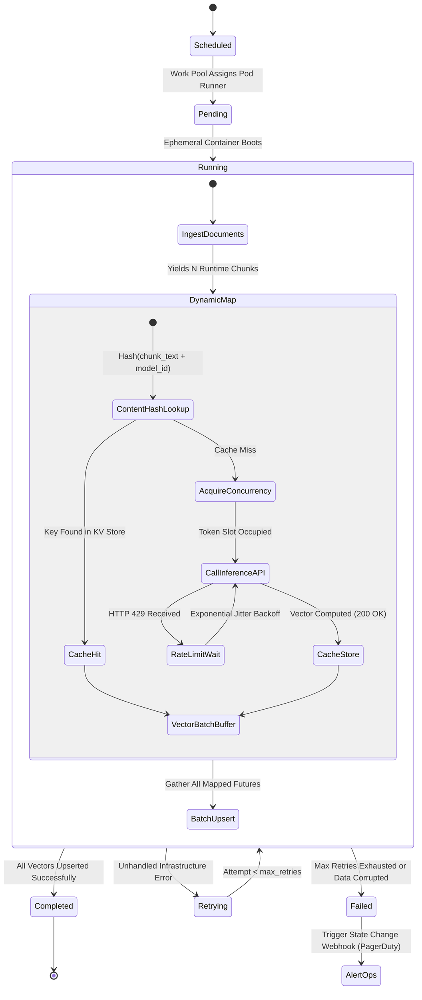

# Data & Workflow Orchestration with Prefect (AI Workloads)

> **Executive Summary:** Classical data pipeline schedulers (such as Apache Airflow or Cron) rely on static Directed Acyclic Graphs (DAGs) compiled ahead of time. Modern AI workloads, however, present variable-sized runtime data inputs: a document batch may yield 20 or 20,000 vector chunks depending on runtime parsing, external model endpoints impose aggressive token rate limits (HTTP 429), and redundant embedding generation burns thousands of dollars in compute. Prefect 3.x bridges this gap by treating workflows as standard asynchronous Python code, enabling dynamic runtime task mapping (`.map()`), deterministic content-hash task caching (SHA-256), and ephemeral GPU worker pool execution on Kubernetes.

---

# 1. Interactive Concept Breakdown

## 1.1 The Production Crucible (The 03:15 AM Ingestion Disaster)

At 03:15 AM, an overnight legal compliance pipeline processing 250,000 regulatory filings crashed on a legacy static Airflow cluster. The pipeline extracted text, split documents into overlapping sliding windows, generated dense vector embeddings via an external model API, and indexed the vectors into a vector database.

```
STATIC DAG AIRFLOW PIPELINE EXECUTION LOGS
[Task: chunk_and_embed] Execution attempt #1 failed: HTTP 429 Too Many Requests (Rate Limit).
  └─ Airflow task retry policy: Re-run entire batch task from scratch.
  └─ Root Failure 1: Static DAG could not dynamically fan out 60,000 tasks based on runtime chunk count.
  └─ Root Failure 2: Single corrupt PDF corrupted the batch memory, causing worker node OOMKilled (Exit 137).
  └─ Root Failure 3: Lack of task-level content-hash caching caused re-embedding of 190,000 already-indexed docs.
  └─ Incident Impact: Context window saturated; $3,100 spent in duplicate API calls; batch SLA breached by 9 hours.
```

### Why Classical Static Schedulers Broke Down
In traditional data warehousing (e.g., SQL transforms or daily CSV rollups), data volumes are predictable and queries operate deterministically on complete tables. Schedulers parse DAG definitions at static compile-time. 

In AI pipelines, however:
1. **Dynamic Fan-Out:** The number of tasks cannot be known until the corpus is parsed and chunked at runtime.
2. **Fine-Grained Task Caching:** If a task generates an embedding for a specific 512-token string, that vector is mathematically immutable. A failure downstream should never cause re-execution of upstream embedding tasks.
3. **Stochastic Rate Throttling:** Downstream LLM inference engines enforce dynamic token buckets. When an HTTP 429 occurs, a static scheduler either halts or blindly retries the entire task, causing thundering herd problems.

---

## 1.2 First-Principles Mental Model: Static DAGs vs. Dynamic AI Dataflows

```
CLASSICAL STATIC DAG SCHEDULER (AIRFLOW)
[Static Compile Phase] ──> DAG Defined: Task A ──> Task B ──> Task C
* Limitations: Predefined task count, heavyweight worker daemons, all-or-nothing task failure retries.

DYNAMIC ASYNC FLOW ENGINE (PREFECT 3.X)
[Runtime Execution]   ──> Document Ingestion (Yields N Chunks Dynamically)
                                 │
                                 v  Dynamic .map() Fan-Out
                      ┌──────────┼──────────┐
                      v          v          v
                   Chunk #1   Chunk #2   Chunk #N
                      │          │          │
        [Check Hash]  │          │          │
        (Cache Hit) ──┘          │          │
        Skip API Call            v          v
                            [HTTP 429]  [Embed OK]
                                 │
                        Exponential Jitter
                                 │
                                 v
                            [Embed OK]
```

Prefect eliminates compile-time DAG friction: any Python function decorated with `@flow` or `@task` becomes an observable, stateful, and retriable unit of work.

---

## 1.3 Architectural Invariants

Every production AI orchestration pipeline must enforce four non-negotiable invariants:

1. **Cryptographic Task Caching:** Every expensive task (embedding calculation, LLM summarization) MUST derive its cache key from a deterministic cryptographic hash of the input text plus model parameters (`cache_key = Hash(text + model_id + temperature)`).
2. **Runtime Dynamic Fan-Out (`.map()`):** Task concurrency must scale dynamically to the exact number of runtime chunks without requiring static DAG recompilation.
3. **Token Concurrency Boundaries:** Dynamic workers must acquire concurrency slots from a centralized token bucket before firing HTTP requests to LLM inference endpoints.
4. **Ephemeral Pod Isolation:** Heavy AI batch tasks must execute inside ephemeral Kubernetes pods that terminate upon completion, freeing GPU/CPU memory back to the cluster.

---

# 2. Visual Architecture

## 2.1 Prefect State Machine with Dynamic Mapping & Jitter Retries



---

## 2.2 Distributed Kubernetes Work Pool Architecture

```
+----------------------------------------------------------------------------------------------------+
|                         PREFECT DISTRIBUTED CONTROL & DATA PLANE TOPOLOGY                          |
+----------------------------------------------------------------------------------------------------+
|  CONTROL PLANE (Prefect Server / Cloud Orchestrator)                                               |
|  - Flow & Task State Transitions (Scheduled -> Pending -> Running -> Completed)                    |
|  - Work Pools & Queues ('k8s-ai-gpu') with Global Concurrency Throttling                           |
|  - Content-Hash Cache Registry (PostgreSQL / Redis Metadata Index)                                 |
+----------------------------------------------------------------------------------------------------+
                                      |
                     gRPC/HTTP2 Work Pool Queue Polling
                                      v
+----------------------------------------------------------------------------------------------------+
|  DATA PLANE (Kubernetes Cluster)                                                                   |
|                                                                                                    |
|    +------------------------------------------------------------------------------------------+    |
|    | Prefect Worker Deployment (Long-Running Agent Daemon)                                     |    |
|    | - Namespace: ai-workloads                                                                |    |
|    | - Submits batch/v1 Jobs to cluster using 'prefect_job_template.yaml'                      |    |
|    +------------------------------------------------------------------------------------------+    |
|                                      |                                                             |
|                       Spawns Ephemeral Batch Jobs                                                  |
|                      ┌───────────────┴───────────────┐                                             |
|                      v                               v                                             |
|    +-----------------------------------+   +-----------------------------------+                   |
|    | Ephemeral Task Pod 1 (GPU Runner) |   | Ephemeral Task Pod N (GPU Runner) |                   |
|    | - Image: ai-pipeline-runner:v3.1  |   | - Image: ai-pipeline-runner:v3.1  |                   |
|    | - Resources: nvidia.com/gpu: 1    |   | - Resources: nvidia.com/gpu: 1    |                   |
|    | - Executes embed_chunk_task.map() |   | - Executes embed_chunk_task.map() |                   |
|    +-----------------------------------+   +-----------------------------------+                   |
|                      │                               │                                             |
|                      └───────────────┬───────────────┘                                             |
|                                      v                                                             |
|                      +-------------------------------+                                             |
|                      | Qdrant / Milvus Vector Store  |                                             |
|                      +-------------------------------+                                             |
+----------------------------------------------------------------------------------------------------+
```

---

# 3. Real-World Code & Configuration

## 3.1 Production Prefect Dynamic Mapping Pipeline (`prefect_rag_pipeline.py`)

The companion implementation in [`artifacts/prefect_rag_pipeline.py`](./artifacts/prefect_rag_pipeline.py) demonstrates dynamic runtime fan-out, content-hash caching, and rate-limit backoff:

```python
# Excerpt from artifacts/prefect_rag_pipeline.py
def embedding_cache_key(context: Any, parameters: dict[str, Any]) -> str:
    """Derives deterministic cache key based on model tag and chunk hash."""
    chunk: DocumentChunk = parameters["chunk"]
    model_tag: str = parameters.get("model_tag", "text-embedding-3-small")
    return f"embed:{model_tag}:{chunk.content_hash}"

@task(
    name="generate-chunk-embedding",
    cache_key_fn=embedding_cache_key,
    retries=4,
)
async def embed_chunk_task(
    chunk: DocumentChunk, 
    model_tag: str = "text-embedding-3-small"
) -> EmbeddedChunk:
    # 1. Acquire global concurrency slot
    async with concurrency("vllm-cluster-concurrency", occupy=1):
        # 2. Resilient invocation with Tenacity exponential jitter backoff
        async for attempt in AsyncRetrying(
            stop=stop_after_attempt(4),
            wait=wait_random_exponential(multiplier=0.1, max=2.0),
            retry=retry_if_exception_type(RateLimitException),
            reraise=True,
        ):
            with attempt:
                # Computed vector embedding with cache storage
                return await compute_vector(chunk, model_tag)

@flow(name="enterprise-rag-prefect-flow")
async def rag_orchestration_flow(documents: list[DocumentPayload]) -> dict[str, Any]:
    # Dynamic Task Mapping (.map()) across variable runtime chunks
    chunks = await extract_chunks_task(raw_documents=documents)
    mapped_futures = embed_chunk_task.map(chunk=chunks, model_tag="text-embedding-3-small")
    embedded_results = await mapped_futures
    total_upserted = await batch_upsert_task(embedded_chunks=embedded_results)
    return {"status": "COMPLETED", "chunks": total_upserted}
```

## 3.2 Ephemeral Kubernetes Work Pool Manifest (`prefect_job_template.yaml`)

The companion manifest in [`artifacts/prefect_job_template.yaml`](./artifacts/prefect_job_template.yaml) enforces security contexts, resource requests/limits, and GPU node affinities:

```yaml
# Excerpt from artifacts/prefect_job_template.yaml
apiVersion: batch/v1
kind: Job
metadata:
  name: "prefect-ai-batch-worker-job"
  namespace: "ai-workloads"
spec:
  ttlSecondsAfterFinished: 300  # Clean up completed pods after 5 mins
  template:
    spec:
      restartPolicy: "Never"
      securityContext:
        runAsNonRoot: true
        runAsUser: 10001
      affinity:
        nodeAffinity:
          requiredDuringSchedulingIgnoredDuringExecution:
            nodeSelectorTerms:
              - matchExpressions:
                  - key: "node.kubernetes.io/instance-type"
                    operator: "In"
                    values: ["g5.xlarge", "g5.2xlarge"]
      containers:
        - name: "prefect-task-container"
          image: "ghcr.io/enterprise/ai-pipeline-runner:v3.1.0"
          resources:
            requests:
              cpu: "2000m"
              memory: "8Gi"
              nvidia.com/gpu: "1"
            limits:
              cpu: "4000m"
              memory: "16Gi"
              nvidia.com/gpu: "1"
```

---

# 4. Edge Cases, Failure Modes & Trade-offs

## 4.1 Comparative Architectural Decision Matrix

| Dimension | Prefect 3.x Workflows | Apache Airflow 2.x | Celery / Redis Queue | Temporal / Cadence |
| :--- | :--- | :--- | :--- | :--- |
| **Graph Dynamicness** | **Native runtime mapping (`.map()`)** | Static DAG parsing required | Ad-hoc task canvas / chords | Code-as-workflow execution |
| **Fine-Grained Caching** | First-class `cache_key_fn` | Custom XCom hacks | Manual Redis lookup required | Event-sourcing history replay |
| **AI Rate Limit Handling**| Concurrency limits + jitter backoff | Global task concurrency only | Worker slot concurrency | Activity retry policies |
| **Resource Footprint** | Ephemeral runner pods | Long-running scheduler + DB | Long-running worker daemons | Heavy event history database |
| **When It Breaks Down**| Very high-throughput (>10k events/sec)| High dynamic branching workflows| Complex DAG state dependencies| Simple, non-stateful cron scripts |

---

## 4.2 Operational Triage Runbook

### Scenario A: Worker OOMKilled (Exit Code 137) During Document Chunking
- **Diagnostic:** Pod terminates abruptly; Kubernetes event logs display `Reason: OOMKilled`.
- **Root Cause:** A batch flow read an entire uncompressed PDF corpus (e.g. 15GB) into a single in-memory Python list.
- **Immediate Triage:** Increase Kubernetes `Job` memory limit from `8Gi` to `16Gi` in `prefect_job_template.yaml`.
- **Permanent Fix:** Convert the chunking task into an asynchronous Python generator (`yield DocumentChunk(...)`) and batch chunks in chunks of 500 before triggering `.map()`.

### Scenario B: HTTP 429 Rate-Limit Death Spiral
- **Diagnostic:** Task retry logs flood with `RateLimitException: HTTP 429 Too Many Requests`.
- **Root Cause:** Too many parallel flow runs fanned out simultaneously, exhausting the global provider quota.
- **Immediate Triage:** Adjust Prefect Global Concurrency Limit:
  ```bash
  prefect gcl set vllm-cluster-concurrency --limit 20
  ```
- **Permanent Fix:** Wrap all LLM and embedding task invocations in `concurrency("vllm-cluster-concurrency", occupy=1)` with Tenacity `wait_random_exponential(multiplier=0.5, max=30.0)` jitter.
