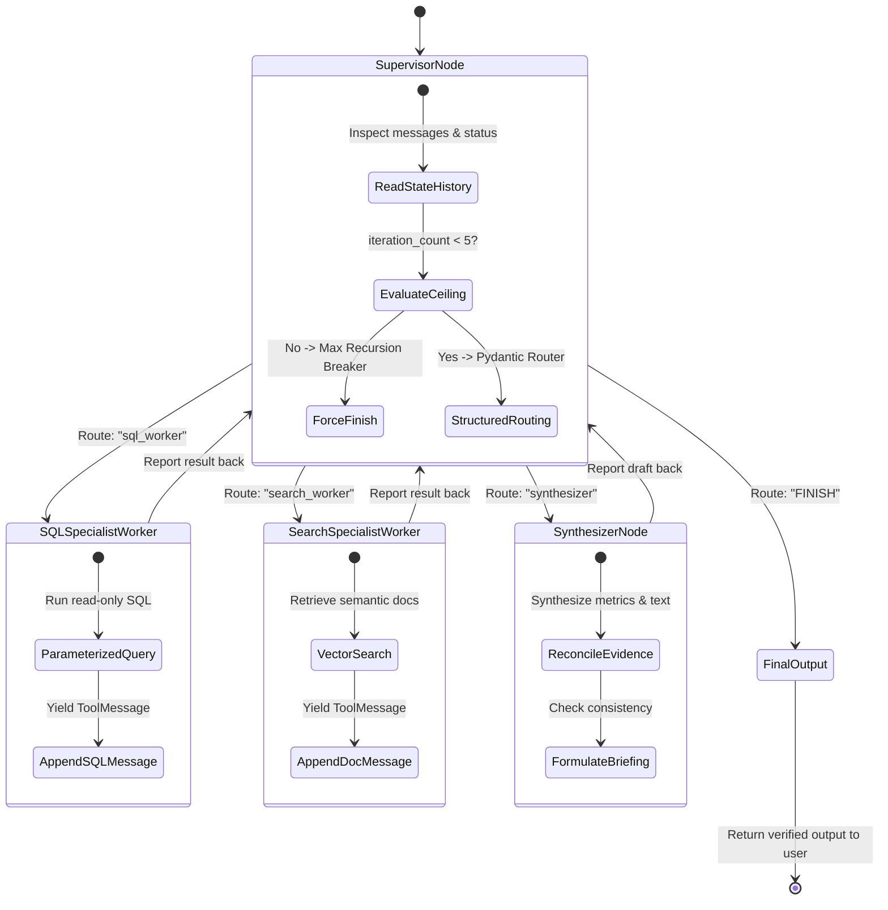
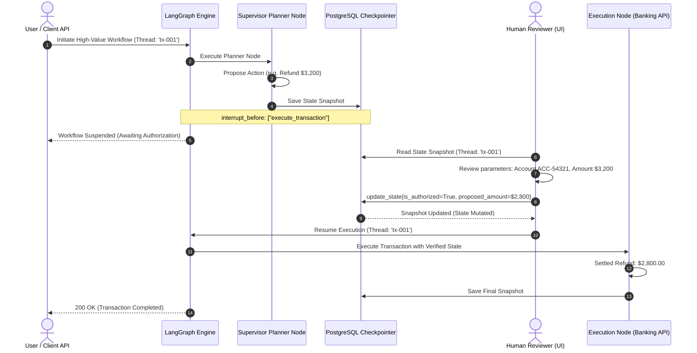

# Agentic Topologies & Cyclic State Machines with LangGraph

> **Executive Summary:** Classical software engineering structures workflows as Directed Acyclic Graphs (DAGs) or linear pipelines. True autonomous agents, however, require **cycles**: an agent must plan, delegate work, observe tool results, critique candidate outputs, and loop back until the objective is achieved. Naive implementations relying on unbounded ReAct prompt loops inevitably spiral into runaway token burn, circular delegations, and silent context corruption. LangGraph resolves this by framing multi-agent systems as **actor-model cyclic state graphs**, where state transitions are governed by immutable reducers (`operator.add`), hard recursion ceilings, thread-scoped checkpointers, and deterministic human-in-the-loop (HITL) interruption gates.

---

# 1. Interactive Concept Breakdown

## 1.1 The Production Crucible (The $3,800 Runaway Loop)

A financial research enterprise deployed an autonomous 3-agent system (Planner, Web Researcher, Financial Analyst) using an unconstrained ReAct loop. The user submitted a query: *"Calculate the 2026 projected operating margin for Acme Corp."*

```
INCIDENT TRACE (THE UNBOUNDED MULTI-AGENT LOOP)
11:02:15 - User Query: "Calculate 2026 projected operating margin for Acme Corp."
11:02:18 - Planner delegates to Web Researcher: "Retrieve Acme Corp 2026 revenue projections."
11:02:24 - Web Researcher finds contradictory analyst estimates from 4 disparate blog posts.
11:02:27 - Financial Analyst attempts to calculate margin, but finds mismatched denominator units.
11:02:30 - Financial Analyst queries Planner: "Which revenue denominator should I use?"
11:02:34 - Planner delegates back to Web Researcher with altered query keywords.
11:02:40 - Loop enters cyclic ping-pong: Planner -> Researcher -> Analyst -> Planner.
11:03:00 - Without a formal state graph or recursion limit, context bloats by 12,000 tokens per loop.
11:14:15 - Incident Impact: 140 round-trip LLM invocations; $3,800 in API spend burned in 12 minutes; rate limits tripped.
```

### Why Unstructured Conversation Loops Fail
In naive agent frameworks, agents pass unstructured chat messages in an unbounded loop. This fails for three critical reasons:
1. **Unconstrained Cycle Depth:** Without an explicit recursion limit and graph termination condition, contradictory inputs trigger infinite delegation loops.
2. **State Destructive Overwrites:** In standard object-oriented workflows, agents overwrite shared state variables, erasing prior tool outputs or intermediate calculations.
3. **Absence of Governance for High-Risk Actions:** When an agent decides to mutate a database or issue a financial transaction, there is no deterministic mechanism to halt execution and require human operator sign-off before state modification.

---

## 1.2 First-Principles Mental Model: Linear Chains vs. Cyclic State Graphs

```
LINEAR PIPELINE (STATIC DAG)
[Input Prompt] ──> [LLM Step 1] ──> [LLM Step 2] ──> [Output]
* Flaw: No capacity for reflection, tool retries, or dynamic branching based on intermediate results.

CYCLIC ACTOR-MODEL STATE GRAPH (LANGGRAPH)
                    +---------------------------+
                    |      Supervisor Node      | <───────┐
                    | (Evaluates State & Routes)|         │
                    +---------------------------+         │
                                  │                       │
                 Structured Route Decision                │
                ┌─────────────────┼─────────────────┐     │
                v                 v                 v     │
         +-------------+   +-------------+   +-----------+│
         | SQL Worker  |   | RAG Search  |   |Synthesizer|│
         | (Tool Node) |   | (Tool Node) |   | (Review)  ││
         +-------------+   +-------------+   +-----------+│
                │                 │                 │     │
                └─────────────────┼─────────────────┴─────┘
                                  v
                   Append to Immutable Reducer:
               messages: Annotated[list, operator.add]
```

LangGraph models computation as an explicit graph:
- **Nodes:** Asynchronous Python functions that take the current `State` and return a state update dictionary.
- **Edges:** Directed connections. Conditional edges query router functions to determine the next node dynamically.
- **State Reducers:** Pure functions specifying how updates are merged (e.g., `operator.add` appends new messages while preserving history).

---

## 1.3 Architectural Invariants

Every production agentic topology must enforce four non-negotiable invariants:

1. **Immutable State Reducers:** Shared graph keys (messages, documents, database records) MUST use append-only or merging reducers (`operator.add`), preventing accidental state destruction by downstream workers.
2. **Hard Recursion Ceilings:** Every cyclic state machine MUST enforce an explicit recursion ceiling (`recursion_limit <= 10`). Reaching this ceiling must trigger a circuit breaker that transitions gracefully to a fallback state.
3. **Structured Supervisor Routing Contracts:** The supervisor node MUST output a validated Pydantic schema containing an explicit target worker enum and step instruction, rather than freeform text.
4. **Thread-Scoped Checkpoint Persistence:** Sensitive state machines MUST save execution snapshots to persistent storage (PostgreSQL/Redis) at each step to support time-travel debugging and human-in-the-loop gates.

---

# 2. Visual Architecture

## 2.1 Multi-Agent Supervisor-Worker Cyclic Topology



---

## 2.2 Human-in-the-Loop Interruption & State Checkpoint Gate



---

# 3. Real-World Code & Configuration

## 3.1 Supervisor-Worker Topology with Typed Reducers (`supervisor_langgraph.py`)

The companion implementation in [`artifacts/supervisor_langgraph.py`](./artifacts/supervisor_langgraph.py) demonstrates typed state reducers, structured routing contracts, and recursion guards:

```python
# Excerpt from artifacts/supervisor_langgraph.py
class AgentWorkflowState(TypedDict):
    """Immutable state with append reducers to prevent state overwrites."""
    messages: Annotated[Sequence[Message], operator.add]
    next_step: str
    iteration_count: Annotated[int, operator.add]
    sql_records: Annotated[list[dict[str, Any]], operator.add]
    search_notes: Annotated[list[str], operator.add]
    is_complete: bool

class SupervisorRoutingDecision(BaseModel):
    """Enforced structured router contract."""
    next_worker: Literal["sql_worker", "search_worker", "synthesizer", "FINISH"]
    instruction: str
    rationale: str

async def supervisor_node(state: AgentWorkflowState) -> dict[str, Any]:
    # Hard recursion limit guardrail
    if state.get("iteration_count", 0) >= 5:
        return {
            "next_step": "FINISH",
            "is_complete": True,
            "messages": [AIMessage("[GUARDRAIL]: Recursion limit reached.")],
        }
    # Deterministic routing based on accumulated evidence
    decision = evaluate_routing_policy(state)
    return {
        "next_step": decision.next_worker,
        "iteration_count": 1,
        "is_complete": (decision.next_worker == "FINISH"),
        "messages": [AIMessage(f"Routing to '{decision.next_worker}': {decision.instruction}")],
    }
```

## 3.2 Human-in-the-Loop State Checkpointing (`hitl_checkpoint_agent.py`)

The companion implementation in [`artifacts/hitl_checkpoint_agent.py`](./artifacts/hitl_checkpoint_agent.py) demonstrates persistent state snapshots, interruption gates, and state mutation:

```python
# Excerpt from artifacts/hitl_checkpoint_agent.py
class HITLStateMachine:
    def stream(self, thread_id: str, initial_state: Optional[dict[str, Any]] = None):
        latest = self.checkpointer.get_latest(thread_id)
        current_node = latest.next_node if latest else "planner"

        while current_node:
            # Enforce interruption gate before executing sensitive node
            if current_node in self.interrupt_before and not current_values.get("is_authorized", False):
                self.checkpointer.save_checkpoint(thread_id, next_node=current_node, state_values=current_values)
                yield {"event": "INTERRUPT", "node": current_node, "thread_id": thread_id}
                return

            # Execute node logic...
```

---

# 4. Edge Cases, Failure Modes & Trade-offs

## 4.1 Comparative Architectural Topologies

| Topology | Control Flow | Concurrency | Debuggability | Failure Risk | Best Fit |
| :--- | :--- | :--- | :--- | :--- | :--- |
| **Sequential State Machine** | Linear transitions ($A \rightarrow B \rightarrow C$) | None (single-threaded) | **Highest** (deterministic path) | Lowest | ETL ingestion, document translation |
| **Supervisor-Worker** | Central router coordinates specialized workers | High (can fan out parallel tasks) | **High** (supervisor logs all decisions) | Moderate (supervisor bottleneck) | Deep research, multi-database aggregation |
| **Blackboard Pattern** | Agents read/write to shared memory pool | **Maximum** | Moderate (race conditions possible) | High (state conflict) | Creative problem solving, code refactoring |
| **Hierarchical Swarm** | Nested supervisors managing sub-teams | High | **Low** (emergent behavior) | Very High (cascading failure) | Large autonomous enterprise simulations |

---

## 4.2 Operational Triage Runbook

### Scenario A: Circular Agent Delegation Loop
- **Diagnostic:** Log metrics show `iteration_count` rapidly climbing toward ceiling while worker outputs repeat.
- **Root Cause:** Supervisor prompt lacks an explicit progress evaluation clause, causing workers to exchange repetitive clarifying questions.
- **Immediate Triage:** Ensure the recursion limit is active (`recursion_limit <= 5`). When tripped, graph yields control to fallback synthesizer.
- **Permanent Fix:** Update the `SupervisorRoutingDecision` schema to require a `progress_score: float = Field(ge=0.0, le=1.0)`. If `progress_score` does not increase across two consecutive turns, force transition to human review.

### Scenario B: Deserialization Failure on Checkpoint Resume
- **Diagnostic:** Resuming a thread from checkpointer throws `PydanticCustomError` or `AttributeError`.
- **Root Cause:** A developer deployed a new code version that renamed an internal state field (e.g., `account` -> `account_id`) while active threads were suspended in the checkpointer.
- **Immediate Triage:** Roll back worker container deployment to the previous image tag to allow active suspended threads to settle.
- **Permanent Fix:** Implement state schema versioning (`schema_version: int = 1`) with backward-compatible migration deserializers in the checkpointer.
